# Clone corporate software lessons

> [@GitHub](plugin://github@openai-curated-remote) [https://github.com/PavelAnko/corporate-software-systems-lessons](https://github.com/PavelAnko/corporate-software-systems-lessons) склонуй репозиторій в "C:\Users\Lenovo\OneDrive\Робочий стіл\ESS"

<details><summary>2 previous messages</summary>

> Перевірю доступність репозиторію та чи можна створити клон у вказаній папці.
>
> <details><summary>Ran 2 commands</summary>
>
> - Ran `git clone https://github.com/PavelAnko/corporate-software-systems-lessons.git "C:\Users\Lenovo\OneDrive\Робочий стіл\ESS"`
> - Ran `git -C "C:\Users\Lenovo\OneDrive\Робочий стіл\ESS" status --short --branch`
>
> </details>
</details>

Репозиторій успішно склоновано до `C:\Users\Lenovo\OneDrive\Робочий стіл\ESS`. Перевірка підтвердила, що гілка `master` відстежує `origin/master`.

> Давай розпочнемо виконувати lab1, проаналізуй відповідний md файл

<details><summary>2 previous messages</summary>

> Знайду в репозиторії інструкцію до Lab 1 і розберу її вимоги, кроки та очікувані результати.
>
> <details><summary>Explored a file, ran 7 commands, searched the web</summary>
>
> - Ran `rg --files -g "*.md"`
>
> - Ran `Get-ChildItem -Force | Select-Object Mode,Name`
>
> Searched the web for `site:github.com/PavelAnko/corporate-software-systems-lessons lab1 md ...`
>
> - Ran `Get-ChildItem -LiteralPath "C:\Users\Lenovo\OneDrive\Робочий стіл\ESS" -Recurse -File -Filter *.md | Select-Object -ExpandProperty FullName`
>
> <details><summary>Explored a file</summary>
>
> - Read `~/OneDrive/Робочий стіл/ESS/lab-01.md`
>
> </details>
>
> - Ran `$p="C:\Users\Lenovo\OneDrive\Робочий стіл\ESS\lab-01.md"; $c=Get-Content -LiteralPath $p; $c[70..179]`
>
> - Ran `$p="C:\Users\Lenovo\OneDrive\Робочий стіл\ESS\lab-01.md"; $c=Get-Content -LiteralPath $p; $c[179..284]`
>
> - Ran `$p="C:\Users\Lenovo\OneDrive\Робочий стіл\ESS\README.md"; Select-String -LiteralPath $p -Pattern '^#{1,4} ' | ForEach-Object { "$($_.LineNumber): $($_.Line)" }`
>
> - Ran `$p="C:\Users\Lenovo\OneDrive\Робочий стіл\ESS\README.md"; $c=Get-Content -LiteralPath $p; $c[98..245]`
>
> </details>
</details>

Переглянув [lab-01.md](C:\Users\Lenovo\OneDrive\Робочий стіл\ESS\lab-01.md) і пов’язані з ним розділи [README.md](C:\Users\Lenovo\OneDrive\Робочий стіл\ESS\README.md).

ЛР1 — проєктна робота на 9 балів, орієнтовно 6 годин. Код писати не потрібно. Потрібно пройти шлях від інтерв’ю до вимог і архітектури: описати процес Lead-to-Cash, підготувати BPMN as-is і to-be, історії користувачів із критеріями приймання, вимірювані NFR, event storming, карту контекстів, C4-діаграми, ADR і початкові контракти модуля.

Робота має п’ять етапів: стейкхолдери й поточний процес; вимоги обраного модуля; event storming і доменні межі; архітектура, ADR та контракти; самоперевірка й оформлення документа. Здати потрібно один проєктний документ і посилання на діалог.

У вимогах уже закладені важливі суперечності для з’ясування: коли резервувати товар — поки клієнт думає чи лише після підтвердження (П4 ↔ С2); який курс застосовувати до обладнання — на день пропозиції чи рахунку (П5 ↔ Б4); як поєднати безперервну нумерацію рахунків з паралельною роботою; як організувати доступ зі звільненням працівників і відновлення після збою. Частина важливих уточнень прихована: за інструкцією їх треба здобути запитаннями до стейкхолдерів, а потім записати в документ.

Перш ніж почати етап 1, оберіть один модуль на весь семестр: **CRM, Orders, Inventory, Billing або Notifications / Reporting**. Потім надішліть свої підготовлені запитання до стейкхолдерів — щонайменше п’ять. Я перегляну їх і почнемо з карти стейкхолдерів та процесу as-is.

> Яке завдання стоїть перед виконанням lab1?

Мета Lab 1 — пройти шлях від побажань стейкхолдерів до проєктної архітектури КПС «КавоХаб»: уточнити й формалізувати вимоги, змоделювати процес Lead-to-Cash, визначити межі модулів, зафіксувати архітектурні рішення та підготувати перші контракти обраного модуля. Код у цій лабораторній не пишуть.

Перед початком потрібно обрати **один модуль на весь семестр** і підготувати щонайменше **п’ять запитань стейкхолдерам**. Деталі є в [lab-01.md](C:\Users\Lenovo\OneDrive\Робочий стіл\ESS\lab-01.md).

> Опиши завдання пунктами

Завдання Lab 1:

1. Обрати модуль на весь семестр: CRM, Orders, Inventory, Billing або Notifications / Reporting.
2. Підготувати щонайменше п’ять запитань до стейкхолдерів і з’ясувати їхні потреби та суперечності.
3. Скласти карту стейкхолдерів і змоделювати поточний процес Lead-to-Cash у BPMN.
4. Для обраного модуля описати цільовий процес, 5–7 user stories із критеріями приймання та щонайменше три вимірювані NFR.
5. Виявити конфлікти й приховані вимоги, запропонувати їх розв’язання та визначити відповідальних за рішення.
6. Провести event storming для Lead-to-Cash і свого модуля; визначити ключові події та межі модулів.
7. Підготувати глосарій щонайменше з 15 термінів, карту контекстів і матрицю власності даних.
8. Описати архітектуру діаграмами C4 і діаграмою послідовності для основного сценарію.
9. Підготувати чотири ADR: про архітектурний стиль, міжмодульну взаємодію, власність і зберігання даних та технологічний стек.
10. Скласти початковий каталог подій, ескіз API і структуру сервісу обраного модуля.
11. Оформити результати в одному проєктному документі, провести самоперевірку й підготувати відповіді щонайменше на п’ять контрольних питань.

Робота проєктна: код писати не потрібно.

> Які модулі представленні в lab1?

У Lab 1 є п’ять модулів на вибір:

- **CRM** — ліди, клієнти, контакти, угоди й воронка продажів.
- **Orders** — замовлення, ціни, знижки та їх погодження.
- **Inventory** — товари, залишки, резерви й відвантаження.
- **Billing** — рахунки, платежі та дебіторська заборгованість.
- **Notifications / Reporting** — сповіщення й зведені звіти. Для цього модуля є додаткове завдання.

> Хто такі стейкхолдери?
> Чим вони займаються, яка їхня зона відповідальності?

**Стейкхолдери** — це люди або організації, на яких впливає система або які можуть впливати на її вимоги й роботу.

У кейсі «КавоХаб» описані такі стейкхолдери:

- **Ірина Мельник — директорка.** Відповідає за загальні результати компанії та управлінські рішення. Їй потрібні щоденні показники замовлень, відвантажень і боргів, контроль строків доставки та звіт про неактивних орендарів. Вона також визначає, що бухгалтерія продовжує працювати в Odoo.
- **Андрій Бондар — керівник відділу продажів.** Відповідає за роботу менеджерів, продажі, знижки та воронку. Йому важливо зберігати історію клієнтів, бачити конверсію, швидко погоджувати знижки й перевіряти наявність товару під час оформлення замовлення.
- **Сергій Ткаченко — керівник складу.** Відповідає за залишки, резервування, комплектацію та відвантаження. Його турбують продаж товару, якого немає, надто довгі резерви, відбір кави за терміном придатності та помилки під час створення ТТН.
- **Наталія Шевчук — головна бухгалтерка.** Відповідає за рахунки, платежі та облік. Вона працює в Odoo, стежить за нумерацією рахунків, коригуваннями, валютним курсом, зіставленням платежів і простроченою заборгованістю.
- **Олег Савчук — ІТ-адміністратор на аутсорсі.** Підтримує ІТ-інфраструктуру та доступи. Його зона — облікові записи, відключення доступу звільненим працівникам, резервні копії та доступ працівників до системи з різних місць.
- **Марта Гнатів — власниця кав’ярні й клієнтка.** Вона замовляє продукцію в «КавоХаб». Їй важливо отримувати рахунок у PDF та вчасно знати статус доставки й номер ТТН.

Це опис їхніх інтересів у межах лабораторного кейсу, а не обов’язково повний перелік посадових обов’язків у реальній компанії.

> Які є проблеми відносно стейкхолдерів (сформуй табличний формат), по модулю CRM

Методичка просить, щоб спершу ви сформулювали власний варіант, а я його перевірив. Нижче — CRM-релевантні свідчення з інтерв’ю; заповніть останню колонку своїми тезами про проблему, і я допоможу їх уточнити.

| Стейкхолдер | Цитата | Що повідомив(-ла) | Яку проблему це створює для CRM? |
|---|---|---|---|
| Андрій Бондар, керівник продажів | П1 | Дані про клієнтів ведуть в Excel і Telegram; після звільнення менеджера клієнти можуть «зникнути». | Ваш висновок: … |
| Андрій Бондар, керівник продажів | П3 | Потрібна воронка продажів із кількістю закладів на кожній стадії та конверсією менеджерів. | Ваш висновок: … |
| Андрій Бондар, керівник продажів | П2 | Знижки понад 10% погоджують через Telegram; клієнт може чекати до двох діб. | Ваш висновок і межа відповідальності CRM: … |
| Ірина Мельник, директорка | Д3 | Директорка не бачить, які орендарі перестали купувати каву. | Ваш висновок; що треба уточнити: … |
| Марта Гнатів, клієнтка | К1 | Хоче знати, коли приїде замовлення, і швидко отримувати номер ТТН. | Ваш висновок і межа відповідальності CRM: … |
| Олег Савчук, ІТ-адміністратор | І2, І3, І4 | Працівники мають працювати з різних місць; на складі спільний пароль; доступ звільнених працівників не завжди закривають вчасно. | Ваш висновок щодо доступу до CRM: … |

Зверніть увагу: погодження знижок, доставка й надсилання ТТН перетинаються з іншими модулями. У колонці про межі відповідальності варто зазначити, що саме CRM зберігає або показує, а що має надходити від іншого модуля.

> Давай опрацюємо наступну проблему, яку ми дослідимо та будемо над нею працювати: Директорка не бачить, які орендарі перестали купувати каву.
> Хто ще з стейкхолдерів взаємодіють з даною проблемою?

З цією проблемою можуть бути пов’язані такі стейкхолдери:

| Стейкхолдер | Як пов’язаний із проблемою | Що варто з’ясувати |
|---|---|---|
| **Керівник відділу продажів Андрій Бондар** | Його команда веде клієнтів; він може організувати контакт із орендарем і вирішити, хто має з ним зв’язатися. | Хто відповідає за клієнта, якщо його менеджер звільнився? Як зараз помічають падіння закупівель? |
| **Менеджер з продажу** | Має безпосередньо спілкуватися з кав’ярнею та знати її історію замовлень. | Яке повідомлення або сигнал допоможе вчасно зв’язатися з клієнтом? |
| **Власниця кав’ярні Марта Гнатів або інші орендарі** | Можуть пояснити, чому закупівлі зменшилися, і якого контакту чи підтримки очікують. | Що може змусити кав’ярню купувати менше? Коли й у який спосіб їй зручно отримати пропозицію допомоги? |
| **Бухгалтерка Наталія Шевчук** | Рахунки й оплати можуть допомогти підтвердити історію покупок, хоча вона не відповідає за відносини з клієнтом. | Які дані про покупки доступні в Odoo та кому їх можна показувати? |

**Ірина Мельник, директорка**, — основна зацікавлена сторона: саме вона підняла проблему (Д3) і потребує інформації для управлінських дій. У межах CRM також треба з’ясувати, хто є власником запису клієнта та як передавати його між менеджерами (П1).

Окремо від людей є залежності між модулями: **CRM** зберігає клієнтів і контакти, **Orders/Billing** мають дані про покупки, а **Reporting** може формувати зведення. Це важливо для архітектури, але самі модулі не є стейкхолдерами-людьми.

> Маючи дану інформацію та вибраний модуль, які наступні пункти по вдалому виконанню lab1 мені потрібно зробити?

Якщо фіксуємо **CRM** як ваш модуль на весь семестр, рухайтеся за етапами з [lab-01.md](C:\Users\Lenovo\OneDrive\Робочий стіл\ESS\lab-01.md). Зараз ви розглянули проблему з цитати Д3 і визначили пов’язаних із нею стейкхолдерів. Це початок дослідження, але артефакти ЛР1 ще потрібно підготувати.

1. **Уточніть проблему Д3 у директорки.** Сформулюйте запитання про те, як визначати орендаря, який перестав купувати, як часто потрібна інформація і які дії очікуються від продажів. Поки не пропонуйте CRM-рішення — спочатку зберіть потреби.
2. **Поговоріть із пов’язаними стейкхолдерами.** З’ясуйте у керівника продажів і менеджерів, як вони зараз супроводжують орендарів; у клієнтів — що може впливати на закупівлі й який контакт був би корисним. Підготуйте щонайменше п’ять запитань загалом і занотуйте відповіді та нові уточнення.
3. **Завершіть етап 1:** складіть карту стейкхолдерів із цілями й проблемами та власну чернетку BPMN as-is для Lead-to-Cash. Позначте ручні кроки, Excel і Telegram. Почніть глосарій.
4. **Опишіть вимоги CRM:** намалюйте BPMN to-be для частини процесу CRM; підготуйте 5–7 user stories з критеріями приймання, зокрема негативними сценаріями; сформулюйте щонайменше три вимірювані NFR; зафіксуйте конфлікти, пропозиції рішень і відповідальних за них.
5. **Опрацюйте домен:** проведіть event storming для Lead-to-Cash і CRM, визначте ключові події, межі відповідальності CRM та його зв’язки з Orders і Reporting. Розширте глосарій до щонайменше 15 термінів і звірте власність даних із README.
6. **Підготуйте архітектуру та контракти:** C4 Context і Container, C4 Component для CRM, діаграму послідовності основного сценарію, чотири ADR, каталог подій CRM, ескіз API та структуру сервісу.
7. **Оформіть документ і перевірте його** за критеріями оцінювання; підготуйте відповіді щонайменше на п’ять контрольних питань.

Найближчий крок — ваші запитання до директорки й продажів про Д3. За методичкою спочатку ви формулюєте власну чернетку, а я допомагаю її перевірити й покращити.

> Сформуй питання-уточнення у директора стосовно повідомленої проблеми "Директорка не бачить, які орендарі перестали купувати каву.". Питання мають стосуватися і бути дотичними до бізнес вимог та очікувань вирішення даної проблеми

Ось запитання до директорки, які допоможуть перетворити проблему на перевірювані бізнес-вимоги:

1. **Що саме для вас означає «орендар перестав купувати каву»?** Це відсутність покупок чи суттєве зменшення їхньої кількості?
2. **За який період потрібно оцінювати закупівлі?** Чи важливо враховувати кілька періодів поспіль?
3. **Яких саме клієнтів включати до такого контролю?** Усіх клієнтів компанії чи лише заклади з орендованою кавомашиною?
4. **Які покупки рахувати:** лише каву чи також інші товари? Як враховувати скасовані замовлення, повернення або ще не оплачені рахунки?
5. **Як часто й коли вам потрібна ця інформація?** Наприклад, регулярно за розкладом чи щоразу, коли клієнт відповідає визначеному критерію?
6. **Які дані про клієнта мають бути у звіті?** Наприклад, відповідальний менеджер, дата останньої покупки та зміна обсягу закупівель.
7. **Що має відбуватися, коли орендар потрапляє до списку?** Хто має зв’язатися з ним і в який строк?
8. **Як ви зрозумієте, що рішення працює?** Який результат для бізнесу має покращитися — наприклад, своєчасний контакт із клієнтом або відновлення закупівель?

Відповіді допоможуть визначити критерій «неактивного орендаря», вміст і періодичність звіту та очікувані дії продажів.

> Тепер проведи опитування у дотичних стейкхолдерів до даної проблеми (які були досліджені раніше), як вони зараз супроводжують орендарів, у клієнтів - що може впливати на закупівлі й який контакт був би корисним. Проведи бізнес аналіз даної проблеми, та підготуй 8 відповідних запитань

Нижче — **рольова симуляція опитування за матеріалами кейсу**, а не реальні відповіді працівників «КавоХаб». Відповіді, яких немає в інтерв’ю, позначив як **нове уточнення** — їх треба буде записати в припущення та підтвердити.

### Опитування стейкхолдерів: 8 запитань

| № | Кому поставити | Запитання | Відповідь за кейсом / рольова відповідь |
|---|---|---|---|
| 1 | **Андрію Бондарю, керівнику продажів** | Як зараз зберігається історія орендарів і хто може побачити, що відбувається з клієнтом, якщо його менеджер звільняється? | Клієнтів ведуть в Excel і Telegram; після звільнення менеджера інформація про клієнтів може втрачатися (П1). **Нове уточнення:** немає спільного процесу передачі клієнта іншому менеджеру. |
| 2 | **Менеджеру з продажу** | Як ви зараз помічаєте, що орендар став замовляти менше кави, і що робите далі? | **Нове уточнення:** менеджер може помітити це під час перегляду власних записів або спілкування з клієнтом, але спільного сигналу для команди немає. |
| 3 | **Андрію Бондарю** | Хто має отримувати інформацію про таких орендарів і що має зробити після її отримання? | **Нове уточнення:** природний варіант — призначати клієнта відповідальному менеджеру для контакту, а керівнику показувати випадки без відповідального або з простроченою дією. Це треба погодити з керівником продажів. |
| 4 | **Марті Гнатів, власниці кав’ярні** | Що може призвести до зменшення закупівель кави? | **Нове уточнення в рольовій відповіді:** сезонність, менший потік відвідувачів, надлишковий запас, проблеми з обладнанням або перехід до іншого постачальника. Це можливі причини, а не встановлені факти про Марту. |
| 5 | **Марті Гнатів** | Який контакт щодо зменшення закупівель був би для вас корисним: коли, яким каналом і з якою пропозицією? | За К1 Марта хоче отримувати інформацію про доставку й ТТН через Viber або e-mail. Це ще **не підтверджує**, що ті самі канали зручні для розмови про закупівлі; це варто уточнити окремо. |
| 6 | **Наталії Шевчук, головній бухгалтерці** | Які дані в Odoo можуть підтвердити закупівлі кави клієнтом, і чи треба враховувати коригувальні документи? | Рахунки ведуться в Odoo, а виставлений рахунок не змінюють — його коригують окремим документом (Б1, Б3). Чи достатньо рахунків для визначення фактично придбаної кількості, треба уточнити. |
| 7 | **Ірині Мельник, директорці** | За яким точним критерієм орендар має потрапляти до переліку тих, хто перестав купувати каву? | Директорка визначає «неактивного орендаря» як клієнта з орендованою машиною, який **два календарні місяці поспіль придбав менше ніж 20 кг кави**. |
| 8 | **Ірині Мельник** | Як часто потрібен перелік і де ви хочете його переглядати? | Директорка хоче бачити звіт **щопонеділка**. Це уточнення до Д3 з матеріалів кейсу. |

### Бізнес-аналіз проблеми

- **Бізнес-потреба:** вчасно виявляти орендарів, чиї закупівлі кави впали, щоб компанія могла зв’язатися з ними до втрати клієнта.
- **Поточна проблема:** історія клієнтів розподілена між Excel і Telegram; її можна втратити при звільненні менеджера (П1). У Д3 директорка прямо вказує, що не бачить, які орендарі перестали купувати.
- **Користувачі результату:** директорка переглядає зведений перелік; керівник продажів контролює опрацювання; менеджер контактує з призначеним клієнтом.
- **Потрібні дані:** зв’язок клієнта з орендованою машиною, історія закупівель кави, відповідальний менеджер і стан подальшого контакту. Доступність і джерело цих даних потрібно підтвердити.
- **Межа CRM:** CRM відповідає за клієнта, контактну історію та відповідального менеджера. Дані про закупівлі мають надходити з модуля, який володіє замовленнями чи рахунками. Власника даних про орендовані машини кейс явно не визначає — це відкрите питання.
- **Очікуваний результат:** щопонеділка директорка бачить перелік за погодженим критерієм, а продажі мають зрозумілий наступний крок щодо кожного клієнта.
- **Що ще треба вирішити:** чи використовувати рахунки або підтверджені/відвантажені замовлення для розрахунку закупівель; як враховувати повернення та коригування; який канал обрати для комерційного контакту; як виміряти успіх роботи з переліком.

> Сформуй карту стейкхолдерів із цілями й проблемами та сформуй, демонстраційну BPMN діаграму as-is для Lead-to-Cash. Познач ручні кроки, (наприклад Excel / Telegram). Сформуй відповідний глосарій по цьому.

Нижче — **демонстраційна чернетка для CRM** на основі інтерв’ю з `lab-01.md` та вже обговореного уточнення про орендарів. Її варто звірити зі стейкхолдерами: там, де поточний процес не описаний у вихідних даних, я позначив це як питання або припущення.

## 1. Карта стейкхолдерів

| Стейкхолдер | Цілі | Проблеми й потреби | Вплив / інтерес | Зв’язок із CRM |
|---|---|---|---|---|
| **Ірина Мельник, директорка** | Бачити показники продажів і виявляти орендарів, чиї закупівлі кави впали (Д1, Д3). | Інформація збирається вручну; немає видимості щодо орендарів, які перестали купувати. | Високий / високий | Потрібні дані про клієнтів і закупівельну активність; CRM може показувати клієнтський контекст, але дані про покупки мають надходити з інших модулів. |
| **Андрій Бондар, керівник продажів** | Керувати клієнтською базою, роботою менеджерів і воронкою (П1, П3). | Клієнтські дані розпорошені між Excel і Telegram; після звільнення менеджера історія клієнта може загубитися. | Високий / високий | Потрібні спільний профіль клієнта, відповідальний менеджер, історія взаємодій і стан угоди. |
| **Менеджер з продажу** | Супроводжувати клієнтів і підтримувати повторні закупівлі. | **Питання для уточнення:** як саме менеджер зараз відстежує закупівлі орендарів і передає історію клієнта колегам? | Середній / високий | Має бачити закріплених клієнтів, історію контактів і подальші дії. |
| **Сергій Ткаченко, керівник складу** | Відвантажувати замовлення, які відповідають реальним залишкам (С1–С3). | Склад дізнається про замовлення, коли менеджер телефонує; трапляються продажі товару, якого немає (С1). | Середній / середній | CRM не керує залишками, але має передавати оформлене замовлення до відповідного процесу. |
| **Наталія Шевчук, головна бухгалтерка** | Виставляти коректні рахунки та зіставляти платежі (Б1–Б3). | Рахунки переносяться в Odoo з листів менеджерів; платежі іноді доводиться зіставляти вручну. | Середній / середній | CRM має передавати достовірні дані про клієнта; рахунками й платежами володіє Billing/Odoo, не CRM. |
| **Олег Савчук, ІТ-адміністратор** | Підтримувати доступність, безпеку та облікові записи (І1–І4). | Спільний пароль на складі, доступ звільнених працівників можуть вчасно не закрити; відновлення з резервних копій не перевіряли. | Середній / високий | Вимоги до входу, персональних облікових записів і прав доступу в CRM. |
| **Марта Гнатів, власниця кав’ярні** | Вчасно отримувати замовлення й інформацію про доставку (К1, К2). | Щоб дізнатися про доставку або ТТН, доводиться звертатися до менеджера (К1). | Низький формальний / високий | CRM зберігає клієнтський контакт і історію взаємодій; доставку й ТТН обробляють інші модулі. |

**Вплив / інтерес** тут оцінено попередньо для демонстрації. Його варто підтвердити під час обговорення з командою або викладачем.

## 2. BPMN as-is: Lead-to-Cash

У діаграмі суцільні стрілки показують послідовність дій усередині процесу, пунктирні — повідомлення між учасниками. Вона відображає наявні ручні кроки. Гілки, позначені як невизначені, потребують уточнення, бо інтерв’ю не описує їх докладно.

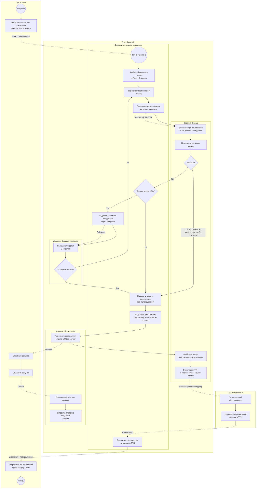

**Підтверджені ручні кроки:** клієнтські дані в Excel/Telegram (П1), передавання замовлення на склад телефоном (С1), погодження знижки через Telegram (П2), перенесення рахунків у Odoo з листів (Б1), ручне зіставлення платежів (Б2), введення ТТН у кабінеті Нової Пошти (С4).

**Потребують уточнення:** канал отримання первинного замовлення; як обробляють відсутність товару; що саме відбувається після відмови погодити знижку; як клієнту надсилають рахунок і ТТН. Ці місця не варто подавати як підтверджений процес без уточнень.

## 3. Глосарій

| Термін | Визначення в межах кейсу | Власник / контекст |
|---|---|---|
| **Клієнт (Account)** | Заклад або компанія, що купує продукцію чи орендує обладнання. | CRM |
| **Контакт** | Людина, з якою компанія спілкується від імені клієнта. | CRM |
| **Менеджер клієнта** | Працівник продажів, відповідальний за взаємодію з клієнтом. | CRM |
| **Лід** | Потенційний клієнт, який ще не став постійним клієнтом компанії. | CRM |
| **Угода (Deal)** | Можливість продажу, що проходить етапи воронки. | CRM |
| **Воронка продажів** | Послідовність етапів, за якими відстежують роботу з потенційними клієнтами. | CRM |
| **Активність** | Запланована або виконана взаємодія з клієнтом: дзвінок, лист, зустріч чи нагадування. | CRM |
| **Орендар** | Клієнт, у якого встановлена кавомашина «КавоХаб» на умовах оренди. | Власника обліку оренди треба визначити |
| **Закупівельна активність** | Історія замовлень або покупок клієнта за визначений період. Потрібно погодити, які саме операції рахувати. | Orders / Billing — джерело даних; CRM — споживач |
| **Замовлення** | Запит клієнта на придбання товарів у визначеній кількості. | Orders |
| **Рядок замовлення** | Один товар і його кількість у складі замовлення. | Orders |
| **Знижка** | Зменшення ціни, надане клієнтові за правилами продажів. | Orders |
| **Погодження знижки** | Рішення керівника щодо знижки понад встановлений поріг. | Orders |
| **Залишок** | Кількість товару, що є на складі. | Inventory |
| **Резерв** | Кількість товару, тимчасово закріплена за замовленням. | Inventory |
| **Відвантаження** | Передавання зібраного замовлення перевізнику або клієнту. | Inventory |
| **ТТН** | Товарно-транспортна накладна, зокрема номер відправлення Нової Пошти. | Inventory / інтеграція з Новою Поштою |
| **Рахунок** | Документ Billing на оплату товарів клієнтом. | Billing |
| **Платіж** | Кошти, отримані від клієнта за одним або кількома рахунками. | Billing |
| **Odoo** | Зовнішня бухгалтерська система, яку «КавоХаб» продовжує використовувати. | Зовнішня система; інтеграція з Billing |

Для наступного кроку варто уточнити позначені в BPMN розвилки та невідомі канали, після чого можна переробити цю демонстраційну схему на підтверджений `as-is`.

> Зроби BPMN більш узагальненою (демонтсративнішою для презентації)

Так. Для презентації краще показати лише основний шлях замовлення та кілька важливих ручних кроків. Нижче — узагальнена Mermaid-демонстрація з пулами й доріжками. Вона не деталізує винятки; точний порядок виставлення рахунку й комплектації ще треба підтвердити.

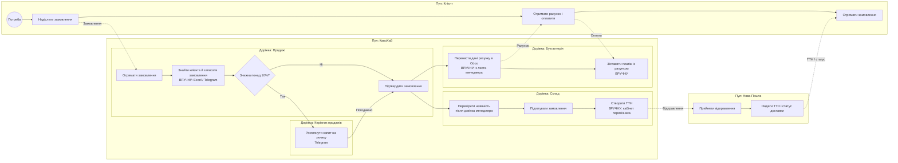

Пунктирні стрілки показують обмін повідомленнями між пулами, суцільні — перебіг процесу. Відмова в погодженні знижки та нестача товару тут не деталізовані, щоб схема залишалася читабельною для презентації.

> **Сформуй та опиши вимоги CRM**
> Створити презентаційну BPMN діаграму to-be для частини процесу CRM

# CRM: вимоги та BPMN to-be

Нижче — робоча проєктна версія для процесу виявлення орендарів зі спадом закупівель і подальшої роботи з ними. Вона спирається на П1, П3, Д3 та уточнення директорки: орендар є неактивним, якщо має орендовану кавомашину й купував **менше ніж 20 кг кави протягом двох календарних місяців поспіль**; перелік потрібен **щопонеділка**.

## Межі CRM

CRM володіє даними клієнтів, контактів, угод і активностей. Дані про замовлення мають надходити з Orders, а CRM не повинна самостійно змінювати їх. У вихідних даних не визначено, який модуль веде облік орендованих машин, тому це відкрите питання.

Також базова подія `orders.order.confirmed` містить SKU та кількість, але з опису не видно, чи є там вага кави в кілограмах. Для автоматичної перевірки порога `<20 кг` потрібно передати вагу або надати CRM доступ до достовірного перерахунку одиниць товару.

## Функціональні вимоги CRM

| ID | Вимога | Джерело |
|---|---|---|
| FR-CRM-01 | CRM зберігає спільний профіль клієнта, його контакти, відповідального менеджера й історію взаємодій. Перепризначення клієнта не повинно стирати історію. | П1 |
| FR-CRM-02 | CRM формує щотижневий перелік орендарів, які відповідають погодженому критерію неактивності. | Д3 та уточнення директорки |
| FR-CRM-03 | У переліку видно клієнта, відповідального менеджера, закупівлі за обидва місяці та дату останнього замовлення. | Д3; склад переліку — проєктна пропозиція |
| FR-CRM-04 | Для клієнта з переліку CRM створює менеджеру активність для подальшого контакту та дозволяє занести результат взаємодії. | Пропозиція, яку треба погодити з продажами |
| FR-CRM-05 | CRM показує воронку продажів за стадіями й конверсію менеджерів із правами перегляду відповідно до ролі. | П3 |

## User stories

### US-CRM-01. Спільна історія клієнта

Як керівник продажів, я хочу бачити клієнта, його відповідального менеджера та історію взаємодій, щоб клієнти не губилися при зміні менеджера. **Пріоритет: Must. Джерело: П1.**

- **AC-1:** Given клієнта внесено в CRM, When менеджер додає дзвінок або нотатку, Then взаємодія з’являється в історії клієнта.
- **AC-2:** Given менеджер звільнився, When керівник перепризначає його клієнта, Then історія зберігається, а новий менеджер отримує доступ до профілю.
- **AC-3, негативний:** Given користувач не має прав на клієнта, When він намагається переглянути або змінити запис, Then CRM відмовляє в доступі й не змінює дані.

### US-CRM-02. Виявлення неактивних орендарів

Як директорка, я хочу отримувати перелік орендарів із закупівлями нижче погодженого порога, щоб продажі могли вчасно з’ясувати причину спаду. **Пріоритет: Must. Джерело: Д3 та уточнення директорки.**

- **AC-1:** Given клієнт має орендовану кавомашину й дані про закупівлі доступні, When закупівлі становлять менше ніж 20 кг у кожному з двох послідовних календарних місяців, Then CRM позначає клієнта як такого, що відповідає критерію неактивності.
- **AC-2, негативний:** Given для клієнта немає підтверджених даних про оренду або закупівлі, When CRM обчислює перелік, Then вона позначає дані як неповні й не класифікує клієнта як неактивного без доказів.

### US-CRM-03. Щотижневий перелік для директорки

Як директорка, я хочу щопонеділка бачити перелік клієнтів, які відповідають критерію неактивності, щоб контролювати роботу з ними. **Пріоритет: Must. Джерело: Д3 та уточнення директорки.**

- **AC-1:** Given є клієнти, що відповідають критерію, When формується тижневий перелік, Then для кожного показано клієнта, менеджера та закупівлі за відповідні місяці.
- **AC-2:** Given жоден клієнт не відповідає критерію, When формується перелік, Then директорка бачить порожній звіт із датою формування.
- **AC-3, негативний:** Given звіт містить клієнта без відповідального менеджера, When CRM формує перелік, Then вона показує відсутність відповідального, а не призначає менеджера самостійно.

### US-CRM-04. Подальша дія менеджера

Як менеджер з продажу, я хочу отримати активність щодо закріпленого за мною орендаря зі спадом закупівель і занести результат контакту, щоб знати, з ким треба зв’язатися та що з’ясовано. **Пріоритет: Must. Джерело: пропозиція на основі Д3; відповідального й процес треба погодити з продажами.**

- **AC-1:** Given CRM визначила клієнта за критерієм неактивності й у нього є відповідальний менеджер, When створено тижневий перелік, Then менеджер бачить активність у профілі клієнта.
- **AC-2:** Given менеджер зв’язався з клієнтом, When він заносить результат, Then результат зберігається в історії взаємодій.
- **AC-3, негативний:** Given активність належить іншому менеджеру, When користувач без відповідних прав намагається її закрити, Then CRM відмовляє й не змінює стан активності.

### US-CRM-05. Воронка продажів

Як керівник відділу продажів, я хочу бачити кількість клієнтів на кожній стадії та конверсію менеджерів, щоб оцінювати перебіг продажів. **Пріоритет: Should. Джерело: П3.**

- **AC-1:** Given угоди мають визначену стадію й відповідального менеджера, When керівник відкриває воронку за період, Then він бачить кількість угод на кожній стадії та конверсію.
- **AC-2:** Given звичайний менеджер відкриває воронку, When він переглядає показники, Then CRM показує лише ті дані, на які має право його роль.
- **AC-3, негативний:** Given угода не має стадії або відповідального, When CRM рахує конверсію, Then вона не зараховує цю угоду до конкретного менеджера й показує проблему як неповні дані.

## Нефункціональні вимоги

| ID | Вимога | Перевірка |
|---|---|---|
| NFR-CRM-01 — точність | На контрольному наборі даних CRM має правильно класифікувати 100% орендарів відповідно до критерію директорки; клієнти з неповними даними мають бути позначені окремо. | Перевірка на заздалегідь підготовлених прикладах, зокрема на межі 20 кг і місяців без даних. |
| NFR-CRM-02 — своєчасність | Щотижневий перелік має бути доступний директорці щопонеділка. Точний час готовності в інтерв’ю не визначений, його потрібно погодити. | Перевірка розкладу формування та часу готовності звіту. |
| NFR-CRM-03 — доступ | 100% запитів від користувачів без відповідної ролі мають отримувати відмову; менеджер бачить лише дозволені йому дані, керівник продажів — дані команди, директорка — звіт. | Перевірка матриці ролей для `sales_manager`, `sales_head` і `director`. |

## Відкриті питання та конфлікти меж відповідальності

| Питання | Чому важливо | Хто має погодити |
|---|---|---|
| Який модуль є джерелом даних про орендовану машину й прив’язку її до клієнта? | Без підтвердження оренди CRM не може визначити, кого включати до переліку орендарів. | Власник процесу оренди та архітектор системи |
| Як із рядків замовлення обчислити кілограми кави? | Базова подія містить SKU й кількість; треба знати вагу товару та одиниці виміру. | Orders та Inventory |
| Що вважати закупівлею: підтверджене замовлення, відвантаження чи рахунок? | Замовлення може бути скасоване, а рахунок — скоригований. Від вибору залежить точність класифікації. | Продажі, склад і бухгалтерія |
| Хто контактує з клієнтом і що робити, якщо менеджер не призначений? | Директорка очікує видимість проблеми, але процес подальшої роботи має погодити керівник продажів. | Андрій Бондар |
| Який канал корисний для комерційного контакту? | Побажання щодо Viber/e-mail для повідомлень про доставку не підтверджує ці канали для розмови про закупівлі. | Менеджери та клієнти |

## BPMN to-be: моніторинг орендарів і подальша дія

Діаграма показує робочий процес на високому рівні: Orders передає дані, CRM оновлює профіль і щопонеділка перевіряє критерій, директорка бачить перелік, а менеджер фіксує контакт. Пунктирні стрілки — повідомлення між учасниками; суцільні — послідовність дій усередині пулу.

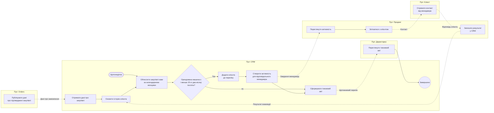

**Важлива передумова цієї схеми:** перш ніж фіксувати контракт CRM з Orders, потрібно погодити, як передавати вагу кави й прив’язку закупівлі до клієнта. Зараз ці поля в описі базової події не визначені.

> Сформуй 7 user stories з критеріями приймання, зокрема негативними сценаріями (в табличному форматі)

Нижче — сім CRM user stories. У кожної є позитивні критерії та щонайменше один негативний сценарій. Вимоги щодо правила неактивності й щотижневого звіту спираються на уточнення директорки; відповідні дані ще потрібно узгодити з Orders та власником даних про оренду.

| ID / пріоритет | User story та джерело | Критерії приймання |
|---|---|---|
| **US-CRM-01 — Must** | **Як менеджер з продажу, я хочу вести спільний профіль клієнта, щоб команда мала доступ до актуальної інформації.** Джерело: П1. | **AC-1:** Given клієнта ще немає в CRM, When уповноважений працівник створює його профіль, Then CRM зберігає запис і призначає відповідального менеджера.<br>**AC-2:** Given профіль клієнта існує, When уповноважений працівник його відкриває, Then він бачить збережену інформацію та історію взаємодій.<br>**AC-3 — негативний:** Given користувач не має прав на перегляд клієнта, When він відкриває профіль, Then CRM відмовляє в доступі. |
| **US-CRM-02 — Must** | **Як менеджер з продажу, я хочу фіксувати взаємодії з клієнтом, щоб не губити контекст спілкування.** Джерело: П1; потребу в журналі взаємодій слід підтвердити з продажами. | **AC-1:** Given клієнт має профіль у CRM, When менеджер записує результат дзвінка або зустрічі, Then запис з’являється в історії клієнта з автором і датою.<br>**AC-2:** Given взаємодію збережено, When інший уповноважений працівник відкриває історію, Then він бачить цей запис.<br>**AC-3 — негативний:** Given взаємодія не пов’язана з клієнтом, When користувач намагається її зберегти, Then CRM просить вибрати клієнта й не створює непов’язаний запис. |
| **US-CRM-03 — Must** | **Як керівник продажів, я хочу перепризначати клієнтів між менеджерами, щоб зберігати відповідальність за клієнта при зміні працівника.** Джерело: П1, І4. | **AC-1:** Given клієнт закріплений за менеджером, When керівник призначає іншого менеджера, Then CRM оновлює відповідального й зберігає історію клієнта.<br>**AC-2:** Given клієнта перепризначено, When новий менеджер відкриває профіль, Then він бачить доступну йому історію взаємодій.<br>**AC-3 — негативний:** Given користувач не має права перепризначати клієнтів, When він змінює відповідального, Then CRM відхиляє зміну. |
| **US-CRM-04 — Must** | **Як директорка, я хочу виявляти орендарів, які купували менше ніж 20 кг кави два календарні місяці поспіль, щоб помічати ризик втрати клієнта.** Джерело: Д3 та уточнення директорки. | **AC-1:** Given підтверджено, що клієнт орендує кавомашину й доступні дані закупівель, When закупівлі становлять менше ніж 20 кг у кожному з двох послідовних календарних місяців, Then CRM позначає клієнта як такого, що відповідає критерію неактивності.<br>**AC-2:** Given закупівлі становлять 20 кг або більше хоча б в одному з двох місяців, When CRM перевіряє клієнта, Then вона не позначає його за цим критерієм.<br>**AC-3 — негативний:** Given відсутні дані про оренду або закупівлі, When CRM виконує перевірку, Then вона позначає дані як неповні й не класифікує клієнта як неактивного. |
| **US-CRM-05 — Must** | **Як директорка, я хочу отримувати щотижневий перелік таких орендарів, щоб бачити, кому може знадобитися увага продажів.** Джерело: Д3 та уточнення директорки. | **AC-1:** Given є клієнти, що відповідають критерію, When CRM формує щотижневий перелік у понеділок, Then він містить клієнта, відповідального менеджера та закупівлі за відповідні місяці.<br>**AC-2:** Given жоден клієнт не відповідає критерію, When CRM формує перелік, Then директорка бачить звіт без клієнтів із датою формування.<br>**AC-3 — негативний:** Given клієнта вже включено до переліку за той самий звітний період, When CRM повторно формує звіт, Then клієнт не дублюється. |
| **US-CRM-06 — Should** | **Як менеджер з продажу, я хочу отримувати завдання щодо закріплених за мною орендарів зі спадом закупівель і записувати результат контакту, щоб мати зрозумілий наступний крок.** Джерело: похідна вимога з Д3; процес треба погодити з керівником продажів. | **AC-1:** Given клієнт відповідає критерію неактивності й має відповідального менеджера, When CRM формує перелік, Then менеджер отримує пов’язану з клієнтом активність.<br>**AC-2:** Given менеджер контактував із клієнтом, When він записує результат, Then CRM зберігає його в історії клієнта й оновлює стан активності.<br>**AC-3 — негативний:** Given користувач не має прав на активність, When він намагається її змінити, Then CRM відмовляє й залишає дані без змін. |
| **US-CRM-07 — Should** | **Як керівник продажів, я хочу бачити кількість угод на кожній стадії та конверсію менеджерів, щоб оцінювати воронку продажів.** Джерело: П3. | **AC-1:** Given угоди мають стадію й відповідального менеджера, When керівник відкриває воронку за період, Then CRM показує кількість угод за стадіями та конверсію менеджерів.<br>**AC-2:** Given користувач має роль менеджера, When він переглядає воронку, Then CRM показує лише дані в межах його прав.<br>**AC-3 — негативний:** Given угода не має стадії або відповідального менеджера, When CRM обчислює показники, Then вона не зараховує її до конкретного менеджера й позначає неповні дані. |

**Потрібно узгодити для US-CRM-04 і US-CRM-05:** звідки CRM бере вагу кави в кілограмах; що вважається закупівлею — підтверджене замовлення, відвантаження чи рахунок; і який модуль є джерелом даних про орендовану кавомашину.

> Сформулюй 5 вимірювані NFR; зафіксуй конфлікти, пропозиції рішень і відповідальних за них.
> Виконай цю роботу базуючись на проведеній бізнес-аналітиці
> Результат має бути професійно оформленим та легко читабельним!

# CRM: нефункціональні вимоги та конфлікти

Нижче — вимоги й рішення для CRM на основі бізнес-аналізу проблеми з орендарями, чиї закупівлі кави зменшилися. Вимоги з позначкою **«запропонована ціль»** — проєктні пороги для погодження: інтерв’ю задають бізнес-потребу, але не всі числові межі.

## 1. Нефункціональні вимоги

| ID | Характеристика | Вимога | Як перевірити | Підстава |
|---|---|---|---|---|
| **NFR-CRM-01** | Точність даних | CRM має правильно визначати 100% орендарів, які відповідають критерію директорки: менше ніж 20 кг кави у кожному з двох послідовних календарних місяців. Клієнти з неповними даними мають бути позначені окремо, а не класифіковані як неактивні. | Порівняти результат CRM із незалежним розрахунком для контрольного набору даних: значення нижче, рівне та вище 20 кг; відсутня оренда; пропущений місяць; скасоване замовлення. | Д3 та уточнення директорки. |
| **NFR-CRM-02** | Своєчасність | Щотижневий перелік має бути доступний директорці щопонеділка. **Запропонована ціль:** до 09:00 за київським часом; у звіті показувати час останнього оновлення даних. | Перевірити формування звіту за кілька послідовних тижнів, зокрема поведінку системи при затримці даних від Orders. | Директорка хоче звіт щопонеділка; точний час ще не погоджений. |
| **NFR-CRM-03** | Продуктивність | **Запропонована ціль:** за пікового навантаження до 4 підтверджень замовлення на хвилину CRM обробляє подію про закупівлю до 5 секунд у 95% випадків; тижневий звіт для набору до 10 000 клієнтів формується до 10 секунд у 95% випадків. Частка помилок обробки подій — не більш як 0,5%. | Навантажувальний тест із потоком подій і звітом на погодженому обсязі даних. Перевірити результат за p95 та журналом помилок. | Піковий період Д4; орієнтир 4 підтвердження/хв наведений у методичці. Обсяг 10 000 клієнтів — припущення для погодження. |
| **NFR-CRM-04** | Безпека та контроль доступу | 100% запитів до CRM мають виконуватися від імені персонального облікового запису з перевіркою ролі. Доступ працівника має блокуватися не пізніше ніж за 15 хвилин після підтвердженого повідомлення про звільнення. Зміни відповідального за клієнта й даних профілю мають журналюватися. | Перевірити доступ за ролями `sales_manager`, `sales_head`, `director`; протестувати блокування облікового запису та аудит змін. | І2–І4; рольова модель у README. Час 15 хвилин — запропонована ціль. |
| **NFR-CRM-05** | Відновлюваність | **Запропонована ціль:** після втрати даних CRM відновлює записи з точкою втрати не більш як 24 години (RPO ≤ 24 год), а критичний доступ до системи відновлюється не більш як за 4 години (RTO ≤ 4 год). Відновлення резервної копії перевіряється щонайменше щокварталу. | Виконати тестове відновлення резервної копії, виміряти RPO/RTO та перевірити доступність профілів клієнтів, активностей і звіту. | І1: резервні копії виконуються щоночі, але відновлення ще не перевіряли. Числові цілі потрібно погодити. |

## 2. Конфлікти й відкриті рішення

Нижче зібрано проблеми, які впливають на реалізацію CRM-процесу. Частина з них є прямими суперечностями між інтересами, частина — прогалинами у вимогах та контрактах.

| Питання / конфлікт | Вплив на CRM | Пропозиція рішення | Хто відповідає за рішення |
|---|---|---|---|
| **Критерій директорки потребує даних про оренду, але власника даних про орендовані машини не визначено.** | CRM не зможе достовірно відокремити орендарів від інших клієнтів. | Призначити власника даних про оренду. Якщо окремого модуля немає, погодити, чи CRM веде зв’язок «клієнт—орендована машина» як власні дані. Зафіксувати це в матриці власності даних. | Директорка як бізнес-власниця потреби; архітектор системи — за межі модулів. |
| **Поріг задано в кілограмах, а базова подія Orders описує SKU та кількість без явної ваги.** | CRM не може обчислити поріг `<20 кг`, якщо невідомі маса товару та одиниці виміру. | Погодити контракт: передавати вагу кави в кілограмах у подіях або передавати стабільний ідентифікатор товару з доступом до ваги з Inventory. У CRM зберігати розрахований підсумок, не змінюючи товарний довідник. | Orders і Inventory — за дані та контракт; CRM — за споживання події. |
| **Не визначено, що саме вважати «купівлею»: замовлення, відвантаження чи рахунок.** | Скасоване замовлення або рахунок, який не відповідає фактичному відвантаженню, може неправильно змінити статус орендаря. | **Рекомендація:** рахувати фактично відвантажену каву, виключати скасовані замовлення та враховувати повернення/коригування. Підтвердити правило з бізнесом до фіксації acceptance criteria. | Директорка — бізнес-правило; керівник складу, керівник продажів і бухгалтерка — джерела та винятки. |
| **Клієнтські дані живуть у Excel/Telegram, тоді як CRM має бути спільним джерелом для продажів.** | Працівники можуть продовжити вести паралельні списки; історія клієнта залишатиметься неповною. | Визначити CRM єдиним місцем для профілю й історії взаємодій; погодити перенесення наявних даних, правила пошуку дублікатів і відповідального за підтримку профілю. | Андрій Бондар — процес продажів; ІТ-адміністратор — доступ і перенесення даних. |
| **Директорці потрібен перелік, але процес подальшого опрацювання клієнтів і відповідальний за нього не визначені.** | Звіт може існувати без контакту з клієнтом і без вимірюваного результату. | Призначати активність відповідальному менеджеру, а випадки без власника показувати окремо керівнику продажів. Погодити строк контакту та перелік результатів, які менеджер фіксує в CRM. | Андрій Бондар — власник процесу; директорка — погоджує очікуваний результат і звітність. |
| **CRM потребує індивідуальної відповідальності за клієнтів, але на складі використовується спільний пароль, а доступи звільнених працівників можуть залишатися активними.** | Неможливо надійно встановити, хто переглядав або змінював дані; це також створює ризик доступу колишнього працівника. | Використовувати персональні облікові записи та рольовий доступ. Визначити процес повідомлення ІТ про звільнення й строк блокування доступу. | ІТ-адміністратор — технічне виконання; керівник відділу — своєчасне повідомлення про зміну працівника. |

**Першими варто погодити три рішення:** джерело даних про оренду, спосіб розрахунку кілограмів і значення терміна «купівля». Вони визначають, чи можна достовірно сформувати щотижневий перелік.

> Проведи event storming для Lead-to-Cash і CRM як бізнес аналітик, визнач ключові події, межі відповідальності CRM та його зв’язки з Orders і Reporting.

# Event storming Lead-to-Cash і CRM

Нижче — event storming на рівні бізнес-процесу й окремо для CRM. Події з базового каталогу позначені їхніми контрактними назвами. Події без такого контракту наведені як **кандидати**, які треба погодити з командами модулів.

## 1. Lead-to-Cash: загальний процес

| Етап | Актор і команда | Доменна подія | Політика / реакція | Гаряча точка |
|---|---|---|---|---|
| Робота з потенційним клієнтом | Менеджер: зареєструвати ліда, вести комунікацію, кваліфікувати угоду | Кандидати: «Ліда створено», «Угоду кваліфіковано» | CRM зберігає клієнта, відповідального та історію взаємодій | Зараз клієнтські дані частково у Excel і Telegram; як уникнути втрати історії при зміні менеджера? |
| Угоду виграно | Менеджер: позначити угоду як виграну | **`crm.deal.won`** | Orders створює чернетку замовлення | Які дані з угоди потрібні для чернетки замовлення? |
| Замовлення підтверджено | Менеджер: підтвердити замовлення; за потреби отримати погодження знижки | **`orders.order.confirmed`** | Inventory отримує запит на резерв; CRM оновлює дату останнього замовлення | П4 і С2 суперечать одне одному щодо моменту резервування: поки клієнт думає чи лише після підтвердження? |
| Резервування | Inventory: зарезервувати товари | **`inventory.stock.reserved`** або **`inventory.stock.reservation_failed`** | Orders отримує результат резервування | Як повідомити менеджера про нестачу й що відбувається із замовленням? |
| Рахунок | Billing: виставити рахунок і передати його в Odoo | **`billing.invoice.issued`** | Orders оновлює стан оплати/рахунку | Виставлення рахунку вводиться в Odoo вручну; правила коригування не можна обходити зміною рахунку. |
| Оплата | Бухгалтерка: отримати виписку та зіставити платіж | **`billing.payment.received`** | Orders отримує статус оплати | Приблизно 20% платежів не містять номера рахунку; один платіж може стосуватися кількох рахунків. |
| Відвантаження | Комірник: зібрати замовлення, створити ТТН, передати перевізнику | **`inventory.shipment.dispatched`** | Orders і Billing отримують інформацію про відвантаження | ТТН вводиться вручну; потрібно узгодити, як клієнт отримує ТТН і статус доставки. |
| Скасування | Менеджер: скасувати замовлення | **`orders.order.cancelled`** | Inventory знімає резерв, Billing обробляє рахунок | Що робити, якщо рахунок уже виставлений або товар уже відвантажений? |

Оплата й відвантаження можуть відбуватися в різному порядку; наявні матеріали не задають для них єдину послідовність.

## 2. Event storming CRM: контроль закупівель орендарів

Окремий повторюваний процес CRM починається не з нового замовлення, а з календарного запуску перевірки.

| Актор / елемент | Команда або реакція | Подія / результат | Примітка |
|---|---|---|---|
| Orders | Публікувати дані про замовлення клієнта | **`orders.order.confirmed`** — існуюча подія | Сама подія містить SKU й кількість; потрібна домовленість, як отримати вагу кави в кілограмах. |
| CRM | Оновити історію покупок клієнта з отриманих даних | Кандидат: «Історію закупівель клієнта оновлено» | CRM тримає проєкцію для аналізу, але не стає власником замовлень. |
| Таймер у CRM | Щопонеділка перевірити орендарів | «Перевірку закупівель виконано» | Порогове правило директорки: менше ніж 20 кг у кожному з двох послідовних календарних місяців. |
| Політика CRM | Якщо клієнт має орендовану машину й відповідає порогу — позначити його для опрацювання | **Кандидат:** `crm.renter.inactivity_detected` | Новий контракт; його треба погодити, назва наведена як пропозиція. |
| CRM | Створити активність для відповідального менеджера | Кандидат: «Активність із клієнтом створено» | Автоматичне призначення — пропозиція. Треба підтвердити, хто відповідає, якщо менеджера не призначено. |
| Reporting | Зібрати щотижневий перелік для директорки | «Тижневий звіт сформовано» | Reporting зберігає звітну проєкцію; джерела клієнта й подій залишаються у відповідних модулях. |
| Менеджер | Зв’язатися з клієнтом і записати результат у CRM | Кандидат: «Результат контакту зафіксовано» | Канал і строк контакту треба погодити з продажами та клієнтом. |

### Ключові події, які визначають межі модулів

- **`crm.deal.won`** — CRM завершує етап продажу, Orders починає створення замовлення.
- **`orders.order.confirmed`** — Orders фіксує підтверджене замовлення; CRM використовує подію для оновлення історії клієнта.
- **`inventory.stock.reserved` / `inventory.stock.reservation_failed`** — Inventory підтверджує або відхиляє резервування.
- **`inventory.shipment.dispatched`** — Inventory фіксує факт відвантаження.
- **`billing.invoice.issued` / `billing.payment.received`** — Billing володіє рахунком та оплатою.
- **`crm.renter.inactivity_detected`** — запропонована подія на межі CRM і Reporting про клієнта, якому потрібна увага продажів.

## 3. Межі відповідальності й зв’язки контекстів

| Напрям | Відповідальність і дані | Тип зв’язку |
|---|---|---|
| **CRM → Orders** | CRM володіє клієнтом, контактами й угодою; публікує `crm.account.upserted` і `crm.deal.won`. Orders створює замовлення, використовуючи дані клієнта, але не змінює запис CRM. | CRM — upstream-постачальник; Orders — downstream-споживач. Контракт — опублікована мова подій. |
| **Orders → CRM** | Orders володіє замовленнями й публікує події про їхній стан. CRM споживає їх для історії закупівель і показу останнього замовлення клієнта. | Orders — upstream для фактів замовлення; CRM — downstream. Контракт — опублікована мова подій; CRM підтримує локальну проєкцію. |
| **CRM → Reporting** | CRM може передавати клієнтські дані, активності та запропоновану подію `crm.renter.inactivity_detected`. Reporting збирає ці дані у тижневий звіт для директорки. | CRM — постачальник CRM-фактів; Reporting — downstream-проєкція для читання. Reporting не змінює клієнтські записи. |
| **Orders → Reporting** | Orders передає факти про замовлення; Reporting формує зведені показники. | Orders — власник замовлень, Reporting — споживач подій і власник звітної проєкції. |

CRM відповідає за **клієнта, контакт, відповідального менеджера, угоду та активності**. Orders відповідає за **замовлення, ціну й погодження знижок**. Reporting відповідає за **зведення та подання інформації**, але не стає власником даних клієнта чи замовлення.

## 4. Гарячі точки, які треба закрити

1. **Джерело оренди:** жодному модулю поки не призначено власність даних про орендовану кавомашину та її клієнта.
2. **Розрахунок кілограмів:** потрібні вага товару та одиниці виміру, яких немає в описі базової події Orders.
3. **Значення «купив»:** потрібно обрати основу для правила — підтверджене замовлення, фактичне відвантаження чи рахунок; визначити облік скасувань і повернень.
4. **Відповідальний за контакт:** треба погодити, кому створювати активність та хто опрацьовує записи без призначеного менеджера.
5. **Контракт CRM–Reporting:** подія про виявленого неактивного орендаря є пропозицією; її склад полів і споживачів ще треба погодити.
6. **Момент резервування:** очікування продажів про резерв «поки клієнт думає» конфліктує з вимогою складу резервувати лише підтверджене замовлення й не довше доби. Це рішення стосується Orders та Inventory, але впливає на CRM-статус угоди й комунікацію з клієнтом.

> Виокреми самі основні пункти після проведеного поглибленого аналізу

## Основні висновки

- **CRM володіє клієнтами й продажною взаємодією:** профілями та контактами, відповідальними менеджерами, угодами й активностями. CRM не змінює замовлення, рахунки чи складські залишки.
- **З Orders CRM обмінюється подіями:** CRM передає дані про клієнтів і виграні угоди; Orders передає статуси замовлень, які CRM використовує для історії закупівель клієнта.
- **Reporting формує щотижневий звіт для директорки** на основі подій CRM та Orders. Він зберігає звітне представлення даних, але не стає їхнім власником.
- **Ключова бізнес-подія CRM:** орендар виявлений як потенційно неактивний. Критерій — менше ніж 20 кг кави протягом кожного з двох послідовних календарних місяців; перелік потрібен щопонеділка.
- **До реалізації правила потрібно погодити три речі:** хто веде дані про орендовану машину; як перераховувати замовлені товари в кілограми; чи вимірювати закупівлі за замовленнями, відвантаженнями чи рахунками.
- **Потрібно визначити подальшу дію продажів:** кому CRM призначає активність, що робити з клієнтом без відповідального менеджера та як фіксувати результат контакту.
- **Окремий наскрізний конфлікт:** продажі хочуть резервувати товар, поки клієнт думає, а склад погоджується резервувати лише підтверджене замовлення й не довше доби. Це рішення для Orders та Inventory, але воно впливає на статуси й повідомлення в CRM.

> На основі даного попереднього аналізу, розшир глосарій до 15 термінів та звір власність даних із README в табличному (лаконічному) форматі.

## Глосарій CRM та суміжних модулів

Власність звірено з README, розділами 2.4–2.6. Для термінів, яких README прямо не розподіляє, це позначено окремо.

| Термін | Лаконічне визначення | Власник даних за README |
|---|---|---|
| **Лід (Lead)** | Потенційний клієнт, з яким ще опрацьовують можливість продажу. | CRM |
| **Клієнт (Account)** | Заклад або компанія, яка купує товари чи орендує обладнання. | CRM |
| **Контакт (Contact)** | Представник клієнта, з яким спілкується «КавоХаб». | CRM |
| **Угода (Deal)** | Потенційний продаж, який проходить етапи воронки. | CRM |
| **Активність (Activity)** | Запланована або виконана взаємодія з клієнтом: дзвінок, зустріч, лист чи нагадування. | CRM |
| **Відповідальний менеджер** | Менеджер, закріплений за клієнтом або угодою. | CRM |
| **Воронка продажів** | Етапи, за якими відстежують роботу з угодами й конверсію. | CRM |
| **Орендар** | Клієнт, який користується кавомашиною на умовах оренди. | Не визначено в README |
| **Орендована кавомашина** | Обладнання, пов’язане з клієнтом у межах оренди. | Не визначено в README |
| **Неактивний орендар** | Для цього кейсу — орендар із закупівлями нижче погодженого порога два календарні місяці поспіль. | Показник можна обчислювати в CRM; це похідна інформація, не окрема сутність із README |
| **Замовлення (Order)** | Запит клієнта на придбання товарів у визначеній кількості. | Orders |
| **Рядок замовлення (OrderLine)** | Товар і кількість цього товару в замовленні. | Orders |
| **Закупівля кави, кг** | Кількість придбаної кави, перерахована в кілограми за погодженим правилом. | Замовлення — Orders; товарні одиниці/вага — треба погодити з Inventory |
| **Контрактна ціна** | Узгоджена з клієнтом ціна товару. | Orders |
| **Погодження знижки** | Рішення уповноваженого керівника щодо знижки понад встановлений поріг. | Orders |
| **Товар (Product/SKU)** | Позиція каталогу з унікальним кодом. | Inventory |
| **Залишок і резерв** | Фактична кількість товару та її частина, зарезервована під замовлення. | Inventory |
| **Відвантаження (Shipment)** | Підготовлене замовлення, передане перевізнику або клієнту. | Inventory |
| **ТТН** | Номер товарно-транспортної накладної для відправлення. | Inventory / інтеграція з Новою Поштою |
| **Рахунок і платіж** | Документ на оплату та отримані кошти клієнта. | Billing |
| **Бухгалтерські проведення** | Облікові записи у бухгалтерській системі. | Odoo |
| **Звітний знімок (ReportSnapshot)** | Збережене представлення показників для перегляду та звітності. | Notifications / Reporting |

## Звірка власності даних із README

| Дані | Власник за README | Відображення в CRM | Висновок |
|---|---|---|---|
| Клієнти й контакти | CRM | Основні записи | Відповідає README. |
| Товари | Inventory | CRM може використовувати SKU для історії закупівель | Inventory передає зміни Orders; дані про вагу кави в контракті не визначені. |
| Ціни та контрактні ціни | Orders | CRM може показувати їх у контексті взаємодії, якщо це погоджено | Власником лишається Orders. |
| Замовлення | Orders | CRM може мати проєкцію для історії клієнта | Проєкція не робить CRM власником замовлень. |
| Залишки й резерви | Inventory | CRM може показувати інформацію через узгоджений інтерфейс | Власник — Inventory; Orders запитує доступність синхронно. |
| Рахунки й оплати | Billing | CRM не має змінювати ці дані | Orders отримує статусні події; бухгалтерські проведення належать Odoo. |
| Зв’язок «клієнт—орендована машина» | Не визначено | Потрібен для відбору орендарів у CRM | **Відкрите рішення:** призначити власника цього зв’язку. |
| Ознака «неактивний орендар» | Не визначено як сутність | Пропонується обчислювати в CRM на основі даних про оренду й закупівлі | CRM може володіти похідною ознакою, якщо це погодять бізнес і архітектор. |
| Тижневий звіт для директорки | Notifications / Reporting | CRM передає клієнтську ознаку та відповідального менеджера | Reporting формує звіт, але не стає власником клієнта чи замовлення. |

**Головна прогалина:** README не визначає власника даних про орендовані машини, а для правила «менше ніж 20 кг» потрібно погодити джерело ваги та спосіб перерахунку товарних одиниць.

> **Базуючись на поглиблені бізнес аналітиці, підготуй демонстраційну архітектуру та контракти стосовно:&#x20;**&#x43;4 Context і Container, C4 Component для CRM, діаграму послідовності основного сценарію, чотири ADR, каталог подій CRM, ескіз API та структуру сервісу.

# Демонстраційна архітектура CRM для «КавоХаб»

Це проєктна пропозиція для описаного сценарію: CRM отримує дані про закупівлі, виявляє орендарів за критерієм директорки, створює менеджеру активність, а Reporting формує щотижневий звіт.

**Критичне припущення:** для розрахунку 20 кг пропоную рахувати фактично відвантажену каву. Це потрібно погодити з директоркою, продажами й бухгалтерією. Також треба додати до контракту джерела кількість у кілограмах або дані для її точного обчислення. Поточний каталог подій цього не гарантує.

## 1. C4 System Context

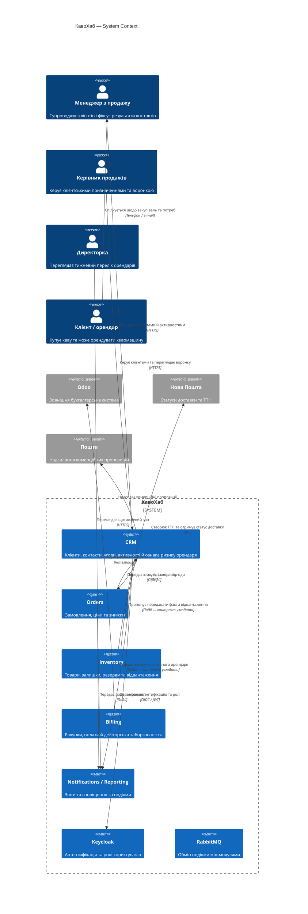

## 2. C4 Container

API та фоновий обробник розгортаються окремо, але працюють із приватною схемою CRM. Модулі обмінюються подіями через RabbitMQ; прямий доступ до чужих баз даних не передбачений.

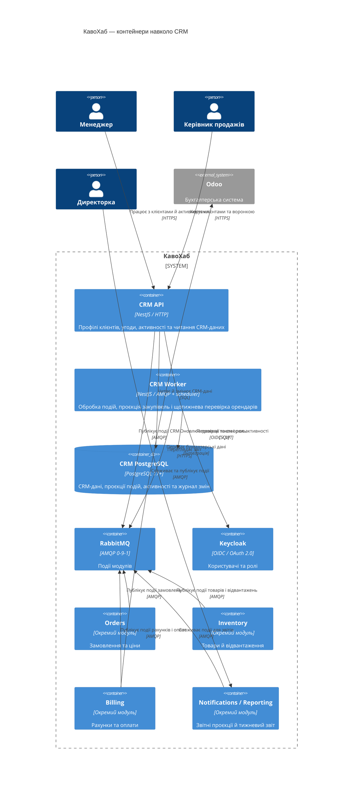

## 3. C4 Component для CRM Worker

Цей контейнер обробляє події від Orders та Inventory й запускає щотижневу перевірку. Контракт подій про відвантаження та вагу кави ще потрібно узгодити.

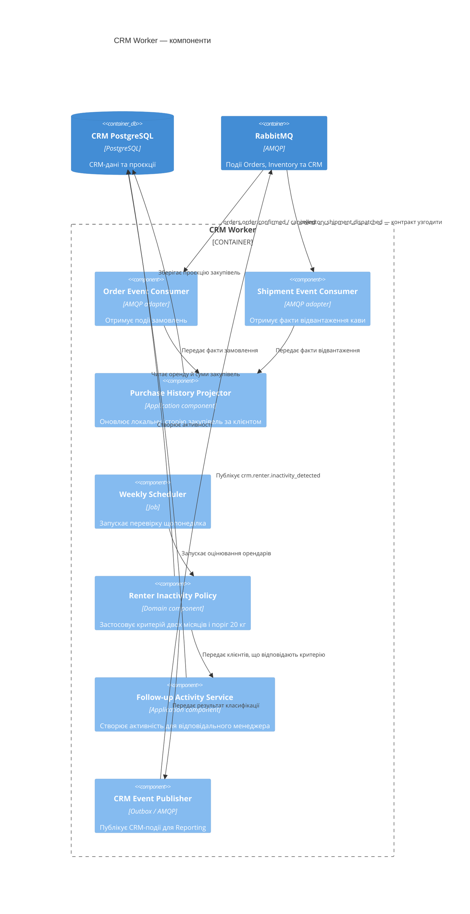

## 4. Діаграма послідовності: щотижневе виявлення орендаря

Діаграма показує основний цільовий сценарій CRM. `inventory.shipment.dispatched` як джерело фактичної кількості закупленої кави — пропозиція, яку слід погодити.

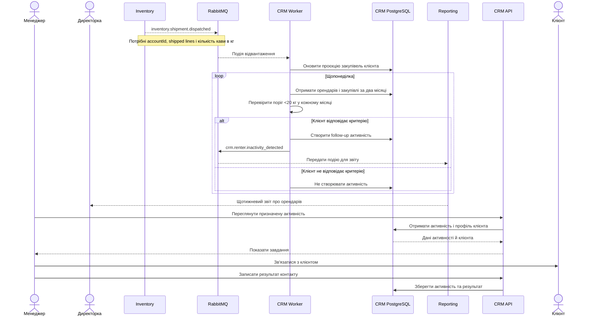

## 5. ADR — архітектурні рішення

### ADR-0001. Стиль архітектури CRM

**Статус:** запропоновано

**Контекст:** CRM має власні дані, API для працівників, фонове опрацювання подій і тижневу перевірку орендарів. Інші модулі розвиваються незалежно.

**Варіанти:**

1. Окремий CRM-сервіс із внутрішніми доменними модулями та фоновим worker.
2. Набір мікросервісів CRM — окремо клієнти, угоди, активності та звіти.
3. Спільний моноліт для всіх модулів із єдиною базою.

**Рішення:** варіант 1 — окремий модульний сервіс CRM із приватною схемою PostgreSQL, HTTP API та фоновим worker.

**Наслідки:** CRM можна розгортати незалежно; один сервіс простіший в експлуатації за кілька дрібних сервісів. API і worker потрібно узгоджувати через спільну схему та контракти подій.

### ADR-0002. Міжмодульна взаємодія CRM

**Статус:** запропоновано

**Контекст:** CRM отримує від Orders факти про замовлення; Reporting потребує CRM-даних для щотижневого звіту. Інші модулі не повинні читати базу CRM напряму.

**Варіанти:**

1. Обмін лише синхронними REST-запитами.
2. Обмін лише подіями через RabbitMQ.
3. REST для інтерактивних запитів і RabbitMQ для поширення бізнес-фактів.

**Рішення:** варіант 3. CRM API використовує HTTPS/OIDC для роботи користувачів; події передають зміни між модулями через RabbitMQ. Події обробляються ідемпотентно; для надійної публікації пропонується Outbox.

**Наслідки:** звітні дані можуть оновлюватись із затримкою; потрібні контроль повторної доставки, dead-letter queue й моніторинг невдалих повідомлень.

### ADR-0003. Власність і зберігання даних CRM

**Статус:** запропоновано

**Контекст:** README визначає CRM власником клієнтів і контактів; Orders — власником замовлень; Inventory — товарів, резервів і відвантажень; Reporting — зведених звітів.

**Рішення:** CRM зберігає власні записи `Lead`, `Account`, `Contact`, `Deal`, `Activity` у приватній схемі PostgreSQL. Дані Orders та Inventory CRM зберігає лише як локальну проєкцію для розрахунку активності клієнтів. Власником цих вихідних даних лишаються відповідні модулі.

**Наслідки й відкриті питання:**

- Визначити, який модуль веде зв’язок клієнта з орендованою кавомашиною.
- Погодити, чи CRM зберігає похідну ознаку неактивності та історію її обчислення.
- Не рахувати кілограми, доки не погоджено джерело ваги й статус закупівлі.

### ADR-0004. Технологічний стек CRM

**Статус:** запропоновано

**Контекст:** стек має підтримувати OpenAPI, міграції PostgreSQL, AMQP 0-9-1, JWT/OIDC, JSON-логи, Prometheus, контейнеризацію та автоматизовані тести.

**Варіанти:** TypeScript/NestJS, C#/ASP.NET Core, Python/FastAPI.

**Рішення:** пропоную TypeScript із NestJS, PostgreSQL 17+, RabbitMQ-клієнтом AMQP 0-9-1, Keycloak OIDC, JSON-логуванням, Prometheus-метриками й Docker. Для перевірок — Jest і Testcontainers.

**Наслідки:** NestJS дає модульну структуру та OpenAPI, але потребує команди, знайомої з TypeScript. Якщо досвід команди сильніший у .NET чи Python, рішення варто переглянути.

## 6. Каталог подій CRM

| Подія | Статус | Продюсер → споживачі | Ключові поля `data` | Коли виникає |
|---|---|---|---|---|
| `crm.account.upserted` | Є в базовому каталозі | CRM → Orders, Billing | `accountId`, `name`, `contacts`, `updatedAt` | Клієнта створено або змінено. |
| `crm.deal.won` | Є в базовому каталозі | CRM → Orders | `dealId`, `accountId`, `wonAt`, `lines[]` або посилання на затверджену пропозицію | Угоду виграно; Orders створює чернетку замовлення. Склад `lines[]` треба погодити. |
| `crm.renter.inactivity_detected` | **Нова пропозиція** | CRM → Reporting; за потреби Notifications | `accountId`, `detectedAt`, `periods[]`, `coffeeKgByPeriod[]`, `managerId`, `ruleVersion` | CRM виявила клієнта, який відповідає критерію неактивності. |
| `crm.activity.completed` | **Нова пропозиція** | CRM → Reporting | `activityId`, `accountId`, `managerId`, `completedAt`, `outcome` | Менеджер завершив активність і записав результат контакту. |

**Події, які CRM споживає:**

- `orders.order.confirmed` — є в базовому каталозі; CRM уже вказана серед споживачів.
- `orders.order.cancelled` — варто додати як споживання CRM, якщо закупівлі рахуватимуться від підтверджених замовлень.
- `inventory.shipment.dispatched` — пропонується додати CRM як споживача, якщо закупівлі рахуватимуться за відвантаженою кавою.
- `inventory.product.upserted` — може знадобитися CRM, якщо вагу доведеться визначати за SKU. Спочатку треба погодити поля події.

**Приклад нової події:**

```json
{
  "specversion": "1.0",
  "id": "b987f8d2-5dab-4d4c-a6d6-c9c851cf4230",
  "type": "crm.renter.inactivity_detected",
  "source": "kavohub/crm",
  "time": "2026-11-16T07:00:00Z",
  "correlationId": "c0ffee00-1234-4abc-9def-000000000042",
  "data": {
    "accountId": "ACC-000587",
    "detectedAt": "2026-11-16",
    "periods": ["2026-09", "2026-10"],
    "coffeeKgByPeriod": [16.5, 18.0],
    "managerId": "USR-00042",
    "ruleVersion": "1"
  }
}
```

## 7. Ескіз API CRM

| Метод | Шлях | Призначення | Хто викликає | Роль |
|---|---|---|---|---|
| `GET` | `/accounts?query=&ownerId=&status=` | Пошук клієнтів і фільтрація за менеджером/статусом | CRM UI | `sales_manager`, `sales_head`, `director` |
| `POST` | `/accounts` | Створення клієнта | CRM UI | `sales_manager`, `admin` |
| `GET` | `/accounts/{accountId}` | Перегляд профілю клієнта | CRM UI | роль із доступом до клієнта |
| `PATCH` | `/accounts/{accountId}/owner` | Перепризначення відповідального менеджера | CRM UI | `sales_head`, `admin` |
| `GET` | `/accounts/{accountId}/activities` | Перегляд історії взаємодій і завдань | CRM UI | `sales_manager`, `sales_head` |
| `POST` | `/accounts/{accountId}/activities` | Створення активності або завдання | CRM UI / CRM Worker | `sales_manager`, `sales_head`, сервісний обліковий запис |
| `PATCH` | `/activities/{activityId}` | Запис результату/завершення активності | CRM UI | призначений менеджер, `sales_head` |
| `GET` | `/accounts/{accountId}/purchase-summary` | Перегляд локальної проєкції закупівель | CRM UI | `sales_manager`, `sales_head`, `director` |
| `POST` | `/deals/{dealId}/win` | Позначити угоду виграною; публікує `crm.deal.won` | CRM UI | `sales_manager`, `sales_head` |
| `GET` | `/health` | Перевірка працездатності сервісу | Моніторинг | без автентифікації; відповідь `{"status":"ok"}` |

## 8. Запропонована структура сервісу

```text
crm/
  src/
    api/
      accounts/
      deals/
      activities/
      health/
    application/
      accounts/
      deals/
      activities/
      renter-monitoring/
    domain/
      account/
      deal/
      activity/
      renter-inactivity/
    infrastructure/
      postgres/
        migrations/
        repositories/
      messaging/
        consumers/
        publishers/
        outbox/
        inbox/
      identity/
      observability/
    jobs/
      weekly-renter-assessment/
  contracts/
    events/
      crm-account-upserted
      crm-deal-won
      crm-renter-inactivity-detected
  docs/
    openapi.yaml
    adr/
  tests/
    unit/
    integration/
```

## Рішення, потрібні перед фіксацією контрактів

1. Визначити власника даних про орендовані кавомашини.
2. Погодити, що вважається закупівлею для порога 20 кг — замовлення чи відвантаження.
3. Узгодити поля ваги кави та додавання CRM до споживачів потрібних подій Inventory/Orders.
4. Погодити, чи створювати менеджеру активність автоматично та хто опрацьовує клієнта без призначеного менеджера.
5. Підтвердити числові цілі NFR і вибір стеку.

> Виправ діаграми виправивши UI проблеми із зв'язками між блоками

Переробив діаграми з простішим розташуванням: користувачі ліворуч, CRM у центрі, події проходять через RabbitMQ, суміжні модулі — праворуч. Це зменшує перехресні зв’язки. Замініть ними попередні версії.

### C4 System Context

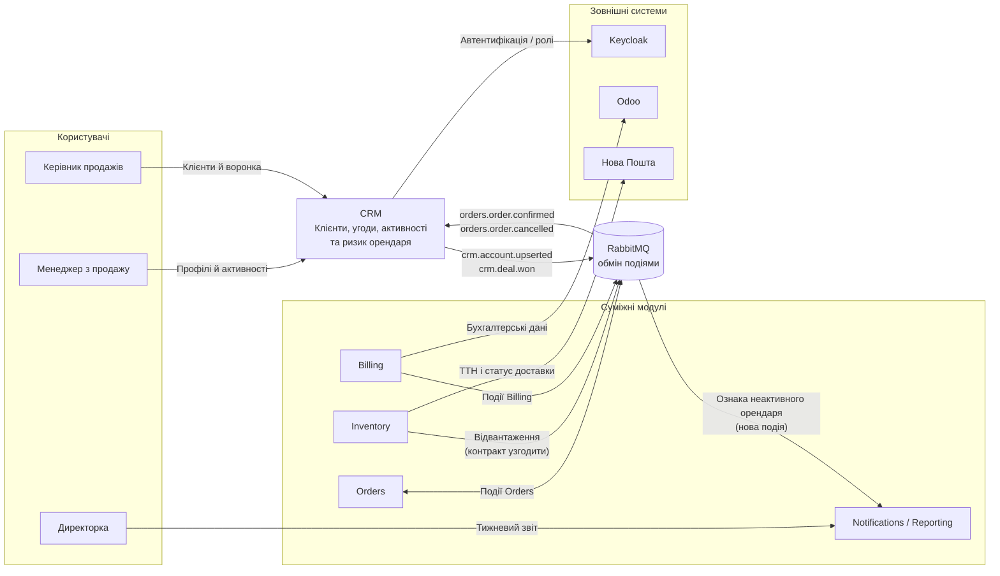

### C4 Container

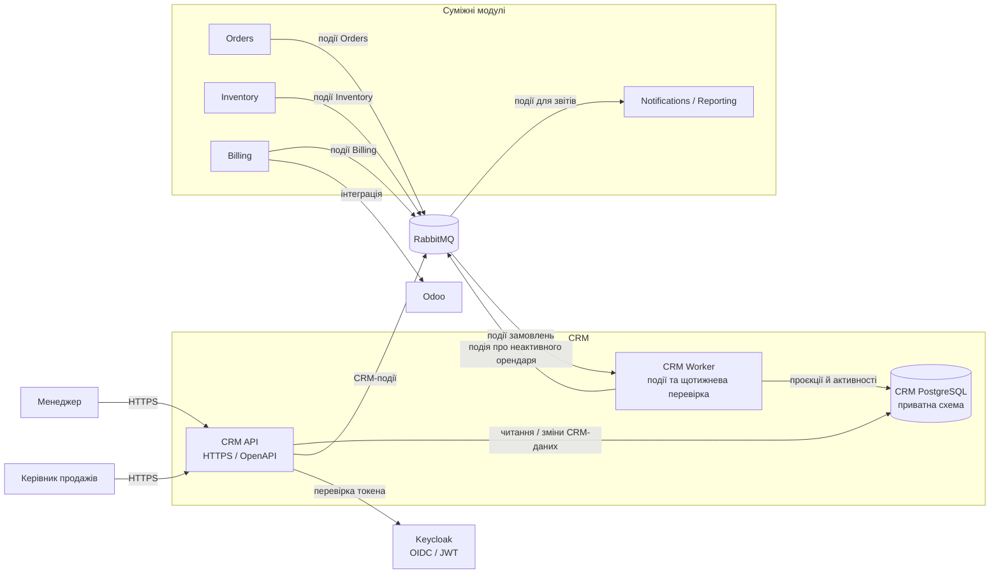

### C4 Component: CRM Worker

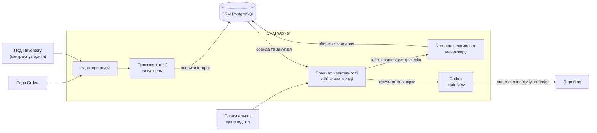

### Діаграма послідовності основного сценарію

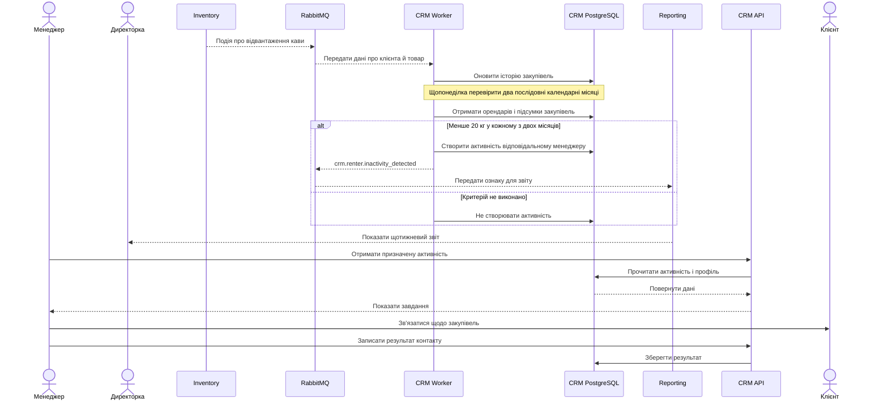

У компонентній і послідовнісній діаграмах зв’язок із Inventory залишено позначеним як такий, що потребує узгодження: базовий каталог подій не визначає достатньо полів, щоб CRM надійно розрахувала кілограми кави для критерію директорки.

> Тепер проведи **адверсіальне ревю** проведеної об'ємної роботи
> Чи всі етапи були виконані та чи фінальний очікуваний результат був досягнутий, чи відповідно до методичних вказівок аналіз та процеси були проведені правильно відповідно до мети та інструкцій заданих в readme file
> Будь строгим та прискіпливим

# Адверсальне ревю Lab 1

**Висновок: робота ще не завершена.** Основні теми досліджені, і більшість артефактів має чернетковий варіант. Але частина обов’язкових результатів відсутня або не відповідає вимогам методички. Найсерйозніші прогалини — C4-діаграми та послідовність Lead-to-Cash; також не зібрано фінальний документ і не пройдено завершальний етап.

Перевіряв відповідність [lab-01.md](<~/OneDrive/Робочий стіл/ESS/lab-01.md>) і розділу 3 README з інструкціями для ШІ.

## Виконання етапів

| Етап | Статус | Результат ревю |
|---|---|---|
| **Передумови** | **Частково** | Робота фактично ведеться для CRM, але в діалозі немає чіткого підтвердження, що CRM обрано як модуль на весь семестр. П’ять і більше запитань були сформульовані асистентом, хоча методичка просить підготувати власні запитання студента. |
| **1. Стейкхолдери й as-is** | **Частково** | Є карта стейкхолдерів, демонстраційна BPMN і глосарій. Проте рівні влади й інтересу оцінені приблизно, а частину процесу позначено припущеннями. Не всі невідомі гілки та кінцеві стани BPMN уточнені. |
| **2. Вимоги CRM** | **Переважно виконано як чернетку** | Є сім user stories з джерелами та негативними AC, п’ять вимірюваних NFR, конфлікти й відповідальні. Водночас деякі критерії та числові цілі є пропозиціями, а джерело закупівель для правила 20 кг не погоджено. |
| **3. Event storming і межі модулів** | **Частково** | Є часовий огляд Lead-to-Cash, події, гарячі точки, ключові події, межі CRM та зв’язки з Orders і Reporting. Відкритими лишаються власник даних про оренду, визначення закупівлі та контракт із кількістю кави в кілограмах. |
| **4. Архітектура, ADR і контракти** | **Частково** | Є чотири ADR, ескіз API, структура сервісу й каталог подій. Але останні «C4» діаграми після виправлення зв’язків стали звичайними Mermaid flowchart, а не C4-діаграмами. Діаграма послідовності описує моніторинг орендарів, тоді як Lab 1 вимагає happy path Lead-to-Cash. |
| **5. Самоперевірка, захист і оформлення** | **Не виконано** | Немає самоперевірки за критеріями, відповідей на п’ять контрольних питань, фінального документа за шаблоном і зібраного журналу взаємодії з ШІ. |

## Найважливіші проблеми

1. **C4 і послідовність — критична прогалина.** Лабораторна вимагає C4 Context і Container як код, C4 Component свого модуля та sequence diagram happy path Lead-to-Cash. Наявний останній варіант діаграм не є C4-синтаксисом, а sequence diagram охоплює інший сценарій.

2. **BPMN — презентаційна, не перевірена модель.** Діаграми подані як Mermaid flowchart, а не `.bpmn`. Mermaid допустимий для невеликої моделі, але потрібно явно показати семантику BPMN: пули й доріжки, події, задачі, шлюзи, потоки керування та повідомлень. Як мінімум, у as-is треба завершити гілки погодження знижки й нестачі товару. Невідомі кроки мають лишатися відкритими питаннями, а не непомітними припущеннями.

3. **Правило неактивного орендаря поки не можна надійно обчислити.** Бізнес-умова сформульована, але контракти не забезпечують потрібних даних. Базова подія замовлення не гарантує вагу кави в кілограмах, а власника даних про орендовану машину не визначено. Також не вирішено, що вважати покупкою: підтвердження замовлення, відвантаження чи рахунок.

4. **Числові NFR частково є проектними припущеннями.** Пороги для 09:00, 10 000 клієнтів, 15 хвилин, RPO і RTO позначені як пропозиції — це добре. Але їх не можна подавати як погоджені вимоги, доки їх не затвердять відповідні стейкхолдери.

5. **Рольові відповіді не дорівнюють реальній валідації.** Рольове опитування відповідає задуму лабораторної роботи з ШІ, але нові відповіді асистента мають бути занесені як «нові уточнення» або припущення. Не можна змішувати їх із фактами, прямо наведеними в інтерв’ю.

6. **Артефакти розкидані по діалогу.** Немає одного проєктного документа, який узгоджує назви подій, їхні поля, правила, припущення та рішення. Наприклад, окремо запропоновані події й API ще не становлять погодженого контракту між CRM, Orders, Inventory та Reporting.

## Оцінка за критеріями лабораторної

| Критерій | Результат ревю |
|---|---|
| BPMN as-is і to-be | **Частково:** є діаграми, але BPMN-семантику й гілки процесів треба доробити. |
| User stories і конфлікти | **Переважно виконано:** є сім історій та конфліктна таблиця; потрібне підтвердження спірних правил. |
| NFR | **Частково:** п’ять вимог вимірювані, але кілька цілей не погоджені, а джерела даних не визначені. |
| Доменний аналіз | **Частково:** є події, глосарій і межі, але дані про оренду та кілограми не мають чіткого власника/контракту. |
| C4 і sequence diagram | **Не завершено:** останні діаграми не є C4, а sequence не показує Lead-to-Cash happy path. |
| ADR | **Переважно як пропозиція:** є альтернативи й наслідки, але рішення не затверджені; бракує дат, автора, обговорених ролей і чітких умов перегляду. |
| Контракти та структура сервісу | **Частково:** API й структура є; контракти подій потребують узгодження полів і споживачів. |

Це не офіційна оцінка в балах; методичка забороняє асистенту її виставляти.

## Що потрібно доробити, щоб вважати Lab 1 завершеною

1. Зафіксувати CRM як обраний модуль на весь семестр.
2. Погодити джерело орендних даних, правило обліку закупівлі та розрахунок кілограмів.
3. Перевірити й завершити BPMN as-is та to-be, включно з альтернативними гілками й кінцевими подіями.
4. Побудувати справжні C4 Context, Container і Component-діаграми та додати sequence diagram для Lead-to-Cash happy path.
5. Уточнити контракти подій і отримати рольове погодження змін від команд суміжних модулів.
6. Зібрати один документ `lab-01-CRM-<прізвище>.md` із журналом рішень, припущеннями, відкритими питаннями та джерелами.
7. Провести самоперевірку, відповісти щонайменше на п’ять контрольних питань і описати 3–5 моментів, у яких ви перевірили або виправили відповідь ШІ.

**Підсумок:** бізнес-аналіз і CRM-вимоги — добрий робочий фундамент. Але фінального очікуваного результату Lab 1 ще не досягнуто: передусім через C4/sequence, неузгоджені контракти та відсутність оформленої й перевіреної здачі.

> 1. Я як студент обраю CRM модуль на весь семестр
> 2. Факт купівлі фіксується виключно в момент переходу статусу замовлення на "Доставлено" та створення накладної. В свою чергу актуальний статус договорів та список активних офісів має щодня синхронізується з основної ERP-системи в CRM. А от кількість проданих одиниць товару автоматично множиться на вагу номенклатури та підсумовується в полі "Спожито кави за поточний місяць" у картці компанії. Але в такому разі відкриті наступні питання: "Який період відсутності нових замовлень ми маємо вважати індикатором того, що орендар перестав купувати?",  "Яку цільову дію має ініціювати система після виявлення такого орендаря?",  "У якому форматі найзручніше буде відслідковувати цю інформацію?"

Прийняв: **CRM — ваш модуль на весь семестр.** Нижче фіксую нові рішення та розбираю три відкриті питання.

## Зафіксовані рішення

| Питання | Рішення |
|---|---|
| Момент обліку покупки | Вважати покупку зафіксованою лише тоді, коли замовлення має статус **«Доставлено»** і для нього створено накладну. Обидві умови мають виконуватися. |
| Договори й офіси | Основна ERP-система є джерелом істини для статусу договорів і переліку активних офісів. CRM отримує ці дані щодня; у CRM вони доступні для перегляду, але не редагуються. |
| Споживання кави | Для доставлених товарних позицій кількість множиться на вагу номенклатури; результати сумуються в полі картки компанії **«Спожито кави за поточний місяць»**. Джерело ваги номенклатури ще треба зафіксувати. |

Це змінює попередню архітектурну пропозицію: події `orders.order.confirmed` або `inventory.shipment.dispatched` самі по собі **ще не підтверджують покупку** за новим правилом. CRM має зіставити факт доставки та факт створення накладної за спільним ідентифікатором замовлення.

## Відповіді на відкриті питання

1. **Який період вважати індикатором припинення закупівель?**
   У матеріалах Lab 1 директорка вже визначила критерій: орендар має орендовану машину й купував **менше ніж 20 кг кави протягом двох календарних місяців поспіль**. Це точніше, ніж просто відсутність нових замовлень. Нуль замовлень може бути окремим сигналом, але це буде інше правило.

2. **Яку дію має ініціювати система?**
   Рекомендація: CRM створює **завдання відповідальному менеджеру** на контакт із клієнтом і додає до нього місячні обсяги закупівель, дату останньої доставки та статус договору. Менеджер фіксує результат розмови в CRM. Якщо відповідального немає, завдання слід передати керівнику продажів. Строк виконання завдання ще потрібно погодити.

3. **У якому форматі показувати інформацію?**
   Виходячи з побажання директорки отримувати перелік щопонеділка, пропоную **тижневу таблицю або дашборд** із фільтрацією за менеджером. Для кожного офісу показувати клієнта, статус договору, споживання за два місяці, дату останньої доставки, відповідального менеджера та стан завдання. Точний формат — наприклад, екран у CRM чи окремий звіт Reporting — ще треба погодити.

## Що необхідно уточнити в контрактах

- Яка система є джерелом статусу **«Доставлено»** та повідомляє про створення накладної.
- Який ідентифікатор зв’язує доставку, накладну, офіс і клієнта.
- Звідки CRM отримує вагу одиниці товару та як обробляє часткові доставки, повернення й коригування.
- За якою датою розподіляти доставку по місяцях. Рекомендую використовувати дату фактичної доставки та часовий пояс компанії.
- До якого часу щодня ERP має завершувати синхронізацію в CRM.

Ці уточнення потрібно внести до журналу рішень і відкрити як питання для ERP/суміжних модулів.

> 1. З якої системи беремо фінальний статус "Доставлено" та інформацію про накладну?
> 2. За яким ідентифікатором (ID) ми будемо пов'язувати клієнта, офіс, накладну та саму доставку?
> 3. Звідки CRM має підтягувати вагу кави і як нам правильно рахувати повернення чи часткові доставки?
> 4. За якою саме датою рахуємо обсяги за місяць?
> 5. О котрій годині щодня всі дані з ERP мають гарантовано оновитися в CRM?

Ці питання фіксують важливі рішення для обчислення закупівель у CRM. Нижче — рекомендовані відповіді з розмежуванням між наявними домовленостями та тим, що ще треба погодити.

| Питання | Рекомендоване рішення | Власник / що погодити |
|---|---|---|
| **1. Звідки брати статус «Доставлено» й інформацію про накладну?** | Статус доставки має вести **Inventory**: для Нової Пошти — на основі її API, для власної доставки — на основі підтвердження працівника складу. Створення рахунку/накладної має підтверджувати **Billing** через подію `billing.invoice.issued`. ERP лишається джерелом договорів і активних офісів, якщо нею не вирішено керувати також доставками й рахунками. | Inventory відповідає за статус доставки; Billing — за фінансовий документ. Треба визначити, чи CRM отримує ці факти подіями або з ERP. |
| **2. Як пов’язувати клієнта, офіс, накладну й доставку?** | Використовувати стабільні ідентифікатори, не назви чи телефони: `accountId` — клієнт у CRM; `officeId` і `contractId` — з ERP; `orderId` і `orderLineId` — Orders; `shipmentId` — Inventory; `invoiceId` та `invoiceLineId` — Billing. Рядок доставки й рахунку мають посилатися на `orderLineId`. | CRM, ERP, Orders, Inventory і Billing мають погодити ID та передавати їх у контрактах. Це також потрібно для випадків кількох доставок або рахунків на одне замовлення. |
| **3. Звідки брати вагу та як рахувати часткові доставки й повернення?** | За README власник каталогу товарів — **Inventory**, тому пропоную брати вагу нетто одиниці товару з його каталогу. Формула: **доставлена кількість × вага одиниці в кг**. Для часткової доставки рахувати лише фактично доставлену кількість. Повернення віднімати з обсягу відповідного товару й зберігати як коригування з посиланням на первинний рядок. | Inventory має надати вагу й одиницю виміру; Billing — пов’язати рахунок або кредит-ноту з рядком замовлення. Якщо master-дані ваги зберігаються в ERP, це треба окремо зафіксувати як джерело істини. |
| **4. За якою датою визначати місяць закупівлі?** | Рекомендую використовувати **дату фактичної доставки** у часовому поясі компанії (`Europe/Kyiv`). Якщо доставка відбулася в одному місяці, а рахунок створили пізніше, обсяг відносити до місяця доставки, але зараховувати лише після виконання обох умов: статус «Доставлено» і наявність рахунку. | Директорка, Billing та Inventory мають підтвердити правило для пізніх рахунків і повернень. |
| **5. Коли мають завершитися щоденні оновлення з ERP?** | Пропоную ціль **до 06:00 за київським часом щодня**, щоб CRM мала свіжі договори й офіси до початку робочого дня. Для звіту щопонеділка потрібно також показувати час останньої успішної синхронізації; якщо дані застарілі, звіт позначати як неповний. | Власник ERP та ІТ-адміністратор мають підтвердити часове вікно, допустиму затримку й порядок повідомлення про збій. |

### Важливе уточнення до бізнес-правила

У кейсі вже є відповідь директорки: орендар вважається неактивним, якщо він має орендовану кавомашину й купував **менше ніж 20 кг кави протягом двох календарних місяців поспіль**. Це правило про малий обсяг закупівель, а не просто про відсутність замовлень. Нуль доставок можна показувати як окремий сигнал, але його поріг і період потрібно погодити окремо.

Також назва поля **«Спожито кави за поточний місяць»** може вводити в оману: система вимірюватиме доставлену й документально підтверджену каву, а не фактичне споживання. Точніша назва — **«Доставлено кави, кг за поточний місяць»**.

Для CRM це означає, що попередній варіант контракту потрібно оновити: одного `inventory.shipment.dispatched` недостатньо — це лише факт відправлення, не доставки. Потрібні підтвердження доставки та подія Billing про створення рахунку, пов’язані спільними ідентифікаторами.

> Тепер на основі наданих уточнень та проведеної аналітики, допоможи мені перевірити й завершити BPMN as-is та to-be, включно з альтернативними гілками й кінцевими подіями.

Перевірив попередні схеми з урахуванням ваших уточнень. Ключова зміна для to-be: факт покупки фіксується **лише після доставки та створення накладної**. Самих `orders.order.confirmed` чи `inventory.shipment.dispatched` для цього недостатньо.

Нижче — презентаційні Mermaid-чернетки з явними пулами, доріжками, шлюзами, кінцевими подіями та потоками повідомлень. Суцільні стрілки — послідовність усередині пулу; пунктирні — повідомлення між пулами. У as-is наслідки відмови й нестачі позначені як невідомі, бо інтерв’ю їх не визначає.

## BPMN as-is — Lead-to-Cash

```mermaid
flowchart LR
  subgraph Customer["Пул: Клієнт"]
    direction TB
    C0((Початок: потрібен товар))
    C1[Задача: надіслати замовлення]
    C2((Кінець: замовлення надіслано))
    C3((Повідомлення: рахунок отримано))
    C4[Задача: сплатити рахунок]
    C5((Кінець: платіж надіслано))
    C6((Повідомлення: потрібно дізнатися статус / ТТН))
    C7[Задача: звернутися до менеджера]
    C8((Кінець: статус уточнено))
    C0 --> C1 --> C2
    C3 --> C4 --> C5
    C6 --> C7 --> C8
  end

  subgraph KavoHub["Пул: КавоХаб"]
    direction LR

    subgraph Sales["Доріжка: Менеджер з продажу"]
      direction TB
      S0((Повідомлення: замовлення отримано))
      S1[Задача: знайти / оновити клієнта<br/>ВРУЧНУ: Excel / Telegram]
      S2[Задача: зафіксувати замовлення]
      G1{XOR: знижка понад 10%?}
      S3[Задача: зателефонувати на склад]
      S4[Задача: надіслати дані рахунку бухгалтерці<br/>ВРУЧНУ: e-mail]
      S5[Задача: відповісти на запит про статус / ТТН]
      S6[Задача: уточнити подальші дії при нестачі]
      E1((Кінець: гілку зупинено<br/>подальша дія не описана))
      S0 --> S1 --> S2 --> G1
      G1 -->|Ні| S3
      S3 --> S4
    end

    subgraph SalesHead["Доріжка: Керівник продажів"]
      direction TB
      H1[Задача: розглянути знижку<br/>Telegram]
      T1((Таймер: очікування відповіді<br/>іноді до 2 діб))
      G2{XOR: знижку погоджено?}
      E2((Кінець: відмова / немає відповіді<br/>наслідок для угоди треба уточнити))
      H1 --> T1 --> G2
    end

    subgraph Warehouse["Доріжка: Склад"]
      direction TB
      W0[Задача: отримати інформацію<br/>після дзвінка менеджера]
      W1[Задача: перевірити залишок вручну]
      G3{XOR: товар є?}
      W2[Задача: підготувати відвантаження]
      W3[Задача: створити ТТН<br/>ВРУЧНУ: кабінет перевізника]
      W4((Кінець: відправлення передано перевізнику))
      W0 --> W1 --> G3
      G3 -->|Так| W2 --> W3 --> W4
      G3 -->|Ні| S6
      S6 --> E1
    end

    subgraph Accounting["Доріжка: Бухгалтерія"]
      direction TB
      A1[Задача: перенести дані рахунку в Odoo<br/>ВРУЧНУ: з листа менеджера]
      A2[Задача: виставити рахунок]
      A3[Задача: зіставити платіж з рахунком<br/>ВРУЧНУ: за банківською випискою]
      G4{XOR: платіж зіставлено?}
      A4[Задача: з'ясувати платіж вручну]
      A5((Кінець: платіж зіставлено))
      A6((Кінець циклу: платіж лишився<br/>на ручному опрацюванні))
      A1 --> A2 --> A3 --> G4
      G4 -->|Так| A5
      G4 -->|Ні| A4 --> A6
    end

    G1 -->|Так| H1
    G2 -->|Так| S3
    G2 -->|Ні| E2
    S4 --> A1
    S4 --> W0
  end

  subgraph Carrier["Пул: Нова Пошта"]
    direction TB
    N1((Повідомлення: відправлення отримано))
    N2[Задача: обробити відправлення й надати ТТН / статус]
    N3((Кінець: перевізник обробив відправлення))
    N1 --> N2 --> N3
  end

  C1 -. "замовлення; канал уточнити" .-> S0
  W3 -. "дані відправлення" .-> N1
  N2 -. "ТТН / статус" .-> S5
  C7 -. "запит статусу / ТТН" .-> S5
  A2 -. "рахунок; канал доставки уточнити" .-> C3
  C4 -. "оплата" .-> A3
```

**Що схема показує:** дані клієнта й замовлення ведуться вручну; погодження знижки може затягнутися; склад дізнається про замовлення телефоном; рахунок переноситься в Odoo з листа; ТТН створюється вручну; клієнт сам звертається щодо статусу. Платежі іноді потребують ручного з’ясування.

**Що треба підтвердити перед здачею as-is:** послідовність виставлення рахунку й комплектування не визначена інтерв’ю. На схемі менеджер передає дані і бухгалтерії, і складу; це не твердження, що ці гілки завжди відбуваються саме в такому порядку. Так само наслідки відмови у знижці й відсутності товару позначено як невідомі, а не як фактичний процес.

## BPMN to-be — контроль закупівель орендарів у CRM

У схемі використано заданий вами критерій покупки: замовлення враховується після доставки та створення накладної; для розрахунку використовується доставлена кількість і вага номенклатури. Поріг для неактивного орендаря взято з уточнення директорки: **менше ніж 20 кг у кожному з двох послідовних календарних місяців**.

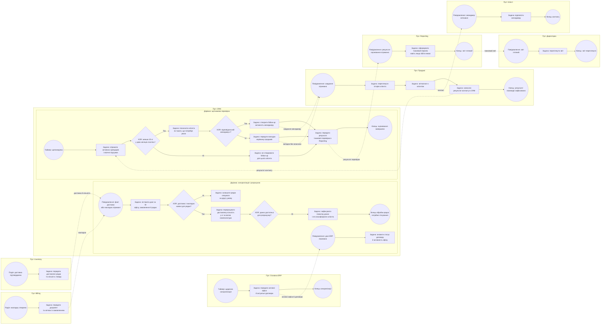

### Альтернативні гілки to-be

- **Доставка або накладна ще не отримані:** рядок залишається очікувати; закупівля поки не враховується.
- **Немає ваги або потрібного ID:** CRM не вгадує обсяг і не ставить клієнту ознаку неактивності; дані передаються на з’ясування.
- **Клієнт не відповідає критерію:** follow-up не створюється, але результат тижневої перевірки передається до звіту.
- **Клієнт відповідає критерію й менеджер призначений:** CRM створює менеджеру активність.
- **Менеджер не призначений:** випадок передається керівнику продажів для призначення відповідального.
- **Збігів немає:** Reporting формує порожній тижневий звіт, а не пропускає його.

## Перед фіксацією діаграм

1. **Уточнити значення слова «накладна».** Чи мається на увазі видаткова накладна, чи рахунок? Це різні документи й можуть належати різним процесам.
2. **Погодити поле дати.** У to-be рекомендую відносити вагу до місяця фактичної доставки. Треба також вирішити, чи перевірка бере два останні завершені місяці, чи враховує поточний місяць із початку.
3. **Уточнити роботу з поверненнями.** Діаграма передбачає коригування доставленої кількості, але не визначає, у якому місяці відображати повернення.
4. **Погодити джерело подій.** Базова подія `inventory.shipment.dispatched` означає відправлення, а не підтверджену доставку. Для правила покупки потрібне підтвердження доставки та створення накладної з узгодженими ID.

Ці діаграми тепер мають альтернативні гілки й кінцеві події. Але as-is варто вважати підтвердженим лише в частинах, прямо описаних інтерв’ю; непідтверджені переходи в ньому залишені як відкриті точки.

> Тепер сформуй чіткі професійні діграми: C4 Context, Container і Component-діаграми та додай sequence diagram для Lead-to-Cash happy path.

Нижче — перевпорядковані діаграми у **C4-PlantUML** і sequence diagram для **Lead-to-Cash happy path**. Компонентні діаграми окремо показують CRM API та фоновий Worker, щоб не змішувати їхні обов’язки в одному контейнері.

Позначення: **суцільні зв’язки** — виклики або передавання даних; `RabbitMQ` — асинхронний обмін подіями. Подію `inventory.shipment.delivered` позначено як **нову пропозицію**: у базовому каталозі є відвантаження, але не підтвердження доставки.

## C4 System Context

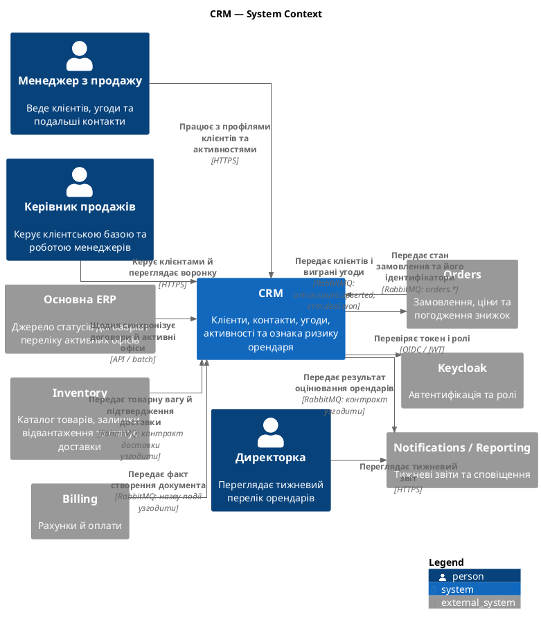

## C4 Container

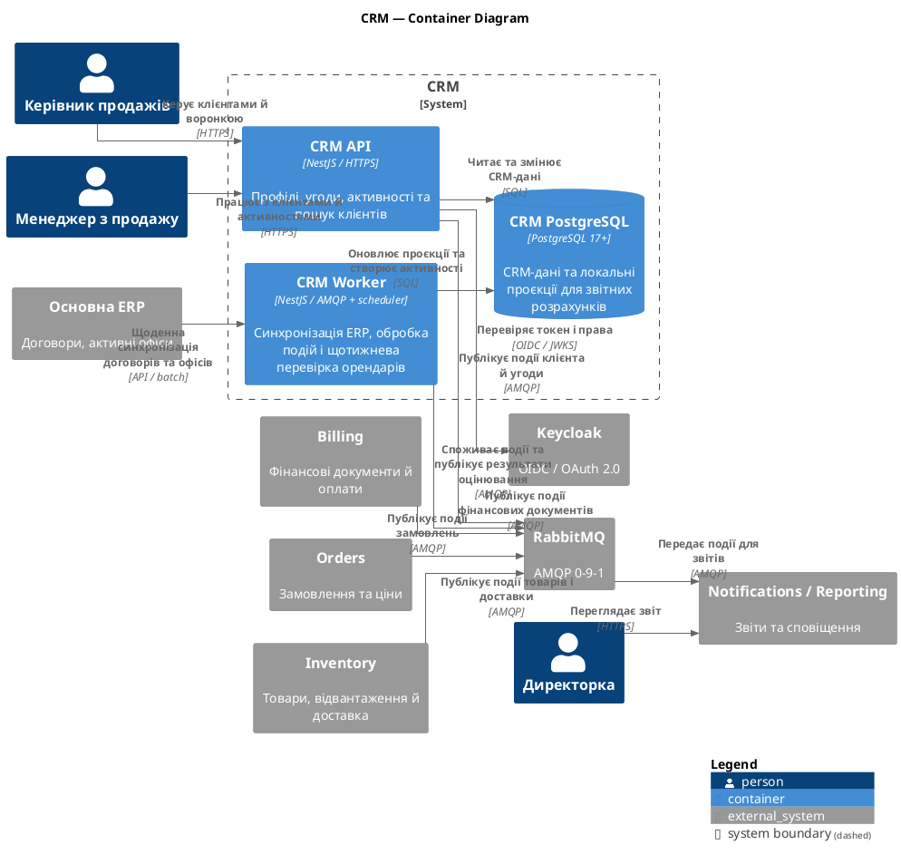

## C4 Component: CRM API

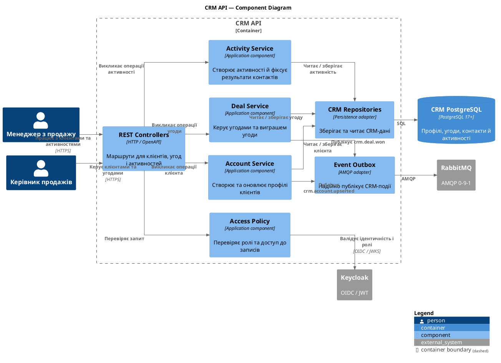

## C4 Component: CRM Worker

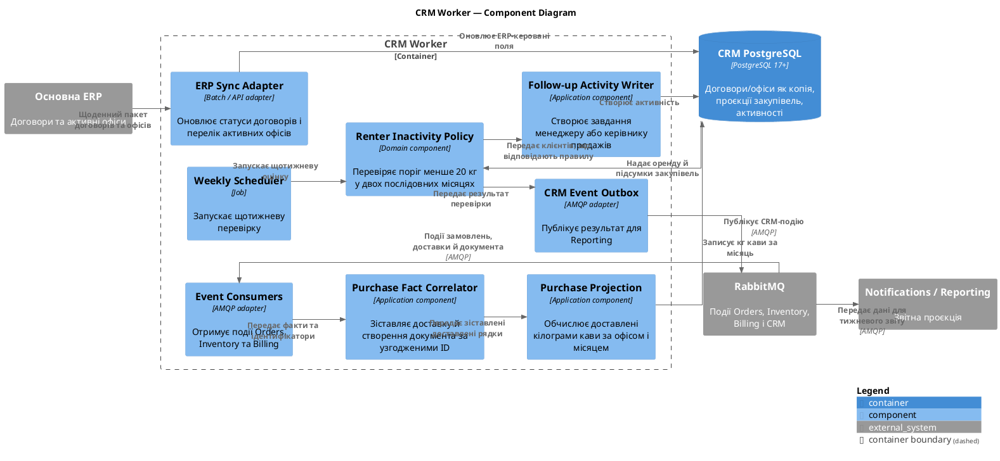

## Sequence diagram: Lead-to-Cash happy path

Сценарій припускає знижку до 10% або вже погоджену знижку, наявність товару й успішну оплату. Відвантаження та виставлення документа можуть іти паралельно після підтвердження замовлення.

```plantuml
@startuml
title Lead-to-Cash — happy path
autonumber
skinparam linetype ortho

actor "Клієнт" as Customer
actor "Менеджер з продажу" as Manager
participant "CRM API" as CRM
database "CRM PostgreSQL" as CRMDB
queue "RabbitMQ" as Broker
participant "Orders" as Orders
participant "Inventory" as Inventory
participant "Billing" as Billing
participant "Odoo" as Odoo
participant "Нова Пошта" as NP
participant "CRM Worker" as Worker

Customer -> Manager: Надсилає запит
Manager -> CRM: Створити / оновити клієнта та угоду
CRM -> CRMDB: Зберегти профіль і угоду
CRMDB --> CRM: Збережено
CRM --> Manager: Підтвердження

Manager -> CRM: Позначити угоду виграною
CRM -> CRMDB: Змінити стан угоди
CRM -> Broker: crm.deal.won
Broker -> Orders: Передати виграну угоду
Orders -> Inventory: Перевірити доступність товару
Inventory --> Orders: Товар доступний

Orders -> Broker: orders.order.confirmed
Broker -> Inventory: Передати підтверджене замовлення
Inventory -> Inventory: Зарезервувати товар
Inventory -> Broker: inventory.stock.reserved

par Фінансовий процес
    Broker -> Billing: Передати замовлення для виставлення документа
    Billing -> Odoo: Створити документ обліку
    Odoo --> Billing: Документ створено
    Billing -> Broker: billing.invoice.issued*
    Billing --> Customer: Надіслати документ на оплату
    Customer -> Billing: Сплатити рахунок
    Billing -> Broker: billing.payment.received
and Виконання та доставка
    Inventory -> Inventory: Зібрати замовлення
    Inventory -> NP: Створити відправлення та ТТН
    NP --> Inventory: ТТН і статуси
    NP --> Inventory: Підтвердження доставки
    Inventory -> Broker: inventory.shipment.delivered**
end

Broker -> Worker: Подія документа створеного
Broker -> Worker: Подія доставки підтверджена
Worker -> CRMDB: Зіставити документ і доставлені рядки<br/>за orderId / orderLineId
alt Є доставка і документ; вага відома
    Worker -> CRMDB: Додати доставлені кг до місячного підсумку
    Worker --> Manager: Оновити історію закупівель клієнта
else Бракує одного факту або ваги
    Worker -> CRMDB: Залишити запис очікувати; позначити дані неповними
end

@enduml
```

\* `billing.invoice.issued` використовувати, **якщо під «накладною» мається на увазі саме рахунок**. Якщо це видаткова накладна, потрібен відповідний тип документа/події Billing.

\** `inventory.shipment.delivered` — нова подія, яку треба погодити з Inventory. У базовому каталозі `inventory.shipment.dispatched` означає відправлення, а не підтверджену доставку.

Для фіналізації контрактів також треба погодити спільні `accountId`, `officeId`, `orderId`, `orderLineId`, `shipmentId` і `invoiceId`, а також джерело ваги номенклатури. У діаграмі CRM Worker не зараховує покупку, доки не отримав і факт доставки, і факт створення потрібного документа.

> Тепер візуально їх відобрази

<details><summary>2 previous messages</summary>

> Застосую навичку візуалізації, щоб показати C4-діаграми й Lead-to-Cash sequence diagram як читабельні схеми.
>
> <details><summary>Ran 2 commands</summary>
>
> - Ran `$p="C:\Users\Lenovo\.codex\plugins\cache\openai-bundled\visualize\1.0.55\skills\visualize\SKILL.md"; $c=Get-Content -LiteralPath $p; $c[0..135]`
> - Ran `$p="C:\Users\Lenovo\.codex\plugins\cache\openai-bundled\visualize\1.0.55\skills\visualize\SKILL.md"; $c=Get-Content -LiteralPath $p; $c[136..271]`
>
> </details>
</details>

### C4 Context

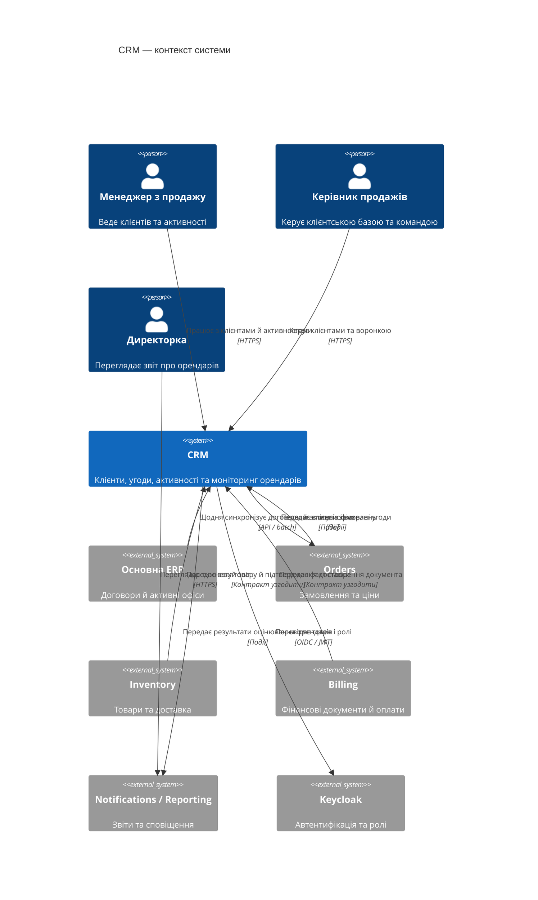

### C4 Container

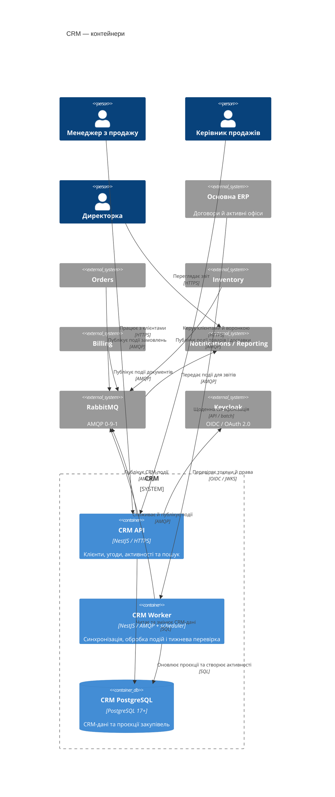

### C4 Component: CRM API

```mermaid
C4Component
    title CRM API — компоненти

    Person(manager, "Менеджер з продажу")
    Person(head, "Керівник продажів")

    Container_Boundary(api, "CRM API") {
        Component(controller, "REST Controllers", "HTTP / OpenAPI", "Обробляють запити клієнтів, угод і активностей")
        Component(access, "Access Policy", "Application component", "Перевіряє ролі та доступ до записів")
        Component(account, "Account Service", "Application component", "Створює й оновлює клієнтські профілі")
        Component(deal, "Deal Service", "Application component", "Керує угодами та їхнім виграшем")
        Component(activity, "Activity Service", "Application component", "Створює активності та фіксує результати контактів")
        Component(repository, "CRM Repositories", "Persistence adapter", "Зберігають і читають CRM-дані")
        Component(outbox, "Event Outbox", "AMQP adapter", "Публікує CRM-події")
    }

    ContainerDb(db, "CRM PostgreSQL", "PostgreSQL 17+", "Клієнти, угоди, контакти й активності")
    System_Ext(keycloak, "Keycloak", "OIDC / JWT")
    System_Ext(rabbit, "RabbitMQ", "AMQP 0-9-1")

    Rel(manager, controller, "Працює з клієнтами", "HTTPS")
    Rel(head, controller, "Керує клієнтами й угодами", "HTTPS")

    Rel(controller, access, "Перевіряє запит")
    Rel(access, keycloak, "Перевіряє ідентичність і ролі", "OIDC")
    Rel(controller, account, "Операції з клієнтами")
    Rel(controller, deal, "Операції з угодами")
    Rel(controller, activity, "Операції з активностями")

    Rel(account, repository, "Читає / зберігає клієнта")
    Rel(deal, repository, "Читає / зберігає угоду")
    Rel(activity, repository, "Читає / зберігає активність")
    Rel(repository, db, "SQL")

    Rel(account, outbox, "crm.account.upserted")
    Rel(deal, outbox, "crm.deal.won")
    Rel(outbox, rabbit, "Публікація подій", "AMQP")
```

### C4 Component: CRM Worker

```mermaid
C4Component
    title CRM Worker — компоненти

    Container_Boundary(worker, "CRM Worker") {
        Component(erpSync, "ERP Sync Adapter", "API / batch adapter", "Оновлює договори й активні офіси")
        Component(consumer, "Event Consumers", "AMQP adapter", "Отримує події замовлень, доставки й документів")
        Component(correlator, "Purchase Fact Correlator", "Application component", "Зіставляє доставку та документ за ID")
        Component(projector, "Purchase Projection", "Application component", "Рахує доставлені кілограми кави")
        Component(scheduler, "Weekly Scheduler", "Job", "Запускає оцінювання щопонеділка")
        Component(policy, "Renter Inactivity Policy", "Domain component", "Перевіряє поріг менше 20 кг за два місяці")
        Component(activity, "Follow-up Activity Writer", "Application component", "Створює завдання менеджеру")
        Component(outbox, "CRM Event Outbox", "AMQP adapter", "Публікує результат для Reporting")
    }

    ContainerDb(db, "CRM PostgreSQL", "PostgreSQL 17+", "Дані CRM і проєкція закупівель")
    System_Ext(erp, "Основна ERP")
    System_Ext(rabbit, "RabbitMQ", "Події Orders, Inventory, Billing і CRM")
    System_Ext(reporting, "Notifications / Reporting")

    Rel(erp, erpSync, "Щоденні дані договорів та офісів")
    Rel(erpSync, db, "Оновлює ERP-керовані поля")

    Rel(rabbit, consumer, "Події Orders, доставки й документів", "AMQP")
    Rel(consumer, correlator, "Передає факти та ідентифікатори")
    Rel(correlator, projector, "Передає зіставлені рядки")
    Rel(projector, db, "Зберігає місячні підсумки")

    Rel(scheduler, policy, "Запускає оцінювання")
    Rel(db, policy, "Надає договори й підсумки закупівель")
    Rel(policy, activity, "Передає клієнтів за критерієм")
    Rel(activity, db, "Створює активність")
    Rel(policy, outbox, "Передає результат перевірки")
    Rel(outbox, rabbit, "Публікує CRM-подію", "AMQP")
    Rel(rabbit, reporting, "Передає дані для звіту", "AMQP")
```

### Sequence diagram: Lead-to-Cash happy path

```mermaid
sequenceDiagram
    autonumber
    actor Customer as Клієнт
    actor Manager as Менеджер
    participant CRM as CRM API
    participant DB as CRM PostgreSQL
    participant MQ as RabbitMQ
    participant Orders
    participant Inventory
    participant Billing
    participant Odoo
    participant NP as Нова Пошта
    participant Worker as CRM Worker

    Customer->>Manager: Надсилає запит
    Manager->>CRM: Створити клієнта й угоду
    CRM->>DB: Зберегти профіль та угоду
    DB-->>CRM: Запис збережено
    CRM-->>Manager: Підтвердження

    Manager->>CRM: Позначити угоду виграною
    CRM->>DB: Оновити статус угоди
    CRM->>MQ: crm.deal.won
    MQ->>Orders: Передати виграну угоду
    Orders->>Inventory: Перевірити доступність
    Inventory-->>Orders: Товар доступний

    Orders->>MQ: orders.order.confirmed
    MQ->>Inventory: Передати підтверджене замовлення
    Inventory->>Inventory: Зарезервувати товар
    Inventory->>MQ: inventory.stock.reserved

    par Рахунок і оплата
        MQ->>Billing: Дані підтвердженого замовлення
        Billing->>Odoo: Створити документ
        Odoo-->>Billing: Документ створено
        Billing->>MQ: billing.invoice.issued*
        Billing-->>Customer: Надіслати рахунок
        Customer->>Billing: Сплатити рахунок
        Billing->>MQ: billing.payment.received
    and Комплектація й доставка
        Inventory->>Inventory: Зібрати замовлення
        Inventory->>NP: Створити відправлення та ТТН
        NP-->>Inventory: ТТН і статуси
        NP-->>Inventory: Доставка підтверджена
        Inventory->>MQ: inventory.shipment.delivered**
    end

    MQ->>Worker: Подія документа
    MQ->>Worker: Подія доставки
    Worker->>DB: Зіставити документ і доставлені рядки

    alt Документ і доставка підтверджені; вага відома
        Worker->>DB: Додати доставлені кг до місячного підсумку
    else Бракує документа, доставки або ваги
        Worker->>DB: Залишити покупку очікувати
    end
```

\* `billing.invoice.issued` підходить, якщо йдеться саме про рахунок. Якщо мається на увазі видаткова накладна, назву документа й події потрібно уточнити.

\** `inventory.shipment.delivered` — запропонована подія: базовий каталог містить відправлення, але не підтвердження доставки. Happy path передбачає наявність товару та знижку до 10% або вже погоджену знижку.

> Тепер випра UI пароблеми із зв'язками між блоками в діаграмах

Перебудував зв’язки в окремі потоки: **користувачі → CRM**, **джерела подій → Worker**, **результати → Reporting**. Компонентні діаграми розділив за контейнерами CRM API і CRM Worker, щоб не змішувати їхні зв’язки.

### C4 Context

```mermaid
C4Context
    title CRM — контекст

    Person(manager, "Менеджер з продажу")
    Person(head, "Керівник продажів")
    Person(director, "Директорка")

    System(crm, "CRM", "Клієнти, угоди, активності та моніторинг орендарів")

    System_Ext(erp, "Основна ERP", "Договори й активні офіси")
    System_Ext(orders, "Orders", "Замовлення та ціни")
    System_Ext(inventory, "Inventory", "Товари й доставка")
    System_Ext(billing, "Billing", "Фінансові документи")
    System_Ext(reporting, "Reporting", "Тижневі звіти")
    System_Ext(keycloak, "Keycloak", "Автентифікація та ролі")

    Rel(manager, crm, "Працює з клієнтами", "HTTPS")
    Rel(head, crm, "Керує клієнтами", "HTTPS")
    Rel(director, reporting, "Переглядає звіт", "HTTPS")

    Rel(erp, crm, "Договори й активні офіси, щодня", "API / batch")
    Rel(crm, orders, "Клієнти й виграні угоди", "RabbitMQ")
    Rel(orders, crm, "Статуси замовлень", "RabbitMQ")
    Rel(inventory, crm, "Вага товару й підтвердження доставки", "Контракт узгодити")
    Rel(billing, crm, "Створення фінансового документа", "Контракт узгодити")
    Rel(crm, reporting, "Результат оцінювання орендарів", "RabbitMQ")
    Rel(crm, keycloak, "Перевірка токена й ролей", "OIDC / JWT")
```

### C4 Container

```mermaid
C4Container
    title CRM — контейнери

    Person(manager, "Менеджер")
    Person(head, "Керівник продажів")
    Person(director, "Директорка")

    System_Boundary(crm, "CRM") {
        Container(api, "CRM API", "NestJS / HTTPS", "Клієнти, угоди й активності")
        Container(worker, "CRM Worker", "NestJS / AMQP + scheduler", "Синхронізація, події та тижнева перевірка")
        ContainerDb(db, "CRM PostgreSQL", "PostgreSQL 17+", "CRM-дані й проєкції закупівель")
    }

    System_Ext(erp, "Основна ERP")
    System_Ext(orders, "Orders")
    System_Ext(inventory, "Inventory")
    System_Ext(billing, "Billing")
    System_Ext(reporting, "Reporting")
    System_Ext(broker, "RabbitMQ", "AMQP 0-9-1")
    System_Ext(keycloak, "Keycloak", "OIDC")

    Rel(manager, api, "Клієнти й активності", "HTTPS")
    Rel(head, api, "Клієнти й воронка", "HTTPS")
    Rel(director, reporting, "Звіт", "HTTPS")

    Rel(api, db, "CRM-записи", "SQL")
    Rel(worker, db, "Проєкції та активності", "SQL")
    Rel(api, keycloak, "Токени й ролі", "OIDC / JWKS")

    Rel(erp, worker, "Щоденна синхронізація", "API / batch")
    Rel(api, broker, "Події CRM", "AMQP")
    Rel(orders, broker, "Події замовлень", "AMQP")
    Rel(inventory, broker, "Події товарів і доставки", "AMQP")
    Rel(billing, broker, "Події документів", "AMQP")
    Rel(broker, worker, "Вхідні події", "AMQP")
    Rel(worker, broker, "Результати оцінювання", "AMQP")
    Rel(broker, reporting, "Дані для звітів", "AMQP")
```

### C4 Component — CRM API

```mermaid
C4Component
    title CRM API — компоненти

    Person(manager, "Менеджер")
    Person(head, "Керівник продажів")

    Container_Boundary(api, "CRM API") {
        Component(controller, "REST Controllers", "HTTP / OpenAPI", "Приймають запити")
        Component(account, "Account Service", "Application", "Профілі клієнтів")
        Component(deal, "Deal Service", "Application", "Угоди й воронка")
        Component(activity, "Activity Service", "Application", "Активності й результати контактів")
        Component(repository, "CRM Repositories", "Persistence adapter", "Доступ до CRM-даних")
        Component(outbox, "Event Outbox", "AMQP adapter", "Публікація подій CRM")
    }

    ContainerDb(db, "CRM PostgreSQL", "PostgreSQL 17+", "Клієнти, угоди й активності")
    System_Ext(keycloak, "Keycloak", "OIDC / JWT")
    System_Ext(broker, "RabbitMQ", "AMQP")

    Rel(manager, controller, "Запити CRM", "HTTPS")
    Rel(head, controller, "Керування клієнтами", "HTTPS")

    Rel(controller, account, "Клієнти")
    Rel(controller, deal, "Угоди")
    Rel(controller, activity, "Активності")

    Rel(account, repository, "Читання / запис")
    Rel(deal, repository, "Читання / запис")
    Rel(activity, repository, "Читання / запис")
    Rel(repository, db, "SQL")

    Rel(controller, keycloak, "Перевірка доступу", "OIDC")
    Rel(account, outbox, "crm.account.upserted")
    Rel(deal, outbox, "crm.deal.won")
    Rel(outbox, broker, "Події CRM", "AMQP")
```

### C4 Component — CRM Worker

```mermaid
C4Component
    title CRM Worker — компоненти

    Container_Boundary(worker, "CRM Worker") {
        Component(erpSync, "ERP Sync Adapter", "API / batch", "Оновлює договори й офіси")
        Component(consumer, "Event Consumers", "AMQP adapter", "Приймають події суміжних модулів")
        Component(correlator, "Purchase Fact Correlator", "Application", "Зіставляє доставку й документ за ID")
        Component(projector, "Purchase Projection", "Application", "Обчислює доставлені кг кави")
        Component(scheduler, "Weekly Scheduler", "Job", "Запускає щотижневу перевірку")
        Component(policy, "Inactivity Policy", "Domain", "Менше 20 кг у двох місяцях")
        Component(activity, "Follow-up Activity Writer", "Application", "Створює завдання менеджеру")
        Component(outbox, "CRM Event Outbox", "AMQP adapter", "Передає результат у Reporting")
    }

    ContainerDb(db, "CRM PostgreSQL", "PostgreSQL 17+", "ERP-копії, закупівлі й активності")
    System_Ext(erp, "Основна ERP")
    System_Ext(broker, "RabbitMQ")
    System_Ext(reporting, "Reporting")

    Rel(erp, erpSync, "Договори й офіси")
    Rel(erpSync, db, "Оновлення ERP-керованих полів")

    Rel(broker, consumer, "Orders, Inventory, Billing")
    Rel(consumer, correlator, "Факти та ідентифікатори")
    Rel(correlator, projector, "Зіставлені рядки")
    Rel(projector, db, "Місячні підсумки")

    Rel(scheduler, policy, "Запуск оцінювання")
    Rel(db, policy, "Договори й підсумки закупівель")
    Rel(policy, activity, "Клієнти за критерієм")
    Rel(activity, db, "Створення активності")
    Rel(policy, outbox, "Результат перевірки")
    Rel(outbox, broker, "CRM-подія")
    Rel(broker, reporting, "Дані для звіту")
```

### Sequence diagram — Lead-to-Cash happy path

```mermaid
sequenceDiagram
    autonumber
    actor Customer as Клієнт
    actor Manager as Менеджер
    participant CRM as CRM API
    participant DB as CRM DB
    participant MQ as RabbitMQ
    participant Orders
    participant Inventory
    participant Billing
    participant Odoo
    participant NP as Нова Пошта
    participant Worker as CRM Worker

    Customer->>Manager: Надсилає запит
    Manager->>CRM: Створити клієнта й угоду
    CRM->>DB: Зберегти профіль та угоду
    DB-->>CRM: Збережено
    CRM-->>Manager: Підтвердження

    Manager->>CRM: Позначити угоду виграною
    CRM->>DB: Оновити стан угоди
    CRM->>MQ: crm.deal.won
    MQ->>Orders: Передати виграну угоду

    Orders->>Inventory: Перевірити наявність
    Inventory-->>Orders: Товар доступний
    Orders->>MQ: orders.order.confirmed
    MQ->>Inventory: Підтверджене замовлення
    Inventory->>Inventory: Зарезервувати товар
    Inventory->>MQ: inventory.stock.reserved

    par Фінансовий процес
        MQ->>Billing: Дані замовлення
        Billing->>Odoo: Створити фінансовий документ
        Odoo-->>Billing: Документ створено
        Billing->>MQ: billing.invoice.issued*
        Billing-->>Customer: Надіслати документ
        Customer->>Billing: Сплатити рахунок
        Billing->>MQ: billing.payment.received
    and Доставка
        Inventory->>Inventory: Зібрати замовлення
        Inventory->>NP: Створити відправлення й ТТН
        NP-->>Inventory: ТТН і статуси
        NP-->>Inventory: Доставку підтверджено
        Inventory->>MQ: inventory.shipment.delivered**
    end

    MQ->>Worker: Фінансовий документ
    MQ->>Worker: Підтверджена доставка
    Worker->>DB: Зіставити документ і рядки замовлення

    alt Документ, доставка й вага наявні
        Worker->>DB: Додати доставлені кг до місячного підсумку
    else Бракує даних
        Worker->>DB: Залишити покупку очікувати
    end
```

`billing.invoice.issued` підходить, якщо йдеться саме про рахунок; для видаткової накладної треба уточнити тип і назву події. `inventory.shipment.delivered` — запропонована подія: базовий каталог фіксує відправлення, але не підтвердження доставки.

> 1. Які саме дані чи параметри в контрактах подій нам треба узгодити?
> 2. Яких саме суміжних команд і модулів торкнуться ці зміни?
> 3. Хто конкретно з кожної команди має дати фінальне погодження?
> 4. У якому форматі ми фіксуємо їхній апрув?
> 5. Який у нас план дій, якщо суміжна команда не погоджує зміни або затягує з відповіддю?

Так, ці питання варто оформити як **план погодження міжмодульних контрактів**. Зараз CRM явно обрано; наведені нижче зміни до подій і синхронізації залишаються пропозиціями. У кейсі не названо конкретних архітекторів суміжних модулів, тому для них указую відповідальні ролі, а не вигадані імена.

## 1. Що саме узгодити в контрактах

| Контракт / дані | Параметри для погодження | Хто має підтвердити |
|---|---|---|
| **Щоденна синхронізація ERP → CRM** | Стабільне зіставлення `erpOfficeId` ↔ `accountId`; `contractId`; статус договору; ознака орендованої кавомашини; статус офісу; `effectiveFrom`, `effectiveTo`, `syncedAt`. Також — формат повної/інкрементальної синхронізації, неактивні записи, повтори й помилки. | Власник даних ERP; **Олег Савчук** — технічне з’єднання та експлуатація. Власника даних ERP у матеріалах не названо. |
| **CRM → Orders: `crm.deal.won`, `crm.account.upserted`** | `dealId`, `accountId`, `officeId`, стабільний `orderId` або `proposalId`; для замовлення — `orderLineId`, SKU, кількість, одиниця, узгоджені умови пропозиції. Окремо визначити, які поля клієнта належать CRM, а які лише синхронізуються з ERP. | Архітектор/власник контракту CRM і представник Orders; **Андрій Бондар** підтверджує бізнес-процес продажу. |
| **Inventory → CRM: доставка** | Пропонована подія `inventory.shipment.delivered`; `shipmentId`, `orderId`, `orderLineId`, `accountId`, `officeId`, `deliveredAt`, доставлена кількість, одиниця виміру. Погодити статуси доставки для Нової Пошти й власного транспорту, часткову доставку та повернення. | Власник контракту Inventory; **Сергій Ткаченко** підтверджує складський процес. |
| **Inventory → CRM: вага товару** | Джерело `netWeightKgPerUnit`, одиниця, точність і версія/дата ваги. Рекомендую передавати вагу як знімок на момент доставки, щоб зміна каталогу не перераховувала історію. Погодити, які SKU вважаються кавою. | Власник каталогу Inventory; якщо номенклатура ведеться в ERP — власник товарних даних ERP. У кейсі конкретну відповідальну особу не названо. |
| **Billing → CRM: створення документа** | Спершу уточнити, чи «накладна» означає рахунок чи видаткову накладну. Потім визначити подію, наприклад `billing.invoice.issued` лише для рахунку; потрібні `documentId`, `documentType`, `issuedAt`, `orderId`, `orderLineId` і статус. Також визначити анулювання та кредит-ноти/коригування. | Власник контракту Billing; **Наталія Шевчук** підтверджує бухгалтерське значення й облік документів. |
| **CRM → Reporting: ознака неактивного орендаря** | Запропонована подія `crm.renter.inactivity_detected`; `accountId`, `officeId`, `periods[{month, coffeeKg}]`, `thresholdKg`, `ruleVersion`, `dataAsOf`, `managerId`, `activityId`. Погодити поведінку для неповних або прострочених даних і звіту без збігів. | Власник контракту CRM і власник Reporting; **Ірина Мельник** затверджує зміст і формат звіту. |

Для всіх подій також узгодити CloudEvents-конверт: `specversion`, унікальний `id`, `type`, `source`, `time`, `correlationId`, `dataschema`. Обробка має бути ідемпотентною: повторно доставлена подія не повинна повторно зарахувати кілограми чи створити дубль активності.

## 2. Кого торкнуться зміни

- **CRM** — споживає синхронізацію ERP, дані про доставку й документ; публікує угоди, клієнтські зміни та результат оцінювання орендарів.
- **Orders** — споживає клієнтів і виграні угоди CRM; надає CRM посилання на замовлення та рядки замовлення.
- **Inventory** — надає підтвердження доставки, кількості й ваги товарів; зміни потрібні для часткових доставок і повернень.
- **Billing** — надає факт створення потрібного фінансового документа та дані для його зіставлення із замовленням.
- **ERP / ERP-інтеграція** — надає договори й активні офіси; потрібні стабільні ID та правила щоденної синхронізації.
- **Notifications / Reporting** — споживає результат CRM і формує тижневий звіт.
- **ІТ / платформа** — підтримує RabbitMQ, доступи, повторні доставки, моніторинг та блокування помилкових повідомлень.

## 3. Хто дає фінальне погодження

Для кожної зміни потрібні **три види підтвердження**: бізнес-правила, схема від продюсера події та прийняття її споживачами.

| Рішення | Фінальне бізнес-погодження | Технічне погодження контракту |
|---|---|---|
| Критерій неактивного орендаря, поріг, період і формат звіту | **Ірина Мельник**, директорка | Власники CRM і Reporting |
| Хто контактує з клієнтом і хто отримує завдання без призначеного менеджера | **Андрій Бондар**, керівник продажів | Власник CRM; власник Reporting, якщо змінюється звіт |
| Статус доставки, доставлена кількість, часткова доставка й повернення | **Сергій Ткаченко**, керівник складу | Власник контракту Inventory та CRM |
| Тип документа, момент його створення й коригування | **Наталія Шевчук**, головна бухгалтерка | Власник контракту Billing та CRM |
| ERP-офіси, договори, зіставлення ID та графік синхронізації | Власник даних ERP — **не названий у кейсі**; Ірина підтверджує бізнес-сенс | **Олег Савчук** — технічна інтеграція; власник ERP-даних — за зміст |
| Подія виграної угоди й створення чернетки замовлення | **Андрій Бондар** — бізнес-процес продажу | Власники контрактів CRM і Orders |

Для Orders, Inventory, Billing та Reporting конкретні архітектори/власники API у кейсі не вказані. Їх треба позначити в документі як **«представник команди — визначити»**. Не варто вважати бізнес-керівника автоматичним власником технічного контракту.

## 4. Як фіксувати погодження

Для лабораторної створіть запис у журналі контрактних рішень, наприклад `CCR-CRM-001`, із такими полями:

- подія або синхронізація, яку змінюють;
- продюсер і всі споживачі;
- схема, приклади повідомлень і версія;
- поля, їхні типи, значення та власники;
- зворотна сумісність, повтори, порядок подій і помилки;
- бізнес-погодження: ім’я, роль, дата й рішення;
- технічне погодження від продюсера та кожного споживача;
- статус: **запропоновано / погоджено / відхилено / відкладено**;
- умови або заперечення.

У реальному репозиторії погодження варто зберігати разом зі схемою AsyncAPI у pull request: один reviewer від команди-продюсера та підтвердження від кожної команди-споживача. Для Lab 1 рольові погодження чату слід позначати саме як **симуляцію**, а нові відповіді стейкхолдерів заносити до розділу уточнень і припущень.

## 5. Якщо команда відмовляє або затримує відповідь

1. **Мовчання не вважається погодженням.** Запропонувати строк відповіді — наприклад, три робочі дні — і назвати його цільовим, доки команди його не підтвердили.
2. **Якщо є заперечення до поля або формату**, записати причину й запропонувати сумісний варіант: необов’язкове поле, адаптер або окрему версію контракту. Не змінювати значення вже опублікованого поля непомітно.
3. **Якщо не погоджене бізнес-правило**, рішення повертається його власнику: директорці — критерій і звіт; продажам — дія менеджера; бухгалтерці та складу — значення й джерело документів/доставки.
4. **Якщо затримка блокує точність звіту**, CRM не класифікує неповні записи як покупки чи неактивних орендарів. Вона позначає дані як очікувані/неповні й передає проблему на з’ясування.
5. **Якщо контракт не встигають погодити**, відкласти залежну автоматизацію або випустити її за feature flag. Не підміняти відсутній факт припущенням про «Доставлено» чи створення документа.

**Найближча дія:** спочатку погодити точне значення «накладної», визначити продюсера підтвердження доставки та затвердити спільні ID `accountId`, `officeId`, `orderId`, `orderLineId`, `shipmentId` і `documentId`. Це розблокує контракт для обчислення доставлених кілограмів у CRM.

> 1. Хто є власником даних ERP та хто відповідає за технічні контракти в Orders, Inventory, Billing і Reporting? (Вказано, що ці особи в кейсі не названі і їх треба визначити).
> 2. Чи означає "накладна" рахунок або видаткову накладну?
> 3. Які саме SKU вважатимуться кавою?
> 4. Яким має бути графік/формат синхронізації з ERP (повна чи інкрементальна, обробка неактивних записів, повторів і помилок)?
> 5. Як оброблятимуться неповні або прострочені дані для звіту, а також що робити, якщо у звіті немає збігів?
> 6. Які статуси доставки використовуватимуться для "Нової Пошти" та власного транспорту, і як фіксуватимуться часткова доставка та повернення?
> 7. Яка процедура анулювання фінансових документів, випуску кредит-нот чи коригувань?
> 8. Кому призначатиметься завдання в CRM, якщо у клієнта немає призначеного менеджера?

Нижче — **робочі рішення для проєктування**, а не підтверджені відповіді суміжних команд. Їх варто зафіксувати як пропозиції й погодити з указаними відповідальними.

| № | Рекомендація | Хто має погодити |
|---|---|---|
| **1. Власники даних і контрактів** | Власником договорів та активних офісів має бути бізнес-власник даних ERP; його ім’я в кейсі не вказане. **Олег Савчук** може координувати технічну інтеграцію, але його не слід автоматично вважати бізнес-власником ERP-даних. Для Orders, Inventory, Billing і Reporting потрібно призначити по одному власнику API/контракту від кожної команди. | Власник ERP-даних — визначити. Технічні власники модулів — визначити командам. **Андрій Бондар** підтверджує правила продажів; **Сергій Ткаченко** — складський процес; **Наталія Шевчук** — бухгалтерські документи; **Ірина Мельник** — вимоги до звіту. |
| **2. Значення «накладної»** | Розрізняти **рахунок** і **видаткову накладну**. Для підтвердження відвантаження товару логічніше використовувати видаткову накладну; рахунок є окремим фінансовим документом. До погодження в контракті використовувати нейтральне поле `documentType`, а не трактувати `billing.invoice.issued` як підтвердження доставки. | **Наталія Шевчук** підтверджує бухгалтерську термінологію; власник контракту Billing фіксує її в схемі. |
| **3. Які SKU є кавою** | Не підтримувати ручний список SKU в CRM. Додати до каталогу Inventory класифікацію товару, наприклад `productCategory = coffee`, і вагу нетто одиниці в кг. До підсумку включати лише позиції з погодженою категорією `coffee`; обладнання, сиропи й інші товари не рахувати. | Власник каталогу Inventory — визначити; **Сергій Ткаченко** підтверджує складський зміст категорії. |
| **4. Синхронізація ERP** | Робочий варіант: початкове повне завантаження, далі щоденна інкрементальна синхронізація; раз на тиждень — повне звіряння. Використовувати стабільні `erpOfficeId` і `contractId`; неактивні записи позначати статусом, не видаляти. Повтори мають бути безпечними для повторної обробки. Запропонована ціль — завершення до **06:00 за київським часом**; помилки після погодженої кількості повторів виводити в чергу збоїв і сповіщати ІТ. | Власник ERP-даних погоджує поля та логіку; **Олег Савчук** — технічний графік, повтори й моніторинг. Час 06:00 — пропозиція, не затверджена вимога. |
| **5. Неповні дані й порожній звіт** | Якщо бракує договору, доставки, документа, ваги або ID, CRM не повинна класифікувати клієнта як неактивного. У звіті показувати дату останньої синхронізації, ознаку повноти й кількість записів, що очікують уточнення. Якщо збігів немає — формувати звіт із нульовим результатом, а не пропускати його. | **Ірина Мельник** погоджує формат і зміст звіту; власник Reporting — спосіб формування; **Олег Савчук** — критерій застарілих даних і сповіщення. |
| **6. Статуси доставки, часткові доставки й повернення** | Нормалізувати статуси: `created → dispatched → delivered`, а також `delivery_failed` і `returned`. Статуси Нової Пошти мапити з її API; власну доставку підтверджує уповноважений працівник із часом доставки. Для часткової доставки передавати кількість по кожному `orderLineId`; у кг зараховувати лише фактично доставлену кількість. Повернення передавати окремою коригувальною подією з посиланням на первинний рядок. | Власник контракту Inventory; **Сергій Ткаченко** підтверджує операційні статуси та облік часткових доставок/повернень. |
| **7. Анулювання й коригування документів** | Виставлений документ не редагувати. Якщо документ помилковий — публікувати факт анулювання із посиланням на початковий документ і причиною; якщо змінилися сума чи кількість після виставлення — створювати кредит-ноту або коригувальний документ. CRM має застосовувати коригування до відповідного `orderLineId`, не переписуючи історію. | **Наталія Шевчук** погоджує бухгалтерські правила; власник Billing — події та поля контракту. |
| **8. Клієнт без менеджера** | Створювати активність у черзі **«Нерозподілені клієнти»** керівника продажів. Не призначати менеджера автоматично й не відкидати запис. Керівник призначає власника; звіт окремо показує нерозподілені випадки. | **Андрій Бондар** затверджує чергу, призначення та строк опрацювання. |

### Перші рішення для погодження

Найбільше на контракти впливають чотири пункти: **тип документа «накладна»**, **класифікація кавових SKU та джерело ваги**, **нормалізовані статуси доставки**, **спільні ID для офісу, замовлення, рядка, доставки й документа**. Поки їх не погоджено, розрахунок кілограмів у CRM слід позначати як такий, що очікує узгодження джерельних даних.

> До ІТ та власників процесів
>
> 1. До кого конкретно стукати за погодженням даних із ERP, складу та бухгалтерії?
> 2. Синхронізуємо бази щодня о 06:00 ранку, чи такий час підходить?
>
> До Наталії (Бухгалтерія)
>
> 1. Фіксуємо успішну доставку тільки за видатковою накладною (не по рахунку), так?
> 2. Проведені накладні не змінюємо, а всі виправлення робимо лише через коригувальні документи?
>
> До Сергія (Склад)
>
> 1. Зможемо додати в базу товарів галочку "це кава" і точну вагу пачки, щоб система рахувала все сама?
> 2. Повернення товару проводимо як окрему операцію, правильно?
>
> До Ірини (Директорка)
>
> 1. Якщо по клієнту немає всіх даних, просто показуємо його менеджерам у списку "на уточнення"?
> 2. Якщо за тиждень жоден клієнт не відвалився, надсилати вам порожній звіт про те, що все добре?
>
> До Андрія (Продажі)
>
> 1. Нових клієнтів, у яких ще немає менеджера, просто скидаємо вам у загальну чергу, щоб ви самі їх розподілили?

Питання добре охоплюють ключові прогалини. Перед опитуванням я б уточнив формулювання: замінив питання з уже закладеною відповіддю на відкриті, а факт доставки відокремив від бухгалтерського документа.

### До ІТ та власників процесів

1. **Хто є бізнес-власником даних ERP про договори й активні офіси, а хто технічно відповідає за контракти інтеграції в Orders, Inventory, Billing і Reporting?** Просимо вказати роль, ім’я та резервний контакт.
2. **Чи можемо гарантувати завершення щоденної синхронізації до 06:00 за київським часом?** Що робимо, якщо синхронізація не завершилась або дані не оновилися?

### До Наталії, бухгалтерія

3. **Який саме документ називаємо «накладною»: рахунок чи видаткову накладну? Чи достатньо його створення для обліку покупки, чи окремо потрібне підтвердження доставки?**
4. **Як виправляємо проведений документ: анулюванням, коригувальним документом чи кредит-нотою? Як такі виправлення мають впливати на місячний обсяг кави?**

### До Сергія, склад

5. **Які дані про товар потрібні для правильного підрахунку кави в кілограмах?** Чи можемо для кожного SKU зберігати категорію товару, вагу нетто й одиницю виміру, і хто підтримуватиме ці дані?
6. **Як реєструвати повернення товару?** Чи буде це окрема операція, пов’язана з початковим замовленням і його рядком, із зазначенням кількості та дати повернення?

### До Ірини, директорка

7. **Як показувати клієнтів, для яких бракує даних про договір, доставку чи вагу товару?** Пропозиція — винести їх до окремого списку «На уточнення» й не класифікувати як неактивних до перевірки. Хто має опрацьовувати цей список?
8. **Якщо за тиждень немає клієнтів, що відповідають критерію неактивності, чи надсилати звичайний звіт із нульовим результатом і датою актуальності даних?**

### До Андрія, продажі

9. **Куди направляти клієнта без призначеного менеджера?** Чи має він потрапляти до загальної черги керівника продажів для розподілу, і в який строк потрібно призначити відповідального?

Ці формулювання ще не є погодженими рішеннями. Після рольового опитування занесіть відповіді в документ як **підтверджений факт**, **нове уточнення** або **відкрите питання**.

> Які п’ять контрольних питань описані в Lab1

У Lab 1 наведено **10 контрольних питань**, а на захисті потрібно відповісти щонайменше на 5. Для вашого модуля CRM найдоречніші ці п’ять із розділу 11 [lab-01.md](<~/OneDrive/Робочий стіл/ESS/lab-01.md>):

1. Чим потік повідомлень у BPMN відрізняється від потоку керування? Наведіть приклади з Lead-to-Cash.
2. Які конфлікти вимог знайдено в інтерв’ю, хто має їх вирішувати й чому це не завдання розробника?
3. Як перетворити скаргу директорки, що таблиця перестала відкриватися, на вимірювану NFR? Яких даних бракувало?
4. Які ключові події визначили межі обраного модуля?
5. Яке нове уточнення стейкхолдера найбільше змінило ваші вимоги й як саме?

> 1. Потоки BPMN це суцільна лінія показує послідовні кроки всередині одного модуля, а пунктир позначає передачу інформації між різними системами.
> 2. Вирішення конфліктів це суперечки між відділами щодо умов покупки вирішує виключно керівництво, оскільки розробник не має права встановлювати правила бізнесу.
> 3. Скарга як NFR це емоційні слова про зависання таблиці перетворюються на точну технічну вимогу завантаження звіту до трьох секунд.
> 4. Межі модуля - вони визначаються контрактами інтеграції. Вхід це отримані дані з бази ERP, складу та бухгалтерії, а вихід це передача виграної угоди та сигнал для системи звітів.
> 5. Вплив уточнень це поява часткових доставок і повернень змусила CRM рахувати кожен відвантажений рядок окремо замість урахування замовлень цілком.

Відповіді показують правильний напрям, але для захисту частину треба уточнити. Особливо важливо відрізняти підтверджені факти від запропонованих правил.

| № | Оцінка | Що варто виправити |
|---|---|---|
| **1** | **Частково правильно** | Потік керування показує послідовність дій **у межах одного пулу**; він може проходити між доріжками. Потік повідомлень показує обмін між **різними пулами**, а не обов’язково між різними системами чи модулями. |
| **2** | **Частково правильно** | Розробник не має одноосібно встановлювати бізнес-правила. Але конфлікти вирішує не завжди «виключно керівництво»: рішення має ухвалити відповідальний власник бізнес-процесу за участю сторін конфлікту. Наприклад, резервування треба погодити продажам і складу; питання курсу — продажам і бухгалтерії. |
| **3** | **Частково правильно** | «Звіт завантажується до трьох секунд» — вимірювана ціль, але не повна NFR: не визначено обсяг даних, пікове навантаження, допустимий відсоток помилок і метод перевірки. Також потрібно згадати, що бракувало даних про пік і їх отримали з уточнення до Д4. |
| **4** | **Частково правильно** | Контракти фіксують межі, але самі межі визначаються відповідальністю за доменні дані й ключовими подіями. Для CRM важливі, зокрема, `crm.deal.won`, вхідні факти про доставку та документ, і результат оцінювання орендаря. |
| **5** | **Потребує виправлення** | Часткова доставка й повернення ще не підтверджені стейкхолдерами: це були відкриті питання та проєктні пропозиції. Також обсяг не зараховується просто за відвантаженим рядком: за вашим правилом потрібні підтверджена доставка й створений документ. |

Щоб відповіді були готові до захисту, у №3 варто вказати показники для пікового навантаження з методички, а в №5 позначити правила повернень як **«погодити зі складом і бухгалтерією»**, доки відповіді не отримані.

> Самоперевірка та у яких ви перевірили або виправили відповідь ШІ.
>
> 1. Контролював точність термінів, вимагаючи використовувати виключно поняття "потенційні ліди".
> 2. Слідкував за чистотою тексту, прибираючи зайву пунктуацію та складні формальні конструкції.
> 3. Змушував переписувати технічні питання простою і зрозумілою людською мовою.
> 4. Блокував спроби видавати непідтверджені гіпотези за вже остаточно погоджені рішення.
> 5. Постійно стискав відповіді, щоб залишити лише абсолютну суть без води.
> 6. Самостійно би перевіряв зв'язки між сутностями в таблиці та певні косметичні зміни вносив би власноруч

Для розділу **«Робота з ШІ-асистентом»** методичка просить 3–5 конкретних прикладів. У вашому списку шість пунктів, а деякі — наприклад, вимога використовувати лише «потенційні ліди» — не підтверджуються нашим діалогом. «Самостійно би перевіряв» описує майбутню дію, а не те, що вже сталося.

Ось п’ять прикладів, які відповідають нашій роботі:

## Робота з ШІ-асистентом

1. **Зафіксував обраний модуль.** Я прямо підтвердив, що обираю CRM на весь семестр, щоб це було рішенням, а не припущенням асистента.

2. **Уточнив правило обліку покупки.** Я визначив, що покупка враховується лише після доставки й створення документа, а кількість кави обчислюється з ваги номенклатури. Це змінило попередню пропозицію використовувати лише подію підтвердження або відправлення замовлення.

3. **Відокремив погоджені рішення від відкритих питань.** Я попросив окремо з’ясувати тип документа «накладна», власників контрактів, джерело ваги, статуси доставки й час ERP-синхронізації, щоб не видавати ці припущення за погоджені факти.

4. **Перевірив зв’язки між системами й даними.** Я поставив питання про ідентифікатори клієнта, офісу, замовлення, рядка, доставки та документа, потрібні для коректного зіставлення даних CRM, ERP, Inventory і Billing.

5. **Попросив переробити діаграми для читабельності.** Я уточнив, що BPMN має бути презентаційною, а зв’язки між блоками в C4 і sequence diagram потрібно виправити, щоб потоки було легше простежити.

Цей розділ описує роботу з ШІ. **Самоперевірку за критеріями Lab 1** потрібно подати окремо у форматі «виконано / частково / не виконано».

> Тепер проведи **адверсіальне ревю** проведеної об'ємної роботи\
> Чи всі етапи, вже на цей етап, були виконані та чи фінальний очікуваний результат був досягнутий, чи відповідно до методичних вказівок аналіз та процеси були проведені правильно відповідно до мети та інструкцій заданих в readme file, не спираючись та не зважаючи на пункт "Зібрати один документ"

# Адверсальне ревю Lab 1 — без урахування збирання одного документа

## Вердикт

**Ні, поки не всі етапи можна вважати виконаними належно й фінальний очікуваний результат не досягнуто.** Майже всі артефакти мають чернетки, але кілька ключових правил і контрактів досі не погоджені, а деякі діаграми та контрольні відповіді мають методологічні помилки.

Також процес роботи не повністю відповідав інструкціям README §3.3: асистент часто створював готові артефакти **до того, як студент подав власний варіант**. Пізніше ви надали власні питання, визначили правило обліку покупки й перевірили відповіді асистента, але це не виправляє заднім числом перебіг ранніх етапів.

## Перевірка етапів

| Етап | Статус | Строгий висновок |
|---|---|---|
| **Вибір модуля та підготовка** | **Виконано** | Ви однозначно обрали CRM. Ви також сформували власний список питань стейкхолдерам. |
| **1. Стейкхолдери й BPMN as-is** | **Частково виконано** | Карта стейкхолдерів і діаграма створені. Але оцінки влади та інтересу не обґрунтовані джерелами; частина as-is процесу невідома, а розгалуження відмови/нестачі не описані фактичними даними. |
| **2. Вимоги CRM** | **Переважно виконано як чернетку** | Є 7 user stories із негативними AC, 5 NFR і таблиця конфліктів. Однак частину NFR-цілей запропонував асистент, а не погодили стейкхолдери. Критерії приймання про закупівлі неможливо остаточно перевірити без погоджених типу документа, джерела доставки й ваги товару. |
| **3. Event storming і межі модулів** | **Частково виконано** | Є огляд Lead-to-Cash, ключові події, глосарій і зв’язки CRM з Orders та Reporting. Після вашого уточнення про ERP не оновлено повністю матрицю власності: ERP володіє договорами й активними офісами, тоді як CRM зберігає власну клієнтську інформацію. |
| **4. Архітектура, ADR і контракти** | **Частково виконано** | C4-діаграми, sequence diagram, 4 ADR, API й структура сервісу наявні. Але вони не всюди узгоджені з новим правилом «доставлено + документ створено». Каталог подій не оновлений до повного набору полів і джерел для цього правила. |
| **5. Самоперевірка й захист** | **Частково виконано** | Ви відповіли на 5 контрольних питань, і відповіді були прорецензовані. Проте кілька з них потребують виправлення. Окрему самоперевірку за критеріями у форматі «виконано / частково / не виконано» ще не проведено. Розділ про взаємодію з ШІ підготовлений у потрібному обсязі, якщо залишити лише підтверджені приклади. |

## Критичні зауваження

1. **Правило покупки ще не операціоналізовано.** Ви визначили, що покупка зараховується після доставки й створення накладної. Але не вирішено, чи «накладна» — рахунок або видаткова накладна, яка система є джерелом статусу доставки, і як ці факти зіставляються. `inventory.shipment.dispatched` не доводить, що товар доставлено.

2. **Поточний місячний показник не узгоджений із критерієм ризику.** У картці компанії планується поле за поточний місяць, а критерій директорки — менше ніж 20 кг у двох послідовних календарних місяцях. Щотижневий звіт може оцінювати неповний поточний місяць; потрібно визначити, чи брати два останні завершені місяці, чи рахувати місяць до поточної дати.

3. **Повернення й часткові доставки ще не є погодженими правилами.** У відповідях на контрольні питання ви назвали їх уточненнями, що вже вплинули на вимоги. Насправді це були питання для Сергія й Наталії; відповідей від них у діалозі немає. До погодження їх треба називати пропозиціями або відкритими питаннями.

4. **BPMN потребує технічного виправлення.** В останній as-is схемі завдання з передаванням даних бухгалтерії має два вихідні потоки без явного паралельного шлюзу. Це не визначає BPMN-поведінку. To-be схема також не з’єднує успішне накопичення покупок із тижневим оцінюванням чітким потоком даних або сховищем. Крім того, послідовність виставлення рахунку й комплектування не підтверджена інтерв’ю.

5. **C4 і контракти — ще не готовий фінальний комплект.** Діаграми присутні у Mermaid C4, але після змін не було фактичної перевірки рендерингу й з’єднань. Event catalog треба синхронізувати з новими рішеннями: додати джерело доставки, тип документа, стабільні ID, вагу або правило її отримання, а також обробку повторів і коригувань.

6. **Числові NFR мають різний рівень обґрунтування.** Цілі на кшталт завершення синхронізації до 06:00, набору в 10 000 клієнтів, RPO/RTO та блокування доступу за 15 хвилин є пропозиціями. Їх не можна називати погодженими, доки відповідальні їх не підтвердять.

7. **Контрольні відповіді ще не всі готові до захисту.** У відповіді про BPMN потрібно сказати «в межах одного пулу», а не модуля. Конфлікти вирішує відповідальний власник бізнес-процесу, не обов’язково лише керівництво. У відповіді про NFR бракує умов пікового навантаження й способу перевірки. Межі CRM визначаються доменною відповідальністю та подіями, а не лише контрактами.

## Що ще потрібно підтвердити для завершення змістової роботи

1. Визначити тип накладної та окреме джерело підтвердження доставки.
2. Погодити стабільні ID, власників даних ERP і модулів, вагу товарів, перелік кавових SKU, часткові доставки й повернення.
3. Визначити періоди для тижневого правила неактивності та процедуру для неповних даних.
4. Оновити BPMN, каталог подій, ownership matrix, NFR та ADR так, щоб вони відображали ті самі рішення.
5. Виправити BPMN-потоки та знову відповісти на контрольні питання з урахуванням зауважень.
6. Провести формальну самоперевірку за критеріями Lab 1.

**Отже:** обсяг робіт значний, але завершеність поки чернеткова. Найбільший блокер — узгоджений контракт факту покупки; без нього центральне CRM-правило не можна перевірити чи надійно реалізувати.

> по пунтку 1)
>
> 1. Який саме документ від бухгалтерії ми фіксуємо як підтвердження продажу?
> 2. Звідки склад отримує та передає системі точний статус фактичної доставки замовлення?
> 3. Як нам технічно розділити отримання документа з білінгу та статусу доставки зі складу?
> 4. Чи погоджуєте ви правило зараховувати випиту каву лише за наявності і накладної, і статусу доставлено?

Це правильний набір для закриття першого блокера. Перед опитуванням варто уточнити два моменти:

- CRM фіксує **доставлену або придбану каву**, а не фактично **випиту**: споживання з доставки визначити неможливо.
- Питання про бізнес-правило й технічне зіставлення фактів краще розділити.

### Уточнені питання

1. **До Наталії:** який документ підтверджує продаж клієнту — рахунок, видаткова накладна чи інший документ? Хто його створює і в який момент він вважається проведеним?
2. **До Сергія:** яка система підтверджує фактичну доставку? Як склад фіксує її для Нової Пошти й власного транспорту, зокрема для часткової доставки та повернень?
3. **До технічних власників CRM, Inventory і Billing:** за якими ID CRM має зіставляти доставку та документ — наприклад, `orderId`, `orderLineId`, `shipmentId`, `documentId`, `accountId` та `officeId`? Як обробляти повторні події та ситуацію, коли документ і підтвердження доставки надходять у різному порядку?
4. **До Ірини та власників процесів:** чи правильно, що в місячний обсяг кави CRM зараховує лише фактично доставлену кількість — і тільки після отримання погодженого документа? Який саме документ є необхідним підтвердженням?

Поки ці питання не погоджені, правило «доставка **і** документ» слід записувати як **пропозицію**, а не як остаточне бізнес-рішення.

> по пунтку 2)
>
> 1. Хто конкретно відповідає за дані в ERP та технічні налаштування інших систем?
> 2. Які єдині ID ми використаємо, щоб надійно зв'язати всі модулі між собою?
> 3. Як нам правильно фіксувати й вираховувати часткові доставки та повернення товару?

Ці три питання добре охоплюють власників даних, ідентифікатори та облік часткових операцій. Щоб отримати конкретні відповіді й рішення, я б уточнив їх так:

1. **До ERP-власника й ІТ:** хто відповідає за бізнес-дані договорів та активних офісів в ERP, а хто — за технічну інтеграцію з CRM? Вкажіть відповідальну роль, ім’я та контакт для ескалації.

2. **До власників CRM, Orders, Inventory, Billing та ERP:** який стабільний ID створює кожна система для клієнта, офісу, договору, замовлення, рядка замовлення, доставки та документа? Які з цих ID мають передаватися в подіях, щоб CRM могла зіставити їх без назв, адрес чи телефонів?

3. **До Сергія й технічного власника Inventory:** як реєструвати доставлену кількість по кожному рядку замовлення, якщо відвантаження часткове? Як оформлювати повернення, до якої початкової доставки прив’язувати повернену кількість і як вона має коригувати місячний обсяг кави?

Для третього питання окремо потрібно погодити, **до якого місяця відносити повернення**: зменшувати первісний місяць доставки чи віднімати його в місяці повернення. Поки відповідей немає, ці правила залишаються відкритими питаннями, а не погодженими контрактами.

> 1. Як фіксувати доставлену кількість для кожного товару, якщо замовлення привезли лише частково?
> 2. Як правильно оформлювати повернення та до якої початкової доставки його прив'язувати?
> 3. З якого місяця віднімати повернуту каву: з того, коли її доставили, чи з того, коли фактично повернули?

Це правильні питання. Щоб відповіді можна було перенести в контракт, зафіксуйте такі робочі варіанти — це **пропозиції для погодження**, не відповіді стейкхолдерів.

1. **Часткова доставка:** реєструвати кожну доставку окремо на рівні рядка замовлення: `orderLineId`, `shipmentId`, доставлена кількість, одиниця виміру й дата доставки. У місячний обсяг включати лише фактично доставлену кількість. Залишок замовлення не вважати доставленим.
2. **Повернення:** оформлювати окремою операцією, не змінюючи первісну доставку. Пов’язувати повернену кількість із `shipmentId` та `orderLineId`; також зберігати дату прийняття повернення й причину.
3. **Місяць коригування:** для показника закупівель за місяць пропоную віднімати повернену каву від місяця первісної доставки й зберігати аудиторський запис про перерахунок. Це краще відповідає правилу оцінювання закупівель за календарні місяці, але може змінити вже сформований звіт.

Пункти 1–2 погодьте із **Сергієм та власником Inventory**, а пункт 3 — з **Іриною й Наталією**. У третьому рішенні також треба погодити, чи дозволено перераховувати минулі періоди після повернення.

> По пунтку 3)
>
> 1. Як саме ми рахуємо тиждень для визначення неактивності клієнта?
> 2. Що має робити система з клієнтами, у яких бракує частини потрібних даних?
> 3. Хто і в якому порядку має опрацьовувати таку неповну інформацію?

Тут важливо розділити **частоту перевірки** та **період вимірювання**. Перевірка й звіт потрібні щопонеділка, але критерій неактивності з кейсу — **менше ніж 20 кг кави у кожному з двох послідовних календарних місяців**, а не відсутність покупок протягом тижня.

| Питання для погодження | Робоча пропозиція |
|---|---|
| **1. Який період перевіряти щопонеділка?** | Використовувати два останні **завершені** календарні місяці. Перевірку запускати після успішної синхронізації ERP; у звіті вказувати дату й час актуальності даних. Якщо потрібно реагувати раніше, окремо визначити попереджувальний сигнал за поточним місяцем — не змішувати його з критерієм неактивності. |
| **2. Що робити з неповними даними?** | Не трактувати відсутні дані як нуль закупівель і не позначати клієнта як неактивного. Віднести його до окремого стану **«Дані потребують уточнення»** із зазначенням відсутнього поля або джерела. У звіті показувати таких клієнтів окремо. |
| **3. Хто й у якій послідовності виправляє дані?** | CRM фіксує помилку та джерело. Відповідальна команда виправляє первинні дані: ERP — договір/офіс; Inventory — доставку, кількість або вагу; Billing — документ. Після повторної передачі CRM перераховує показник. Якщо бракує відповідального менеджера, випадок передається Андрію для розподілу. Строк виправлення треба погодити. |

Для остаточного рішення варто уточнити в Ірини, чи погоджується вона використовувати два останні завершені місяці, та в Андрія — хто опрацьовуватиме список неповних даних і в який строк. Ролі власників ERP і технічних контактів суміжних модулів у кейсі поки не визначені.

> 1. Хто саме виправляє помилки в первинних базах даних та який максимальний час ми на це даємо?
> 2. Чи погоджуєте Ірино використання двох останніх завершених місяців для перевірки неактивності клієнта?
> 3. Хто конкретно і в які строки має розбирати список клієнтів із неповними даними?
> 4. Чи Андрій самостійно розподілятиме тих клієнтів, яким система не знайшла менеджера?
> 5. Кого офіційно призначити власниками бази ERP та технічних налаштувань інших модулів?

Питання по суті. Я б розділив виправлення даних у джерельних системах і опрацювання CRM-списку, щоб відповідальність не дублювалася.

1. **Для ERP, Inventory та Billing:** хто є власником первинних даних і хто технічним контактом для виправлень? Який максимальний строк виправлення після виявлення помилки? Як базову ціль для обговорення можна запропонувати **один робочий день** — її ще треба погодити.
2. **До Ірини:** чи погоджуєте перевірку неактивності за двома останніми завершеними календарними місяцями? Якщо ні, який саме період використовувати?
3. **До Ірини й Андрія:** хто відповідає за чергу клієнтів із неповними даними, у який строк її потрібно розглянути та кому ескалювати прострочені випадки?
4. **До Андрія:** чи потрапляють клієнти без призначеного менеджера у вашу чергу для розподілу? У який строк ви призначаєте відповідального і хто підміняє вас за відсутності?
5. **До керівництва й ІТ:** кого офіційно призначаємо бізнес-власником даних ERP і технічним власником інтеграцій у Orders, Inventory, Billing та Reporting? Для кожного потрібні ім’я, роль, право погоджувати зміни й резервний контакт.

Поки відповідальні та строки не названі, ці пункти лишаються **відкритими питаннями**, а не затвердженими вимогами.

> Онови BPMN, каталог подій, ownership matrix, NFR та ADR так, щоб вони відображали ті самі (оновлені) рішення.

Оновив артефакти відповідно до **підтверджених рішень** і окремо позначив пропозиції, які ще чекають на погодження. Це важливо, бо документ для бухгалтерії, дедлайн ERP-синхронізації о 06:00, період звіту та відповідальні поки не затверджені стейкхолдерами.

## 1. BPMN to-be

As-is описує фактичний поточний процес, тому нові цільові правила до нього переносити не слід. У попередній as-is діаграмі, однак, звичайна задача менеджера мала два вихідні потоки керування без паралельного шлюзу. Якщо передавання даних бухгалтерії та складу справді паралельні — потрібен AND-шлюз; якщо ні — послідовність треба підтвердити в інтерв’ю.

Оновлений to-be відображає правило покупки **«доставка підтверджена і потрібний документ створено»**, щоденне оновлення ERP-даних, облік ваги, окрему обробку неповних даних і щотижневу оцінку.

```mermaid
flowchart LR
  subgraph ERP["Пул: Основна ERP"]
    direction TB
    E0((Таймер: щодня))
    E1[Передати договори,<br/>активні офіси та їхні ID]
    E0 --> E1
  end

  subgraph Inventory["Пул: Inventory"]
    direction TB
    I0((Подія: доставку підтверджено))
    I1[Передати доставлені рядки,<br/>кількість і вагу на дату доставки]
    I2((Подія: повернення прийнято))
    I3[Передати повернену кількість<br/>з посиланням на первинний рядок]
    I0 --> I1
    I2 --> I3
  end

  subgraph Billing["Пул: Billing"]
    direction TB
    B0((Подія: документ створено))
    B1[Передати тип документа,<br/>ID та посилання на замовлення]
    B0 --> B1
  end

  subgraph CRM["Пул: CRM"]
    direction LR

    subgraph Intake["Доріжка: приймання даних"]
      direction TB
      C0[Оновити копію ERP-даних]
      C1[Зберегти вхідні факти<br/>без дублювання]
      G1{Доставка й документ<br/>зіставлені за ID?}
      C2[Залишити покупку<br/>в очікуванні]
      G2{Усі потрібні дані<br/>наявні й коректні?}
      C3[Додати запис до черги<br/>«Дані потребують уточнення»]
      C4[Обчислити кг:<br/>доставлена кількість × вага]
      C5[Оновити місячний підсумок<br/>за датою доставки]
      C0 --> C1
      C1 --> G1
      G1 -->|Ні| C2
      G1 -->|Так| G2
      G2 -->|Ні| C3
      G2 -->|Так| C4 --> C5
    end

    subgraph Assessment["Доріжка: тижнева оцінка"]
      direction TB
      T0((Таймер: щопонеділка))
      C6[Прочитати підсумки<br/>за два погоджені місяці]
      G3{Менше 20 кг<br/>у кожному місяці?}
      C7[Позначити клієнта<br/>для опрацювання]
      G4{Є призначений<br/>менеджер?}
      C8[Створити активність<br/>для менеджера]
      C9[Передати випадок<br/>у чергу керівника продажів]
      C10[Не створювати активність<br/>за критерієм неактивності]
      C11[Завершити тижневу оцінку<br/>та передати результат у Reporting]
      C12((Кінець: оцінку завершено))
      T0 --> C6 --> G3
      G3 -->|Так| C7 --> G4
      G3 -->|Ні| C10 --> C11
      G4 -->|Так| C8 --> C11
      G4 -->|Ні| C9 --> C11
      C11 --> C12
    end
  end

  subgraph Sales["Пул: Продажі"]
    direction TB
    S0((Повідомлення: активність призначено))
    S1[Менеджер зв'язується<br/>з клієнтом]
    S2[Менеджер фіксує результат<br/>в CRM]
    S3((Кінець: контакт зафіксовано))
    S0 --> S1 --> S2 --> S3
  end

  subgraph Reporting["Пул: Reporting"]
    direction TB
    R0((Результат оцінки отримано))
    R1[Сформувати щотижневий звіт,<br/>у тому числі з нульовим результатом]
    R2((Кінець: звіт готовий))
    R0 --> R1 --> R2
  end

  E1 -. "Щоденна синхронізація" .-> C0
  I1 -. "Доставка" .-> C1
  I3 -. "Повернення" .-> C1
  B1 -. "Документ" .-> C1

  C8 -. "Активність менеджеру" .-> S0
  C9 -. "Випадок без власника" .-> S0
  S2 -. "Результат контакту" .-> C5

  C3 -. "Кількість записів на уточнення" .-> C11
  C11 -. "Результат тижневої оцінки" .-> R0
```

У схемі поки використано **два останні завершені календарні місяці** як пропозицію. Ірина ще має це погодити. Так само не погоджено, чи повернення перераховуватиме первісний місяць доставки.

## 2. Каталог подій CRM

У каталозі розділив наявні події та запропоновані зміни. Тип бухгалтерського документа лишився відкритим: до відповіді Наталії не слід остаточно називати подію `billing.invoice.issued`.

| Подія | Статус | Продюсер → споживачі | Ключові поля | Призначення |
|---|---|---|---|---|
| `crm.account.upserted` | Є в базовому каталозі | CRM → Orders, Billing | `accountId`, CRM-керовані дані клієнта, `updatedAt` | Синхронізація клієнтського запису. ERP-керовані договори й активні офіси треба розмежувати за власником полів. |
| `crm.deal.won` | Є в базовому каталозі | CRM → Orders | `dealId`, `accountId`, `officeId`, `wonAt`, посилання на погоджену пропозицію або її рядки | Orders створює чернетку замовлення. Склад рядків і цін треба погодити з Orders. |
| `inventory.product.upserted` | Є; споживача CRM пропонується додати | Inventory → Orders; CRM — запропонований споживач | `sku`, категорія кави, `netWeightKgPerUnit`, `unitOfMeasure`, версія/дата ваги | Довідник для перевірки категорії та ваги. Якщо вага змінюється, потрібна вага-знімок на дату доставки. |
| `inventory.shipment.delivered` | **Нова пропозиція** | Inventory → CRM | `shipmentId`, `orderId`, `orderLineId`, `accountId`, `officeId`, `sku`, `deliveredQty`, одиниця, вага-знімок, `deliveredAt` | Фіксує фактичну доставку. Це окрема подія від `inventory.shipment.dispatched`. |
| `billing.document.issued` | **Нова пропозиція; назву уточнити** | Billing → CRM | `documentId`, `documentType`, `orderId`, `orderLineId`, `accountId`, `officeId`, `issuedAt`, статус | Дозволяє зіставити створений документ із доставкою. Тип документа має підтвердити бухгалтерія. |
| `inventory.return.received` | **Нова пропозиція** | Inventory → CRM; за потреби Billing | `returnId`, первинні `shipmentId` і `orderLineId`, `returnedQty`, одиниця, дата прийняття, причина | Коригує доставлений обсяг. Правило місяця коригування ще не погоджене. |
| `crm.renter.inactivity_detected` | **Нова пропозиція** | CRM → Reporting | `accountId`, `officeId`, періоди з кг, правило, `dataAsOf`, `managerId` | Передає клієнтів, що відповідають затвердженому критерію. |
| `crm.renter.assessment.completed` | **Нова пропозиція** | CRM → Reporting | `runId`, дата зрізу, періоди, кількість відповідних клієнтів, кількість неповних записів | Повідомляє про завершення оцінювання, щоб Reporting міг сформувати звіт навіть без збігів. |

Для всіх подій узгодити спільний конверт CloudEvents: `specversion`, `id`, `type`, `source`, `time`, `correlationId`, `dataschema`. Повторна доставка події не повинна повторно зараховувати вагу чи створювати дубль активності.

## 3. Ownership matrix

| Дані | Власник | Що зберігає CRM | Звірка / відкриття |
|---|---|---|---|
| Ліди, клієнтська взаємодія, контакти, угоди й активності | **CRM** | Первинні записи | Відповідає README; менеджер клієнта та історія належать CRM. |
| Договори й активні офіси | **Основна ERP** | Щоденну read-only копію та зв’язок `erpOfficeId` ↔ `accountId` | Нове уточнення користувача. Бізнес-власник ERP ще не призначений. |
| Товари, категорія «кава» й вага | **Inventory** за README | Локальну проєкцію або вагу-знімок для обчислень | Треба з’ясувати, чи ERP насправді є master системою номенклатури. |
| Замовлення, рядки, ціни та знижки | **Orders** | Ідентифікатори й потрібну проєкцію | CRM не змінює замовлення. |
| Доставки й повернення | **Inventory** | Проєкцію фактів доставки та повернення для місячного розрахунку | Підтвердження доставки, часткові кількості та повернення ще треба погодити. |
| Рахунки / видаткові накладні та оплати | **Billing**; бухгалтерські проведення — **Odoo** | Посилання й статус створення документа | Точний тип документа для правила покупки не визначено. |
| Місячні доставлені кг і похідна ознака неактивності | **CRM як похідна проєкція** | Розрахунок за подіями джерельних модулів | CRM не стає власником замовлень, товарів чи первинних документів. |
| Звітний знімок | **Notifications / Reporting** | CRM публікує результат оцінювання | Reporting володіє представленням звіту, не джерельними записами. |

## 4. NFR CRM

Нижче наведено п’ять **вимірюваних цілей**. Числові пороги позначені як пропозиції до погодження, а не як затверджені SLA.

| ID | Вимога | Перевірка | Статус |
|---|---|---|---|
| **NFR-CRM-01 Точність** | На контрольному наборі CRM має правильно зіставити 100% рядків доставки з документом і коректно обчислити кг. Неповні дані не можна трактувати як нульові закупівлі. | Незалежний розрахунок на прикладах: повна/часткова доставка, дубль події, відсутній документ, повернення. | Критерій 100% — ціль; правило повернень ще відкрите. |
| **NFR-CRM-02 Своєчасність** | ERP-дані оновлюються щодня; запропонована ціль — синхронізація завершена до 06:00 за київським часом. Щотижневий звіт формується щопонеділка й показує час зрізу. | Перевірка журналу синхронізацій і часу готовності звіту; звіт позначається неповним, якщо джерело не оновилося. | 06:00 ще не погоджено. Час готовності звіту треба визначити. |
| **NFR-CRM-03 Продуктивність** | За орієнтиром пікового навантаження з методички — до 4 подій замовлення за хвилину — обробка факту доставки/документа має тривати до 5 секунд у 95% випадків. **Запропонована ціль:** звіт до 10 секунд для 10 000 офісів/клієнтів. | Навантажувальний тест із повторними подіями та тестовим обсягом даних. | 10 000 записів і пороги CRM — припущення для погодження. |
| **NFR-CRM-04 Безпека й аудит** | Усі працівники використовують персональні OIDC-облікові записи; усі запити без належної ролі відхиляються; зміни клієнта, відповідального й результату активності журналюються. **Запропонована ціль:** доступ звільненого працівника відкликається до 15 хвилин після повідомлення. | Перевірка ролей і негативних сценаріїв доступу; аудит журналу; тест процедури offboarding. | Рольова модель базується на README; 15 хвилин треба погодити з ІТ. |
| **NFR-CRM-05 Надійність і відновлення** | Повторні події та тимчасова недоступність одного джерела до 10 хвилин не мають спричинити втрату чи подвійне зарахування. **Запропоновані цілі:** RPO ≤24 год, RTO ≤4 год; відновлення з резервної копії тестується щокварталу. | Ін’єкція збою, повторне відтворення подій, тест відновлення й звірка місячних підсумків. | Числові RPO/RTO та періодичність тесту треба погодити. |

## 5. ADR — оновлені рішення

### ADR-0001. Стиль архітектури CRM

**Статус:** запропоновано
**Рішення:** окремий CRM-сервіс із приватною схемою PostgreSQL, HTTP API та Worker для синхронізації, подій і щотижневої оцінки.
**Альтернативи:** спільний моноліт із усіма модулями; мікросервіси для кожної CRM-функції.
**Наслідки:** CRM розгортається незалежно; Worker має обробляти повтори подій і не створювати дублікати. Архітектуру варто переглянути, якщо навантаження або структура команди вимагатимуть окремого масштабування.

### ADR-0002. Міжмодульна взаємодія

**Статус:** запропоновано
**Рішення:** події RabbitMQ — для міжмодульних фактів; ERP договори й офіси синхронізуються щоденним інтеграційним процесом. CRM зіставляє факт доставки й фінансовий документ за спільними ID; покупка не зараховується, поки обидва факти не отримані.
**Альтернативи:** лише REST-запити під час звіту; спільна база даних; лише синхронне щоденне завантаження всіх джерел.
**Наслідки:** потрібні ідемпотентність, Outbox/Inbox, контроль повторів і відкладених повідомлень. Тип документа та точну подію доставки треба погодити до фіналізації контракту.

### ADR-0003. Власність і зберігання даних

**Статус:** запропоновано
**Рішення:** CRM володіє лідами, клієнтською взаємодією, контактами, угодами й активностями; ERP — статусами договорів і активних офісів; Inventory — товарами, вагою, доставками й поверненнями; Orders — замовленнями та цінами; Billing — документами й оплатами; Reporting — звітними знімками. CRM зберігає похідну проєкцію для місячних кг та ознаки ризику.
**Альтернативи:** вважати CRM master для всіх даних клієнта; перенести всі клієнтські дані в ERP; використовувати спільні таблиці між модулями.
**Наслідки:** у профілі CRM потрібне розмежування CRM-керованих і ERP-керованих полів. Дані іншого власника не редагуються CRM. Власників ERP і модулів ще треба призначити.

### ADR-0004. Технологічний стек CRM

**Статус:** запропоновано
**Рішення:** TypeScript/NestJS, PostgreSQL 17+, RabbitMQ AMQP 0-9-1, Keycloak OIDC/JWT, структуровані JSON-логи, Prometheus і Docker; для автоматизованих перевірок — Jest і Testcontainers.
**Альтернативи:** ASP.NET Core, FastAPI або Go з відповідними засобами для OpenAPI, міграцій, RabbitMQ, OIDC і метрик.
**Наслідки:** NestJS підтримує модульну структуру й OpenAPI; вибір треба переглянути, якщо він не відповідає досвіду команди чи вимогам курсу. Остаточне рішення студента ще не зафіксоване.

## Відкриті рішення, які лишаються

- Хто саме є власником ERP-даних і технічним контракт-власником кожного модуля.
- «Накладна» — рахунок чи видаткова накладна; хто публікує відповідну подію.
- Хто підтверджує фактичну доставку для Нової Пошти та власного транспорту.
- Список кавових SKU, джерело ваги й обробка часткових доставок/повернень.
- Чи використовуємо два останні завершені місяці та як перераховуємо місяць після повернення.
- Чи погоджені 06:00 для синхронізації, строк виправлення неповних даних, порожній звіт і розподіл клієнтів без менеджера.

Отже, зміст артефактів узгоджений між собою на рівні **проєктної пропозиції**. Фінальними контрактами й затвердженими NFR вони стануть після відповідей власників ERP, Inventory, Billing, Reporting, Ірини та Андрія.

> Виправ BPMN-потоки

<details><summary>3 previous messages</summary>

> Context compaction
>
> Source: automatic
> Status: completed
>
> Перевірю наявні BPMN-діаграми та виправлю логіку потоків: послідовні кроки, передачу між системами, розгалуження й завершення процесу.
>
> <details><summary>Ran 4 commands</summary>
>
> - Ran `Get-ChildItem -Force | Select-Object Mode,Name; rg --files -g "*.md" -g "*.mmd" -g "*.puml" -g "*.drawio" -g "*.bpmn" -g "*.xml"`
> - Ran `Get-Location; Get-ChildItem -Force | Format-Table -AutoSize`
> - Ran `rg --files sources`
> - Ran `Get-ChildItem -LiteralPath sources -Force -Recurse | Select-Object FullName,Length,Mode | Format-Table -AutoSize`
>
> </details>
</details>

Виправив BPMN-потоки в демонстраційних схемах нижче. **Суцільні стрілки** позначають послідовність робіт усередині одного пулу; **пунктирні** — передачу повідомлень між системами. У кожному розгалуженні тепер є явний шлюз XOR, а альтернативні гілки підписані.

### Щоденна синхронізація ERP → CRM

```mermaid
flowchart LR
  subgraph ERP["Пул: ERP"]
    direction TB
    E0((Таймер: щодня<br/>час запуску уточнити)) --> E1["Відібрати активні договори<br/>та офіси"]
    E1 --> E2((Надіслати дані синхронізації))
  end

  subgraph CRM["Пул: CRM"]
    direction TB
    C0((Отримати дані ERP)) --> C1["Перевірити повноту<br/>та коректність даних"]
    C1 --> G1{"XOR: дані придатні?"}
    G1 -->|Ні| C2["Зареєструвати помилку<br/>в черзі на уточнення"]
    C2 --> C3(((Завершення:<br/>не вважати пропуски нулем)))
    G1 -->|Так| C4["Оновити копію даних ERP<br/>у CRM"]
    C4 --> C5(((Завершення:<br/>синхронізацію виконано)))
  end

  E2 -. "Потік повідомлення" .-> C0
```

### Підтвердження факту купівлі

```mermaid
flowchart LR
  subgraph INV["Пул: Inventory / система доставки"]
    direction TB
    I0((Підтверджена фактична доставка)) --> I1["Сформувати дані доставки<br/>за позиціями замовлення"]
    I1 --> I2((Надіслати подію доставки))
  end

  subgraph BILL["Пул: Billing"]
    direction TB
    B0((Документ зафіксовано)) --> B1["Сформувати дані документа"]
    B1 --> B2((Надіслати подію документа))
  end

  subgraph CRM["Пул: CRM"]
    direction TB
    C0((Отримати подію доставки)) --> G0{"XOR-злиття:<br/>обробити одне повідомлення"}
    C1((Отримати подію документа)) --> G0
    G0 --> C2["Перевірити дані<br/>та ключі зв'язку"]
    C2 --> G1{"XOR: дані повні<br/>та пов'язані?"}
    G1 -->|Ні| C3["Додати запис<br/>до черги уточнення"]
    C3 --> E3(((Кінець: факт<br/>не зараховано)))
    G1 -->|Так| C4["Ідемпотентно зберегти<br/>отримане підтвердження"]
    C4 --> G2{"XOR: є і доставка,<br/>і документ?"}
    G2 -->|Ні| E4(((Кінець: очікуємо<br/>друге підтвердження)))
    G2 -->|Так| C5["Розрахувати доставлену вагу:<br/>кількість × вага SKU"]
    C5 --> E5(((Кінець: факт купівлі<br/>готовий до агрегації)))
  end

  I2 -. "Потік повідомлення" .-> C0
  B2 -. "Потік повідомлення" .-> C1
```

Якщо перше повідомлення надійшло раніше за друге, CRM зберігає його й завершує цю обробку в стані очікування. Друге повідомлення запускає нову обробку; CRM перевіряє обидва факти разом. Тому тут застосовано **перевірку наявності обох підтверджень**, а не AND-шлюз, який міг би безстроково чекати в межах одного екземпляра процесу.

### Щотижневе оцінювання та звіт

```mermaid
flowchart LR
  subgraph CRM["Пул: CRM"]
    direction TB
    W0((Таймер: понеділок)) --> W1["Запустити оцінювання<br/>орендарів"]
    W1 --> W2["Для кожного орендаря:<br/>виконати перевірку"]
    W2 --> W3["Зібрати результати<br/>та записи на уточнення"]
    W3 --> W4["Сформувати знімок<br/>щотижневого оцінювання"]
    W4 --> W5((Надіслати результат оцінювання))
  end

  subgraph REPORT["Пул: Reporting"]
    direction TB
    R0((Отримати результат)) --> R1["Сформувати звіт<br/>для директорки"]
    R1 --> R2(((Звіт сформовано)))
  end

  W5 -. "Потік повідомлення" .-> R0
```

**Внутрішні гілки оцінювання одного орендаря:**

```mermaid
flowchart LR
  S((Початок оцінювання орендаря)) --> D1["Перевірити повноту<br/>даних"]
  D1 --> G1{"XOR: дані повні?"}

  G1 -->|Ні| Q1["Додати запис<br/>до черги уточнення"]
  Q1 --> E1(((Завершення:<br/>не класифікувати як неактивного)))

  G1 -->|Так| D2["Перевірити правило:<br/><20 кг у кожному з двох місяців"]
  D2 --> G2{"XOR: критерій<br/>неактивності виконано?"}

  G2 -->|Ні| E2(((Завершення:<br/>без завдання на контакт)))
  G2 -->|Так| G3{"XOR: менеджера<br/>призначено?"}

  G3 -->|Так| T1["Створити завдання<br/>призначеному менеджеру"]
  T1 --> E3(((Завершення:<br/>завдання створено)))

  G3 -->|Ні| T2["Додати до черги<br/>без призначеного менеджера"]
  T2 --> E4(((Завершення:<br/>потрібен власник)))
```

**Що лишається погодити:** точний час синхронізації ERP, тип документа Billing, джерело статусу доставки, правила обробки повернень, період оцінювання та маршрут клієнтів без менеджера. Правило «менше 20 кг у кожному з двох місяців» відображене як критерій кейсу; вибір саме двох останніх завершених місяців ще потребує погодження. Поведінка звіту за нульової кількості кандидатів також не затверджена.

У доступній робочій теці окремих BPMN-файлів для редагування немає, тому ці схеми подані як виправлені версії для перенесення в документ.

> Більшість критеріїв, на мою думку, було виконано: межі модуля, конфлікти вимог, NFR та відповіді на контрольні питання повністю підготовлені. Журнал рішень виконано частково документ сформовано, але для його завершення та готовності до захисту необхідно провести опитування стейкхолдерів і перевести поточні відкриті питання у статус підтверджених фактів. Однак з цією інформацією вже можна працювати, доуточнювати та поліпшувати

Оцінка загалом збалансована. Я б лише розрізнив **підготовлені артефакти** та **погоджені рішення**: NFR, межі CRM і конфлікти вимог можуть бути оформлені, але частина їхніх параметрів ще очікує підтвердження стейкхолдерів. Тому роботу вже можна розвивати, але наразі коректніше називати її підготовленою основою, а не повністю завершеним результатом для захисту.

Більшість аналітичних матеріалів Lab 1 підготовлена: визначено межі CRM, зафіксовано конфлікти вимог і сформульовано NFR, а також підготовлено відповіді на контрольні питання. Водночас частина рішень і параметрів ще не підтверджена стейкхолдерами.

Журнал рішень оформлено частково. Питання для стейкхолдерів підготовлені, але опитування та фіксація відповідей ще мають бути виконані. Після цього потрібно оновити пов’язані артефакти — зокрема BPMN, каталог подій, матрицю відповідальності, NFR та ADR — щоб вони відображали погоджені рішення узгоджено.

Отже, поточні матеріали вже є придатною основою для подальшого уточнення й удосконалення, але для завершення роботи та підготовки до захисту потрібно провести опитування й відокремити підтверджені факти від пропозицій та відкритих питань.
