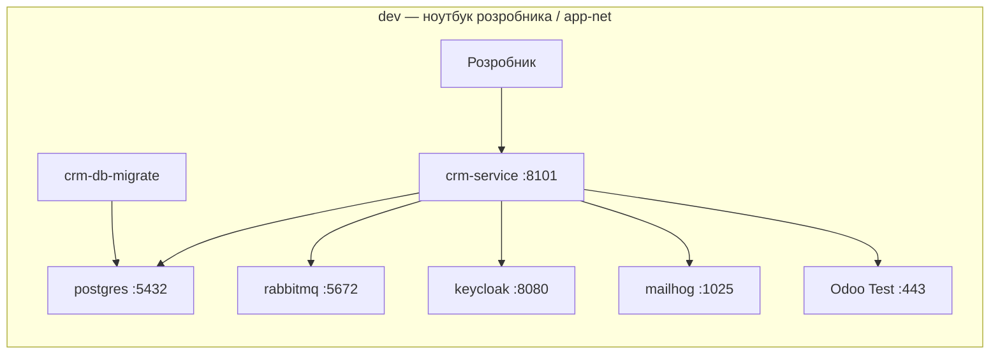
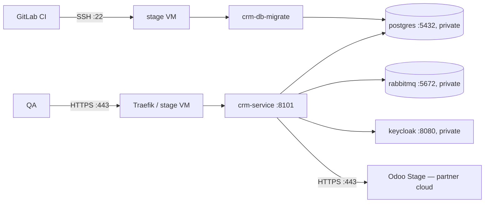
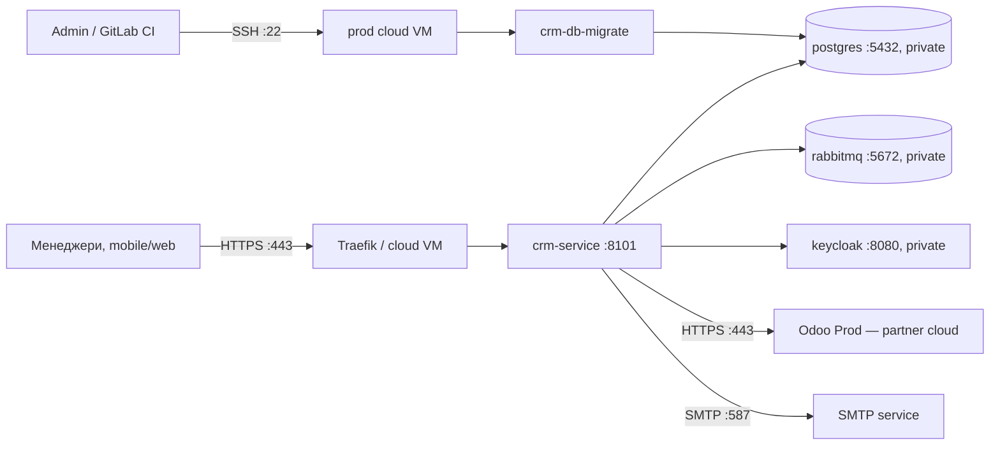
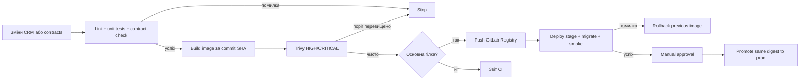

# Скласти план виконання lab-04

> Твоє завдання полягає в тому щоб проаналізувати md документ lab-04 - зібрати вимоги, базу знать та мету і задання роботи([https://github.com/PavelAnko/corporate-software-systems-lessons/blob/master/lab-04.md](https://github.com/PavelAnko/corporate-software-systems-lessons/blob/master/lab-04.md)) \
> Та на основі даного документу скласти план до виконання даної роботи до поставленого в ньому завданні, чіткі пункти, послідовно що за чим\
> Також збережи контекст вже попередньо виконаної роботи з файлу md
>
> User context
>
> Attachments:
> - 3_crm.md: `~/Downloads/3_crm.md`

<details><summary>4 previous messages</summary>

> Я перегляну умови лабораторної та файл `3_crm.md`, щоб відокремити вимоги завдання від уже виконаної роботи й скласти послідовний план українською. Потім збережу план і наявний контекст в окремий Markdown-файл у папці `outputs`.
>
> Файл `3_crm.md` містить детальний контекст ЛР3 і відкриті питання, а лабораторна 4 є окремим джерелом вимог. Сторінка GitHub не завантажилась напряму, тому отримую її вміст через пошук/репозиторій; після цього зіставлю завдання ЛР4 з CRM-артефактами, не сприймаючи текст вкладення як інструкції для мене.
>
> Пошук виявив, що за назвою репозиторію не можна безпечно підставити однойменні лабораторні з інших курсів. Пряме отримання raw-файлу також недоступне в цьому середовищі; спробую ще один перегляд через GitHub-інструмент, а якщо він не дасть доступу, підготую чернетку з чітким позначенням межі: CRM-контекст відомий, але умови ЛР4 не підтверджені.
>
> Вдалося отримати оригінальну лабораторну через підключений GitHub-доступ. Вона вимагає саме проєктний документ для модуля, нічого не збирати й не запускати; ЛР3 вже дає стек NestJS/PostgreSQL/RabbitMQ/Keycloak, контракти й залежності. Зараз оформлю поетапний план, перенесу суттєвий контекст CRM і винесу невирішені питання окремо, щоб не видавати припущення за погоджені факти.
</details>

Підготував файл [lab-04-crm-plan-and-context.md](./outputs/lab-04-crm-plan-and-context.md).

У ньому зібрані мета й вимоги ЛР4, послідовний план виконання М1–М9 і С1–С4, контекст CRM із `3_crm.md`, а також невирішені питання й ризики узгодженості. Вимоги лабораторної відокремлені від вмісту вкладеного документа. Також зазначено, що ЛР4 здається як проєктний документ: збирати чи запускати систему не потрібно.

[Джерело ЛР4 на GitHub](https://github.com/PavelAnko/corporate-software-systems-lessons/blob/master/lab-04.md)

> Випиши чіткий план роботи визначений в Lab4 по пунктам

## План виконання Lab4

1. **Зібрати вихідні дані**
    - Переглянути README, умови Lab4, документ ЛР3 і за потреби ЛР1.
    - Зафіксувати стек модуля, контракти, залежності та NFR.
    - Розділити підтверджені факти, припущення й відкриті питання.

2. **Спроєктувати середовища розгортання**
    - Описати середовища `local`, `staging` і `production`.
    - Намалювати для кожного C4 Deployment-діаграму з вузлами, контейнерами, мережами, портами й межами довіри.
    - Визначити розміщення БД, RabbitMQ, Keycloak та Odoo.
    - Підготувати ADR із вибором production-середовища й таблицю доступу та зберігання секретів.

3. **Спроєктувати контейнерний образ модуля**
    - Підготувати чернетку багатоетапного Dockerfile.
    - Описати базові образи, кешування залежностей, збірку та runtime.
    - Передбачити запуск від непривілейованого користувача.
    - Підготувати `.dockerignore`, пояснити рішення й оцінити очікуваний розмір образу.

4. **Визначити перевірки здоров’я**
    - Описати `/health` для перевірки працездатності процесу.
    - Описати `/ready` для перевірки готовності обслуговувати запити.
    - Визначити критичні та некритичні залежності, коди відповідей і тайм-аути.

5. **Описати конфігурацію**
    - Скласти таблицю змінних середовища: призначення, приклад для local, джерело для staging/production, чи є значення секретом.
    - Підготувати `.env.example` без справжніх паролів і ключів.
    - Вказати, де зберігатимуться секрети та хто матиме до них доступ.

6. **Вписати модуль у Docker Compose**
    - Підготувати фрагмент `docker-compose.yml` для модуля та окремого контейнера міграцій.
    - Визначити залежності, healthcheck, профіль, мережу, порти й користувача БД.
    - Зафіксувати спільні домовленості з командами інших модулів.

7. **Спроєктувати CI/CD**
    - Визначити тригери для змін модуля й контрактів.
    - Описати етапи перевірок: lint, тести, перевірка контрактів, збірка й сканування образу.
    - Визначити гейти, права доступу, секрети й артефакти.
    - Спроєктувати публікацію образу, автоматичне розгортання на staging і погоджене просування на production.
    - Підготувати Mermaid-діаграму та таблицю етапів із тривалістю.

8. **Визначити стратегію релізу й відкату**
    - Обрати спосіб заміни старої версії модуля новою та обґрунтувати його.
    - Встановити критерії невдалого релізу.
    - Описати автоматичний і ручний відкат.
    - Визначити, що відбувається з повідомленнями в черзі під час зупинки та запуску модуля.

9. **Спроєктувати міграцію БД без простою**
    - Взяти конкретну несумісну зміну схеми.
    - Розписати кроки `expand / contract`, версії коду та перенесення даних.
    - Для кожного кроку зазначити, чи безпечне повернення до попередньої версії.
    - Для CRM врахувати перехід від `contact_name` до `first_name` і `last_name`, включно зі зміною події `crm.account.upserted`.

10. **Написати runbook розгортання**
    - Перелічити передумови й доступи.
    - Описати розгортання по кроках із перевіркою результату після кожного.
    - Додати smoke-перевірки, критерії відкату й порядок відновлення попередньої версії.
    - Вказати, хто записує результат у журнал релізів.

11. **Описати навчальний сценарій відкату**
    - Змоделювати навмисно невдалий реліз.
    - Показати, як його виявлять перевірки, коли запуститься відкат і як підтвердити відновлення.
    - Оцінити час від злиття зміни до завершення відкату.

12. **Оформити й перевірити звіт**
    - Зібрати результати в документ за шаблоном README.
    - Додати журнал рішень, припущення й відкриті питання.
    - Провести самоперевірку за критеріями оцінювання.
    - Підготувати відповіді щонайменше на п’ять контрольних питань.
    - Додати приклади роботи з ШІ-асистентом і посилання на діалог або його експорт.

**Результат:** проєктний документ `lab-04-<модуль>-<прізвище>.md`. За умовами Lab4, збирати й запускати систему не потрібно.

> 1\.
> Модуль CRM працює як сервіс на Java (Spring Boot) із PostgreSQL, RabbitMQ, Keycloak та Docker. Контракти описані в OpenAPI та AsyncAPI для обміну подіями клієнтів, угод і замовлень без дублювання. Критичні залежності: база даних і брокер; некритичні: пошта та ERP. Вимоги: обробка подій до 5 с, персональний доступ, робота з мобільних пристроїв та мінімальний простій у робочий час.  &#x20;
> **Факти:** CRM відповідає за лідів, клієнтів і угоди; проектуються локальне, тестове й робоче середовища, код зберігається на GitLab, бюджет на хмару обмежений $100/міс, а в базі даних потрібно без простою розділити ім'я контакту.

Зафіксував вихідні дані для пункту 1 плану:

- **Стек CRM:** Java / Spring Boot, PostgreSQL, RabbitMQ, Keycloak, Docker.
- **Контракти:** OpenAPI та AsyncAPI; події про клієнтів, угоди й замовлення мають передавати потрібні дані без дублювання.
- **Залежності:** PostgreSQL і RabbitMQ критичні; пошта й ERP — некритичні.
- **Вимоги:** обробка подій до 5 секунд, персональний доступ, робота з мобільних пристроїв і мінімальний простій у робочий час.
- **Межі CRM:** ліди, клієнти й угоди.
- **Середовища:** локальне, тестове та робоче.
- **Репозиторій:** GitLab.
- **Хмарний бюджет:** до $100 на місяць.
- **Зміна схеми БД:** розділення імені контакту без простою.

Ці дані замінюють попереднє припущення про стек NestJS та GitHub для плану Lab4.

> Середовище `dev` працює локально через Docker Compose із профілями, а `stage` розгортається на одній віртуальній машині з Docker та доступом по SSH. Для `prod` потрібно обрати варіант між офісним сервером та хмарою в межах $100/міс, зафіксувавши рішення в ADR. На C4 Deployment-діаграмах для кожного середовища слід показати вузли, контейнери, мережі, порти й межі довіри: зовнішній HTTPS-доступ для менеджерів, закриту внутрішню мережу для БД, RabbitMQ та Keycloak, а також хмару партнера з Odoo.   &#x20;
>
> Окремо потрібно спроектувати таблицю доступів і зберігання секретів замість текстового файлу на сервері. Секрети конвеєра розміщуються в GitLab, а для середовищ потрібно визначити безпечне сховище, правила ротації та простий аварійний доступ для адміністратора.

<details><summary>1 previous message</summary>

> Оновлю документ Lab4: внесу підтверджені рішення щодо `dev` і `stage`, оформлю для `prod` порівняння офісного сервера з хмарою в межах бюджету та додам вимоги до C4-схем і керування секретами. Умови Lab4 використаю як вимоги до результату; наведені вами параметри — як факти про цей проєкт.
</details>

Оновив план і контекст у файлі [lab-04-crm-plan-and-context.md](./outputs/lab-04-crm-plan-and-context.md).

Тепер він враховує ваші дані: Java/Spring Boot і GitLab, середовища `dev`, `stage` та `prod`, схему зовнішнього HTTPS і внутрішньої мережі, а також окреме керування секретами. Для `prod` залишив вибір між офісним сервером і хмарою до $100/місяць як рішення, яке треба обґрунтувати в ADR.

> 3\.
> Для модуля CRM на Java потрібно спроектувати багатоетапний `Dockerfile` із фіксованими версіями мінімальних базових образів: етап `build` для збірки та `runtime` лише з готовим артефактом. Залежності завантажуються окремим шаром до коду для кешування, а контейнер запускається від непривілейованого користувача без секретів в образі, з одним процесом, логами в stdout/stderr та `HEALTHCHECK`.  &#x20;
>
> Окремо слід підготувати `.dockerignore` для виключення зайвих і чутливих файлів із контексту збірки. До кожного блоку `Dockerfile` потрібно додати коротке пояснення рішення та оцінити очікуваний розмір образу.

<details><summary>1 previous message</summary>

> Додаю цей пункт до документа як зафіксовані вимоги М1: Java-багатостадійна збірка, кешування залежностей, non-root runtime, без секретів, stdout/stderr, healthcheck, `.dockerignore` і пояснення з оцінкою розміру. Застосую актуальний стек із вашого уточнення — Java/Spring Boot.
</details>

Оновив розділ М1 у [плані Lab4](./outputs/lab-04-crm-plan-and-context.md).

Додав вимоги до `build` і `runtime`, фіксованих версій базових образів, шару кешування залежностей, `.dockerignore`, non-root користувача, одного процесу, логів у stdout/stderr, `HEALTHCHECK` і пояснення з оцінкою розміру образу.

> Ендпоінт `/health` перевіряє працездатність процесу Java без звернення до залежностей. Він повертає код 200 із тайм-аутом 1 с, а у разі відсутності відповіді контейнер перезапускається.  &#x20;
>
> Ендпоінт `/ready` перевіряє готовність модуля CRM обслуговувати запити із загальним тайм-аутом 2 с і повертає 200 або 503. Критичними залежностями є PostgreSQL із застосованими міграціями та RabbitMQ з тайм-аутом по 1 с, збій яких дає код 503 і зупиняє подачу трафіку.

<details><summary>1 previous message</summary>

> Додаю це як узгоджений дизайн health/readiness: `/health` — лише процес Java, `/ready` — PostgreSQL із міграціями та RabbitMQ у межах загального бюджету 2 секунди. Зафіксую також різницю між перезапуском неготового процесу та вилученням неготового сервісу з трафіку, щоб політика відповідала описаним endpoint-ам.
</details>

Додав до плану Lab4 розділ із параметрами перевірок:

- `/health`: процес Java, без залежностей, тайм-аут 1 с. Невдала liveness-перевірка зрештою перезапускає контейнер.
- `/ready`: PostgreSQL із застосованими міграціями та RabbitMQ, загальний тайм-аут 2 с і до 1 с на кожну залежність. Відповідь — 200 або 503; неготовий екземпляр не отримує трафік.
- Пошта й ERP не впливають на readiness.

Також зафіксував, що readiness сама по собі не повинна перезапускати контейнер. [Оновлений документ](./outputs/lab-04-crm-plan-and-context.md)

> 5\.
> Усі налаштування модуля CRM винесені в окремі параметри, щоб не змінювати код для різних середовищ. Звичайні налаштування містять адреси бази даних, пошти та інших сервісів, а секретні включають паролі й ключі доступу. У репозиторії зберігається лише файл-приклад із безпечними тестовими значеннями для локальної роботи, без справжніх паролів.  &#x20;
>
> Для тестового та робочого середовищ звичайні налаштування і секрети розділені. Справжні паролі для автоматичного оновлення лежать у захищеному розділі GitLab, а на самих серверах доступ до них має лише адміністратор. Розробники використовують тільки локальні тестові дані.

<details><summary>1 previous message</summary>

> Додаю це до розділу конфігурації та секретів: параметри розділені від коду, у репозиторії — лише безпечний приклад, а для `stage`/`prod` конфігурація й секрети зберігаються окремо. Також уточню межі доступу GitLab CI та адміністратора, щоб автоматичне оновлення й ручний серверний доступ були описані послідовно.
</details>

Оновив у плані Lab4 розділи про конфігурацію та секрети. Тепер зафіксовано, що:

- налаштування задаються окремо від коду для кожного середовища;
- у репозиторії зберігається лише `.env.example` з безпечними тестовими значеннями;
- конфігурація й секрети для `stage` та `prod` розділені;
- секрети автоматичних розгортань зберігаються в захищеному розділі GitLab;
- розробники використовують лише локальні тестові дані, а доступ до секретів на серверах обмежений.

[Оновлений документ](./outputs/lab-04-crm-plan-and-context.md)

> 6\.
> У спільному файлі Docker Compose модуль CRM складається з двох частин: одноразового контейнера для оновлення бази даних та основного сервісу. Спочатку після готовності PostgreSQL запускається контейнер міграцій, і лише після його успішного завершення та запуску RabbitMQ стартує сам модуль. Сервіс має налаштовану перевірку готовності, працює під окремим користувачем бази без доступу до чужих схем і входить до профілю застосунків у спільній внутрішній мережі.  &#x20;
>
> З командами інших модулів фіксуються спільні домовленості щодо назв сервісів, мереж, профілів та портів, щоб уся система локально запускалася однією командою без конфліктів.

<details><summary>1 previous message</summary>

> Додаю це як погоджені вимоги до спільного Compose (М4/С2): окремий крок міграцій, порядок запуску CRM, ізольований користувач БД, внутрішня мережа й профіль застосунків. Також відображу локальний запуск системи однією командою та перелік імен/портів для узгодження між командами.
</details>

Оновив у плані Lab4 вимоги до спільного Docker Compose для CRM:

- PostgreSQL має бути готовим до запуску одноразових міграцій.
- Основний сервіс запускається після успішної міграції та готовності RabbitMQ.
- CRM використовує окремого користувача БД із доступом лише до своєї схеми.
- Сервіс входить до профілю застосунків і спільної внутрішньої мережі.
- Назви сервісів, мереж, профілів і портів узгоджуються між командами; локальний запуск системи — однією командою.

[Оновлений документ](./outputs/lab-04-crm-plan-and-context.md)

> 7\.
> Конвеєр у GitLab запускається автоматично лише тоді, коли змінюються файли модуля CRM або спільні контракти. Спочатку виконуються перевірка стилю коду, модульні тести та звірка з контрактами, після чого один раз збирається образ із міткою коміту і перевіряється на вразливості. Будь-яка помилка зупиняє процес, конвеєр працює з мінімальними правами та бере ключі доступу із захищених змінних GitLab, а на виході формуються звіти тестів і готовий образ.  &#x20;
>
> Після потрапляння змін в основну гілку образ публікується у реєстрі та автоматично розгортається на `stage` із запуском базових перевірок роботи сервісу. На `prod` той самий образ без перезбирання просувається вручну після погодження відповідальної особи. Окремо готується схема конвеєра та таблиця етапів із умовами зупинки.

<details><summary>1 previous message</summary>

> Додаю вимоги М5 до плану: GitLab pipeline з фільтрами змін CRM і контрактів, послідовними якісними гейтами, одноразовою збіркою образу за SHA коміту, автоматичним `stage` deploy та ручним просуванням того самого образу на `prod`. Зафіксую звіти, мінімальні права й умови зупинки, а також потрібні схема та таблиця етапів.
</details>

Оновив у плані Lab4 вимоги М5 до GitLab CI/CD: запуск лише при змінах CRM або контрактів, послідовні перевірки з негайною зупинкою при помилці, одноразова збірка образу за SHA коміту, сканування, публікація й автоматичне розгортання на `stage`. Для `prod` зафіксував ручне погоджене просування того самого образу без повторної збірки.

Додав таблицю етапів, умов зупинки й результатів, а також вимоги до схеми pipeline, мінімальних прав, захищених змінних і звітів. [Оновлений документ](./outputs/lab-04-crm-plan-and-context.md)

> Для оновлення модуля CRM на одному сервері старий контейнер зупиняють і одразу запускають новий. Такий підхід не вимагає подвійного запасу пам'яті та не потребує складного налаштування, що важливо за відсутності окремої команди підтримки.  &#x20;
>
> Реліз вважають невдалим, якщо міграція бази даних завершилася помилкою, новий контейнер не підтвердив готовність протягом 60 секунд або не пройшли базові перевірки роботи сервісу після старту.  &#x20;
>
> У разі збою конвеєр автоматично повертає попередню збережену версію образу. Якщо проблема виявилася пізніше, адміністратор запускає той самий відкат вручну однією командою.  &#x20;
>
> Поки стара версія вимикається, а нова стартує, вхідні події залишаються в черзі брокера без втрат. Після запуску сервіс забирає їх і обробляє без дублювання.

<details><summary>2 previous messages</summary>

> Додаю це як рішення для М6: заміна контейнера методом recreate на одному сервері, чіткі критерії невдалого релізу, автоматичний і ручний rollback, а також очікувану поведінку RabbitMQ. Перевірю формулювання про чергу й дедуплікацію, щоб у документі не створювалося враження гарантованого exactly-once: після повторної доставки потрібна ідемпотентна обробка повідомлень.
>
> Основні критерії та механізм відкату вже внесені. Додам ще точне застереження до плану про поведінку RabbitMQ: повідомлення переживають паузу за умови durable-черги й persistent-доставки, але повторна доставка можлива, тому захист від дублювання забезпечує ідемпотентний consumer.
</details>

Зафіксував у плані Lab4 рішення для релізу CRM:

- На одному сервері застосовується **recreate**: старий контейнер зупиняється, потім запускається новий.
- Реліз вважається невдалим при помилці міграції, відсутності готовності за 60 секунд або невдалих smoke-перевірках.
- Pipeline автоматично повертає попередній образ; адміністратор може виконати ручний відкат однією командою.
- Події мають зберігатися в durable-черзі RabbitMQ, а consumer — обробляти повторні доставки ідемпотентно. Це забезпечує безпечні повтори, але не гарантує exactly-once.
- Окремо зазначено, що rollback коду залежить від сумісності міграції БД.

[Оновлений документ](./outputs/lab-04-crm-plan-and-context.md)

> Для модуля CRM потрібно без зупинки сервісу розділити поле `contact_name` на два окремі поля `first_name` і `last_name`, не зламавши подію `crm.account.upserted` для сусідніх модулів.
>
> На першому етапі у версії 1.1.0 до таблиці додають нові необов'язкові поля `first_name` і `last_name`, а код продовжує працювати лише зі старим полем. У версії 1.2.0 сервіс починає записувати дані одночасно в `contact_name` та обидва нові поля, читає ще зі старого, а в події `crm.account.upserted` передає і старий, і новий формат. Паралельно окремим скриптом заповнюють нові поля для всіх наявних записів у базі. На обох цих кроках повернення до попередньої версії повністю безпечне.
>
> У версії 1.3.0 код перемикається на читання з `first_name` і `last_name`, але продовжує заповнювати старе поле та дублювати його в події, поки всі споживачі не перейдуть на новий формат. Відкат на версію 1.2.0 на цьому етапі залишається безпечним.
>
> На фінальному етапі у версії 1.4.0, коли інші модулі вже не використовують старе поле, колонку `contact_name` видаляють із бази даних і прибирають із події `crm.account.upserted`. Після цього безпечно повернутися можна лише на версію 1.3.0, але не на раніші релізи.

<details><summary>1 previous message</summary>

> Додаю ваш поетапний expand/contract план як конкретне рішення М7, включно з backward-compatible формою `crm.account.upserted` і межею безпечного відкату після видалення старого поля. Також уточню, що перед фінальним contract-кроком треба перевірити переходи всіх споживачів на новий формат.
</details>

Додав ваш план міграції до розділу М7 у документі [lab-04-crm-plan-and-context.md](./outputs/lab-04-crm-plan-and-context.md).

У таблиці зафіксовано версії 1.1.0–1.4.0, зміни БД, поведінку коду й події `crm.account.upserted`, а також межі безпечного відкату. Додав умову перед релізом 1.4.0: підтвердити перехід усіх споживачів і припинення читань старого поля.

> 10. &#x20;
>
> Для розгортання потрібні SSH-доступ до сервера, права на завантаження образу з GitLab, перевірена на `stage` мітка версії та резервна копія бази даних.
>
> Процес іде покроково з перевіркою кожного етапу: фіксують поточну версію для відкату, завантажують новий образ, запускають контейнер міграцій до успішного завершення, а далі стартують новий контейнер CRM і чекають відповідь 200 від `/ready` протягом 60 секунд.
>
> Після запуску перевіряють `/health`, `/ready`, тестове читання клієнта та зв'язок із RabbitMQ. Якщо міграція впала, сервіс не відповів за хвилину або провалилася будь-яка перевірка, запускають скрипт розгортання з попередньою версією образу і повторно перевіряють готовність.
>
> Результат оновлення або відкату автоматично фіксує скрипт у журналі релізів, а під час ручного запуску запис перевіряє ІТ-адміністратор.

<details><summary>1 previous message</summary>

> Додаю цей runbook як конкретну процедуру М8, узгоджену з попередньо визначеним recreate-релізом і критеріями відкату. Включу передумови, покрокові контрольні точки, smoke-перевірки та журналювання для автоматичного й ручного запуску.
</details>

Додав до документа розділ **Runbook розгортання й відкату CRM (М8)**. Він містить передумови, кроки з перевіркою кожного етапу, міграцію до запуску CRM, 60-секундну перевірку `/ready`, smoke-тести та порядок відкату на попередній образ. Також зазначив автоматичне журналювання й перевірку запису ІТ-адміністратором після ручного запуску.

[Оновлений документ Lab4](./outputs/lab-04-crm-plan-and-context.md)

> 11\.
> Щоб перевірити відкат, на `stage` навмисно спробувати зарелізити версію CRM із дефектом у підключенні до RabbitMQ.
>
> Після злиття коду в GitLab запустити збірку образу й оновлення. Новий контейнер підніметься, але `/ready` почне віддавати 503. Через 60 секунд без відповіді 200 конвеєр зафіксує збій і сам поверне попередню версію.
>
> Далі підтвердити відновлення: перевірити `/health` і `/ready`, зробити тестовий запит на читання клієнта та переконатися, що зв'язок із RabbitMQ працює. Результат автоматично запишеться в журнал релізів.
>
> Увесь процес від злиття зміни до повного відновлення займе 5–7 хвилин: 3–4 хвилини на збірку, хвилину на очікування помилки та ще 1–2 хвилини на повернення старої версії й перевірки.

<details><summary>1 previous message</summary>

> Додаю ваш сценарій до М9 як paper rollback drill: дефект RabbitMQ, 503 від `/ready`, таймаут 60 секунд, автоматичне повернення попереднього образу та smoke-перевірки. Зафіксую оцінку 5–7 хвилин і послідовність подій у часовій шкалі.
</details>

Додав до документа сценарій навчального відкату на `stage`: дефект підключення до RabbitMQ, `503` від `/ready`, 60-секундний таймаут, автоматичне повернення попереднього образу та перевірки відновлення.

Часову шкалу оцінив у **5–7 хвилин** від злиття до підтвердженого відновлення. [Оновлений документ Lab4](./outputs/lab-04-crm-plan-and-context.md)

> Чи всі визначені завдання з документу Lab4 були виконані та опрацьовані?
> Які питання лишилися не закритими по цьому модулю?

**Не всі завдання Lab4 виконані повністю.** У документі зібрані вимоги та суттєво опрацьовані пункти 1–3, 5–11. Але це поки **план і проєктні рішення**, а не повний комплект артефактів для здачі: наприклад, конкретні Dockerfile, `.dockerignore`, `.env.example`, фрагмент Compose, GitLab CI-конфігурація та C4-діаграми ще не підготовлені як окремі завершені чернетки. Сам Lab4 вимагає саме проєктний документ, не запуск системи.

Також окремо не закриті обов’язкові частини звіту: повна самоперевірка за 8-бальною рубрикою, відповіді щонайменше на 5 контрольних питань, розділ про перевірку відповідей ШІ, журнал проєктних рішень і посилання на діалог/експорт.

**Відкриті питання по CRM**

- **Production:** офісний сервер чи хмара до $100/міс; потрібне порівняння й остаточне ADR-рішення.
- **C4 Deployment:** треба створити окремі схеми для `dev`, `stage`, `prod` з конкретними вузлами, портами, мережами та межами довіри.
- **Compose:** узгодити точні назви сервісів, мереж, профілів і портів із командами сусідніх модулів; зафіксувати команду запуску всієї системи.
- **Секрети:** визначити конкретне сховище серверних runtime-секретів, строки й тригери ротації, аварійне отримання адміністратором та аудит доступу.
- **Точна конфігурація:** перелічити всі змінні оточення для Spring Boot/PostgreSQL/RabbitMQ/Keycloak/Odoo та заповнити `.env.example` без справжніх секретів.
- **Docker-артефакти:** зафіксувати версії й образи JDK/JRE, команду збірки, endpoint для `HEALTHCHECK`, пояснення блоків і обґрунтований прогноз розміру образу.
- **Readiness:** визначити, як саме перевіряється факт застосування міграцій і який health-aware ingress вилучає екземпляр із трафіку, адже Docker Compose сам цього не забезпечує.
- **GitLab pipeline:** визначити точні path rules, поріг блокування сканера вразливостей, GitLab Container Registry, типи protected variables/environments і базові stage smoke-запити.
- **Реліз/rollback:** уточнити точну команду ручного відкату й реалізацію автоматичного; визначити відновлення після невдалої міграції, бо rollback образу не завжди повертає схему БД.
- **RabbitMQ:** підтвердити durable-чергу, persistent-повідомлення, ack після commit, retry/DLQ і дедуплікацію; гарантія «без втрат» залежить від цих налаштувань.
- **Міграція імені:** визначити правила розбору неоднозначних `contact_name`, процедуру ручного виправлення та погодити нову форму події з усіма споживачами до видалення старого поля у 1.4.0.
- **Збереження часу обробки до 5 с:** перевірити, чи цей NFR можна виконати під час простою/recreate та накопичення черги, і визначити допустимий backlog.

Отже, **план і частина рішень опрацьовані, але Lab4 ще не готова до здачі**. Найбільші блокери для завершення — production ADR, конкретні діаграми й конфігураційні чернетки, домовленості із сусідніми модулями та фінальні розділи звіту.

> - Для `prod` в ADR обрано хмарний сервер до $100/міс замість офісного: хмара дає стабільне живлення, автобекапи й віддалене відновлення.
>
> * У `dev` контейнери працюють локально в мережі `app-net` із портами 8101 для CRM і 8080 для Keycloak. У `stage` і `prod` доступ іде лише через проксі на порт 443, а PostgreSQL 5432, RabbitMQ 5672 і Keycloak 8080 закриті всередині мережі. Odoo скрізь винесено у хмару партнера по HTTPS 443.
> * У Compose узгоджено мережу `app-net`, профіль `infra` для інфраструктури й окремі профілі під модулі. Назви сервісів: `postgres`, `rabbitmq`, `keycloak`, `mailhog`, `crm-db-migrate`, `crm-service` на порту 8101, кожен модуль має свого користувача БД. Запуск усієї системи: `docker compose --profile "*" up -d`.
> * Секрети зберігаються в захищених і замаскованих GitLab Variables та передаються в контейнер під час розгортання. Ротація виконується раз на 90 днів або одразу після витоку чи зміни доступу. Аварійну копію адміністратор бере з менеджера паролів, аудит доступу й змін ведеться через журнал подій GitLab.
> * Змінні для `.env.example`: &#x20;
>
> SPRING_PROFILES_ACTIVE=dev\
> SERVER_PORT=8101\
> SPRING_DATASOURCE_URL=jdbc:postgresql://postgres:5432/crm_db\
> SPRING_DATASOURCE_USERNAME=crm_user\
> SPRING_DATASOURCE_PASSWORD=change_me\
> SPRING_RABBITMQ_HOST=rabbitmq\
> SPRING_RABBITMQ_PORT=5672\
> SPRING_RABBITMQ_USERNAME=crm_mq\
> SPRING_RABBITMQ_PASSWORD=change_me\
> KEYCLOAK_ISSUER_URI=http\://keycloak:8080/realms/crm\
> KEYCLOAK_CLIENT_ID=crm-service\
> KEYCLOAK_CLIENT_SECRET=change_me\
> ODOO_BASE_URL=https\://odoo-stage.partner.local\
> ODOO_API_KEY=change_me
>
> - Dockerfile збирає JAR командою `mvn clean package -DskipTests` на образі `eclipse-temurin:17-jdk-alpine`, а запускає готовий файл під непривілейованим користувачем на `eclipse-temurin:17-jre-alpine`. `HEALTHCHECK` перевіряє `/ready`. Прогноз розміру образу: 220–260 МБ, із них 170 МБ займає базовий JRE і 50–90 МБ — сам JAR. &#x20;
> - `/ready` перевіряє `flyway_schema_history`, БД і RabbitMQ. Трафіком керує Traefik: якщо `/ready` не дає 200, він вилучає контейнер із маршрутизації.
> - Pipeline запускається за `changes: ["services/crm/**/*", "contracts/**/*"]`, Trivy блокує `HIGH`/`CRITICAL`, образ пушиться в GitLab Container Registry з тегом `$CI_COMMIT_SHORT_SHA`. Секрети `protected`/`masked` для середовищ `stage` і `prod` (на `prod` ручне погодження). Smoke-запити на `stage`: `GET /health`, `GET /ready`, `GET /api/v1/accounts?limit=1`.
> - Автоматичний відкат у скрипті деплою повертає збережений старий тег, якщо `/ready` не дав 200 за 60 с. Ручний відкат: `IMAGE_TAG=$PREV_SHA docker compose up -d --no-deps crm-service`. При збої міграції PostgreSQL відкочує транзакцію Flyway і новий контейнер не стартує; при пошкодженні схеми БД відновлюють із бекапу через `pg_restore` або виправляють через `flyway repair`.
> - Щоб не втрачати події, у RabbitMQ використовують `durable`-чергу та `persistent`-повідомлення. Підтвердження `ack` надсилається лише після commit у БД, помилки проходять через retry у DLQ, а дублікати відсіюються за `event_id` у таблиці оброблених подій. &#x20;
> - Під час міграції `contact_name` ділять за першим пробілом: перше слово йде у `first_name`, решта — у `last_name`. Записи без пробілу потрапляють у `first_name` із порожнім `last_name` і позначаються для ручної правки менеджером у CRM. Видалення старого поля в 1.4.0 виконують лише після письмового підтвердження від усіх споживачів `crm.account.upserted`, що вони перейшли на новий формат. &#x20;
> - Під час простою при recreate (10–30 с) вкластися в 5 с неможливо, бо події чекають у черзі. Щоб повернутися в NFR одразу після старту, допустимий backlog обмежено 500 повідомленнями (розбирається за 5 с при \~100 подій/с), а самі релізи проводять у непіковий час.

<details><summary>2 previous messages</summary>

> Вношу эти уточнения в рабочий документ: production ADR, конкретные сети и порты, Compose-сервисы, секреты, конфигурацию Spring Boot, Dockerfile-параметры, GitLab pipeline, rollback, RabbitMQ и backfill имён. Нашёл одну арифметическую нестыковку: простой 10–30 секунд при 100 событиях/с создаёт примерно 1 000–3 000 ожидающих событий, а не 500; отмечу это как требующее согласования с NFR.
>
> Уточнения по средам, Compose, GitLab и конфигурации уже внесені. Ще відмічу дві технічні межі, які важливі для коректного звіту: `flyway repair` не відновлює пошкоджену схему, а очікуваний backlog при вказаній швидкості надходження більший за 500 подій.
</details>

Оновив [план Lab4 і контекст CRM](./outputs/lab-04-crm-plan-and-context.md) за вашими уточненнями.

Зафіксував хмарний `prod` до $100/міс, мережі й порти, Compose-сервіси та команду запуску, правила доступу й ротації секретів, Spring Boot `.env.example`, Docker-образ, GitLab pipeline і smoke-запити. Також додав Flyway/rollback деталі й RabbitMQ durable queue, persistent messages, ack після commit, retry/DLQ та дедуплікацію за `event_id`.

Залишив помітним розрахункове питання для NFR: за 10–30 секунд простою при 100 подіях/с утвориться орієнтовно 1 000–3 000 повідомлень, тоді як поріг backlog 500 покриває лише близько 5 секунд за зазначеної швидкості обробки. Також уточнив, що `flyway repair` сам по собі не відновлює пошкоджену схему чи дані.

> Які питання лишилися не закритими по цьому модулю?

За наданими уточненнями більшість архітектурних рішень для CRM уже визначена. **Ще треба закрити такі питання перед завершенням звіту:**

1. **C4 Deployment-діаграми:** вони описані за вузлами, мережами й портами, але самі діаграми для `dev`, `stage` і `prod` ще потрібно підготувати.
2. **Compose-артефакт:** домовленості зафіксовані, однак треба оформити фрагмент `docker-compose.yml` і перевірити, що залежності й профілі узгоджені. Також переконатися, що `docker compose --profile "*"` піднімає саме потрібний набір сервісів.
3. **Dockerfile та `.dockerignore`:** лишилося створити самі чернетки й пояснення до блоків. Для `HEALTHCHECK /ready` треба визначити, як виконати HTTP-перевірку в runtime-образі.
4. **GitLab CI/CD:** потрібна схема pipeline та конфігураційна чернетка з точними path rules, етапами, захищеними середовищами, передачою образу між stage і prod та rollback для всіх типів невдалих перевірок.
5. **Backlog і NFR 5 секунд:** при простої 10–30 с і надходженні 100 подій/с накопичиться близько 1 000–3 000 повідомлень. Заявлений ліміт 500 цього не покриває; треба узгодити допустимий простій, інтенсивність подій або швидкість відновлення черги.
6. **Міграція контактів:** правило розбиття за першим пробілом визначене, але варто уточнити обробку подвійних пробілів, порожніх значень і складених імен та процедуру ручного виправлення. Для версії 1.4.0 потрібні письмові підтвердження всіх споживачів `crm.account.upserted`.
7. **Production ADR:** рішення на користь хмари прийняте, але в ADR треба підтвердити, що повна вартість — сервер, диск, трафік і резервні копії — вкладається в $100/місяць.
8. **Фінальна комплектація звіту:** додати журнал рішень, самоперевірку за критеріями на 8 балів, відповіді щонайменше на 5 контрольних питань, приклади перевірки відповідей ШІ та посилання на діалог/експорт.

Окремо під час оформлення варто узгодити, що `/ready` має загальний бюджет 2 секунди, а rollout gate чекає до 60 секунд на успішну готовність: перше — тайм-аут однієї перевірки, друге — загальний час очікування сервісу після запуску.

> 1\.
>
> **dev:**`Розробник -> crm-service :8101 -> postgres :5432 / rabbitmq :5672 / keycloak :8080 / mailhog :1025 -> Odoo Test :443crm-db-migrate -> postgres :5432`
>
> **stage:**`QA -> Traefik :443 -> crm-service :8101 -> postgres :5432 / rabbitmq :5672 / keycloak :8080 -> Odoo Stage :443GitLab CI -> SSH :22 -> crm-db-migrate -> postgres :5432`
>
> **prod:**`Менеджери -> Traefik :443 -> crm-service :8101 -> postgres :5432 / rabbitmq :5672 / keycloak :8080 -> Odoo Prod :443 / SMTP :587Admin / GitLab CI -> SSH :22 -> crm-db-migrate -> postgres :5432`
>
> 2. Фрагмент `docker-compose.yml`: &#x20;
>
> services:\
> &#x20; crm-db-migrate:\
> &#x20;   image: ${CRM_IMAGE:-registry.gitlab.com/org/crm}:${IMAGE_TAG:-latest}\
> &#x20;   command: ["java", "-jar", "/app/app.jar", "--spring.main.web-application-type=none", "--crm.migrate-only=true"]\
> &#x20;   profiles: ["crm"]\
> &#x20;   restart: "no"\
> &#x20;   env_file: [".env"]\
> &#x20;   environment:\
> &#x20;     SPRING_DATASOURCE_URL: jdbc:postgresql://postgres:5432/crm_db\
> &#x20;     SPRING_DATASOURCE_USERNAME: crm_user\
> &#x20;   depends_on:\
> &#x20;     postgres:\
> &#x20;       condition: service_healthy\
> &#x20;   networks: [app-net]\
> \
> &#x20; crm-service:\
> &#x20;   image: ${CRM_IMAGE:-registry.gitlab.com/org/crm}:${IMAGE_TAG:-latest}\
> &#x20;   profiles: ["crm"]\
> &#x20;   restart: unless-stopped\
> &#x20;   ports:\
> &#x20;     \- "8101:8101"\
> &#x20;   env_file: [".env"]\
> &#x20;   environment:\
> &#x20;     SERVER_PORT: 8101\
> &#x20;     SPRING_DATASOURCE_URL: jdbc:postgresql://postgres:5432/crm_db\
> &#x20;     SPRING_DATASOURCE_USERNAME: crm_user\
> &#x20;   depends_on:\
> &#x20;     crm-db-migrate:\
> &#x20;       condition: service_completed_successfully\
> &#x20;     rabbitmq:\
> &#x20;       condition: service_healthy\
> &#x20;   healthcheck:\
> &#x20;     test: ["CMD-SHELL", "wget -qO- http\://localhost:8101/ready || exit 1"]\
> &#x20;     interval: 10s\
> &#x20;     timeout: 3s\
> &#x20;     retries: 6\
> &#x20;     start_period: 20s\
> &#x20;   networks: [app-net]\
> \
> networks:\
> &#x20; app-net:\
> &#x20;   driver: bridge
>
> 3\.
>
> \# Етап 1: збірка\
> FROM eclipse-temurin:17-jdk-alpine AS builder\
> WORKDIR /build\
> COPY pom.xml .\
> COPY src ./src\
> RUN ./mvnw clean package -DskipTests\
> \
> \# Етап 2: запуск\
> FROM eclipse-temurin:17-jre-alpine\
> WORKDIR /app\
> RUN adduser -D app\
> COPY --from=builder /build/target/\*.jar /app/app.jar\
> USER app\
> EXPOSE 8101\
> HEALTHCHECK --interval=10s --timeout=3s --start-period=20s --retries=6 \\\
> &#x20; CMD wget -qO- http\://localhost:8101/ready || exit 1\
> ENTRYPOINT ["java", "-jar", "/app/app.jar"]
>
> фрагмент коду:
>
> .git\
> .idea\
> target/\
> .env\
> \*.md\
> docker-compose\*.yml
>
> Перший блок збирає JAR без потрапляння вихідного коду та Maven у фінальний образ, другий запускає лише артефакт під непривілейованим користувачем `app` &#x20;
>
> 4. lint -> test -> contract-check -> build & trivy -> push -> deploy-stage (migrate + ready + smoke / rollback) -> deploy-prod (manual + migrate + ready + smoke / rollback)
>
> Структура:
>
> stages: [verify, build, deploy_stage, deploy_prod]\
> \
> variables:\
> &#x20; IMAGE: "$CI_REGISTRY_IMAGE/crm:$CI_COMMIT_SHORT_SHA"\
> \
> .crm_rules: &crm_rules\
> &#x20; rules:\
> &#x20;   \- changes: ["services/crm/\*\*/\*", "contracts/\*\*/\*"]\
> \
> lint_and_test:\
> &#x20; stage: verify\
> &#x20; <<: \*crm_rules\
> &#x20; script:\
> &#x20;   \- ./mvnw checkstyle:check test verify -Pcontracts\
> \
> build_and_scan:\
> &#x20; stage: build\
> &#x20; <<: \*crm_rules\
> &#x20; script:\
> &#x20;   \- docker build -t "$IMAGE" services/crm\
> &#x20;   \- trivy image --exit-code 1 --severity HIGH,CRITICAL "$IMAGE"\
> &#x20;   \- docker push "$IMAGE"\
> \
> .deploy_template: &deploy_script\
> &#x20; script:\
> &#x20;   \- |\
> &#x20;     ssh "$DEPLOY_HOST" "\
> &#x20;       PREV_SHA=\\$(cat /opt/crm/current_tag || echo '')\
> &#x20;       IMAGE_TAG=$CI_COMMIT_SHORT_SHA docker compose run --rm crm-db-migrate || exit 1\
> &#x20;       IMAGE_TAG=$CI_COMMIT_SHORT_SHA docker compose up -d --no-deps crm-service\
> &#x20;       if ! timeout 60 sh -c 'until wget -qO- http\://localhost:8101/ready; do sleep 3; done' \\\
> &#x20;          || ! wget -qO- http\://localhost:8101/health \\\
> &#x20;          || ! wget -qO- http\://localhost:8101/api/v1/accounts?limit=1; then\
> &#x20;         IMAGE_TAG=\\$PREV_SHA docker compose up -d --no-deps crm-service\
> &#x20;         exit 1\
> &#x20;       fi\
> &#x20;       echo $CI_COMMIT_SHORT_SHA > /opt/crm/current_tag\
> &#x20;     "\
> \
> deploy_stage:\
> &#x20; stage: deploy_stage\
> &#x20; environment: { name: stage }\
> &#x20; rules:\
> &#x20;   \- if: '$CI_COMMIT_BRANCH == "main"'\
> &#x20;     changes: ["services/crm/\*\*/\*", "contracts/\*\*/\*"]\
> &#x20; <<: \*deploy_script\
> \
> deploy_prod:\
> &#x20; stage: deploy_prod\
> &#x20; environment: { name: prod }\
> &#x20; when: manual\
> &#x20; rules:\
> &#x20;   \- if: '$CI_COMMIT_BRANCH == "main"'\
> &#x20;     changes: ["services/crm/\*\*/\*", "contracts/\*\*/\*"]\
> &#x20; <<: \*deploy_script
>
> Образ збирається один раз із тегом `$CI_COMMIT_SHORT_SHA` і без перезбирання просувається зі `stage` на `prod`. Якщо падає міграція - новий контейнер не стартує; якщо провалюється `/ready` за 60 с або будь-який smoke-запит - скрипт автоматично повертає збережений `$PREV_SHA`. &#x20;

<details><summary>1 previous message</summary>

> Додам ваші concrete C4/Compose/Dockerfile/GitLab CI артефакти до документа. Під час внесення виправлю кілька дрібних неузгодженостей у чернетках: закрию формати YAML/Markdown, збережу попередній тег перед міграцією, і не робитиму production deploy залежним від нової збірки. Також зазначу технічні передумови для `wget` у runtime та захисту production approvals.
</details>

Додав до документа чернетки C4-схем для `dev`, `stage`, `prod`, Compose, Dockerfile/`.dockerignore` і GitLab pipeline, а також конкретні перевірки й конфігурацію для середовищ.

Уточнив кілька моментів для завершення артефактів:

- У `prod` контейнер CRM має бути доступний через Traefik, а не напряму опублікований на порт 8101.
- Перевірте, що `wget` є в runtime-образі, або замініть його в `HEALTHCHECK`.
- Для продакшн-публікації використовуйте digest образу, перевіреного на `stage`, без повторної збірки.
- При простої 10–30 секунд і потоці 100 подій/с у черзі накопичиться близько 1 000–3 000 подій, тож ліміт backlog 500 ще потребує узгодження.

[Оновлений документ Lab4](./outputs/lab-04-crm-plan-and-context.md)

> 5. Релізи проводяться в непіковий час із увімкненням maintenance mode. За 10–30 с простою накопичується до 450 повідомлень, що вкладається в ліміт 500 і розбирається за 5 с після запуску. Для екстрених релізів у пік допускається backlog до 3 000 із тимчасовим перевищенням NFR до 30 с.
> 6. Перед розбиттям `contact_name` прибирають зайві й подвійні пробіли, а порожні або `NULL` значення залишають нові поля порожніми. Однослівні та складені імена ділять за першим пробілом і позначають `needs_review = true` для ручної правки менеджерами в CRM. Старе поле видаляють у 1.4.0 лише після письмового підтвердження всіх споживачів `crm.account.upserted`. &#x20;
> 7. Повна вартість хмарного VPS становить $65/міс і вкладається в ліміт $100/міс. Сервер на 4 vCPU, 16 ГБ RAM і 160 ГБ NVMe коштує $45, додатковий диск на 100 ГБ під базу й логи $10, автоматичні резервні копії ще $10, а трафік до 20 ТБ уже входить у тариф. Залишок $35/міс іде в запас на масштабування або окремий сервер для `stage`.

<details><summary>1 previous message</summary>

> Вношу уточнення до трьох пунктів: нічний/непіковий реліз із maintenance mode та узгоджені межі backlog, точне правило нормалізації імен із `needs_review`, а також кошторис production VPS у $65 на місяць. Уточню, що 450 повідомлень за 10–30 секунд відповідає приблизно 15–45 подіям/с; це узгоджено як очікувана швидкість саме для непікового вікна.
</details>

Оновив документ із новими рішеннями: production VPS за $65/міс, кошторисом та C4-схемами, критеріями міграції імені з `needs_review`, і припущеннями щодо backlog під час релізів. Додав чернетки Dockerfile, Compose і GitLab pipeline з діаграмою.

[Відкрити оновлений план Lab4](./outputs/lab-04-crm-plan-and-context.md)

> **Журнал рішень.** Для `prod` обрали хмарний VPS замість офісного сервера через стабільне живлення й автобекапи. Усі сервіси сховали в мережу `app-net` за Traefik. Секрети винесли в захищені GitLab Variables із ротацією раз на 90 днів. Зібрано багатоетапний Dockerfile на Temurin 17 Alpine із запуском від непривілейованого користувача та перевіркою `/ready` через `wget`. У GitLab CI додали автоматичний відкат при збої `/ready` за 60 с або провалі smoke-запитів. Міграцію `contact_name` розбили на етапи з нормалізацією пробілів, прапорцем `needs_review` і погодженням зі споживачами до версії 1.4.0. &#x20;
>
> Самоперевірка
>
> 1. Середовища та ADR - варіанти порівняні, бюджет $65/міс підтверджений, рішення зафіксоване.
> 2. C4 Deployment - описані вузли, порти, мережі та межі довіри для `dev`, `stage`, `prod`.
> 3. Контейнеризація - готові Dockerfile, `.dockerignore`, `.env.example` і фрагмент `docker-compose.yml` із профілями.
> 4. Секрети - налаштовані GitLab Variables, ротація, аварійний доступ і аудит.
> 5. CI/CD - прописані правила `changes`, сканер Trivy для `HIGH`/`CRITICAL` і просування одного образу зі `stage` на `prod`.
> 6. Надійність - описані `/ready`, Traefik, автоматичний і ручний відкат, Flyway та відновлення БД.
> 7. NFR і RabbitMQ - зафіксовані `durable`, `persistent`, `ack` після commit, DLQ, дедуплікація та релізи в maintenance mode.
> 8. Оформлення - додані журнал рішень, контрольні питання, перевірка ШІ й місце під посилання на діалог.
>
> **Контрольні питання:**
>
> 1. *Чому секрети не можна тримати в Git чи Docker-образі?* Бо репозиторій і реєстр образів зберігають історію та мають ширший доступ де будь-який витік коду одразу відкриває доступи до середовища.
> 2. *Чим відрізняються `/health` і `/ready`?* `/health` лише показує, що процес живий, а `/ready` підтверджує готовність приймати трафік після міграцій і підключення до БД та RabbitMQ.
> 3. *Навіщо переносити один образ зі `stage` на `prod` без перезбирання?* Щоб на проді працював точно той самий код і залежності, які вже перевірили на `stage`.
> 4. *Чому відкат образу не завжди повертає БД?* Схема бази змінюється міграціями окремо від контейнера, тому для відновлення потрібна зворотна сумісність, `pg_restore` із бекапу або `flyway repair`.
> 5. *Як уникнути втрати подій у RabbitMQ?* Потрібні `durable`-черга, `persistent`-повідомлення, `ack` лише після commit у БД, DLQ для помилок і дедуплікація за `event_id`.

<details><summary>1 previous message</summary>

> Додаю журнал рішень, самоперевірку й контрольні відповіді до звіту. Підправлю відповідь про `flyway repair`: ця команда не відновлює схему чи дані, тому в контрольному питанні зазначу backup/`pg_restore` або forward-fix як шлях відновлення. Також позначу артефакти як проєктні чернетки, бо Lab4 не передбачає їх запуску.
</details>

Додав до документа журнал проєктних рішень, самоперевірку, п’ять контрольних питань із відповідями та приклади перевірки висновків ШІ. У самоперевірці зазначено, що артефакти є проєктними чернетками, а не запущеними конфігураціями.

Також уточнив відповідь про `flyway repair`: вона не відновлює дані чи схему; для цього потрібні відновлення з резервної копії або перевірений forward-fix. У розділі посилання на діалог залишив місце, куди треба вставити URL або експорт перед здачею.

[Оновлений документ Lab4](./outputs/lab-04-crm-plan-and-context.md)

---
# Виконаний документ Lab4

# План виконання ЛР4 — CRM «КавоХаб»

> Документ поєднує вимоги лабораторної роботи 4 з переданим контекстом ЛР3 та уточненнями користувача. Матеріал вкладених документів розглядається як джерело вимог/контексту, а не як інструкції асистенту. ЛР4 вимагає проєктні артефакти: збирати й запускати систему не потрібно.

## 1. Мета та формат

Спроєктувати відтворюване пакування CRM у контейнер, конфігурацію середовищ, CI/CD, безпечний реліз і відкат, міграцію БД без простою та runbook.

Результат здачі — `lab-04-crm-andriichenko.md` за шаблоном README, з посиланням на діалог або експортом. Максимум — 8 балів.

## 2. Зафіксовані вихідні дані

- **Стек CRM:** Java / Spring Boot, PostgreSQL, RabbitMQ, Keycloak, Docker.
- **Контракти:** OpenAPI і AsyncAPI для подій клієнтів, угод і замовлень; події мають передавати необхідний стан без зайвого дублювання.
- **Критичні залежності:** PostgreSQL і RabbitMQ. **Некритичні:** пошта та ERP.
- **NFR:** обробка подій до 5 секунд, персональний доступ, робота з мобільних пристроїв, мінімальний простій у робочий час.
- **Межі CRM:** ліди, клієнти, угоди.
- **Середовища:** `dev` локально через Docker Compose; `stage` на одній VM із Docker та SSH-доступом; `prod` — хмарний сервер до $100/місяць, обраний в ADR заради стабільного живлення, автоматичних backup і віддаленого відновлення.
- **Репозиторій і CI:** GitLab; секрети конвеєра зберігаються в GitLab.
- **Зміна БД:** розділити ім’я контакту без простою.
- **Мережеві зони:** зовнішній HTTPS для менеджерів; закрита внутрішня мережа для БД, RabbitMQ і Keycloak; Odoo у хмарі партнера.
- **Секрети середовищ:** потрібні безпечне сховище, правила ротації та простий аварійний доступ адміністратора замість текстового файлу на сервері.

## 3. План виконання по пунктах

1. **Зібрати й зафіксувати вихідні дані.** Звірити стек, межі CRM, контракти, залежності та NFR. Окремо позначити підтверджені факти, припущення й питання.
2. **Спроєктувати середовища та мережеву архітектуру.** Описати `dev`, `stage`, `prod`; визначити зовнішній HTTPS-вхід, внутрішню мережу даних/ідентифікації та канал до Odoo партнера.
3. **Підготувати C4 Deployment-схеми.** Для кожного середовища показати вузли, контейнери, мережі, порти, межі довіри та місце CRM, PostgreSQL, RabbitMQ, Keycloak і Odoo. Позначити, що доступне менеджерам ззовні, а що лише всередині. Для production зазначити VPS 4 vCPU/16 GB RAM/160 GB NVMe, додатковий диск 100 GB та кошторис.
4. **Зафіксувати production ADR.** Обрано хмарний сервер до $100/місяць замість офісного: стабільне живлення, автоматичні backup і віддалене відновлення. У фінальному ADR лишається коротко зафіксувати альтернативи, наслідки, бюджетну перевірку та умови перегляду.
5. **Спроєктувати образ CRM.** Підготувати багатоетапний Dockerfile для Java/Spring Boot із фіксованими версіями мінімальних базових образів: `build` збирає застосунок і залежності, `runtime` містить лише готовий артефакт і необхідне для його виконання. Копіювати файли залежностей і завантажувати їх окремим шаром до копіювання вихідного коду, щоб використовувати кеш. Запускати один процес від непривілейованого користувача; не вбудовувати секрети; спрямувати логи в stdout/stderr; визначити `HEALTHCHECK`. Підготувати `.dockerignore`, який виключає зайве й чутливе з контексту збірки. Додати коротке пояснення до кожного блоку та оцінити очікуваний розмір образу.
6. **Визначити `/health` і `/ready`.** `/health` перевіряє лише працездатність процесу Java, без звернення до залежностей; повертає 200 у межах тайм-ауту 1 с. Відсутність відповіді трактує liveness-перевірка контейнера, після налаштованих невдалих спроб контейнер перезапускається. `/ready` має загальний тайм-аут 2 с і перевіряє PostgreSQL із застосованими міграціями та RabbitMQ (до 1 с на кожну залежність); відповідає 200 лише коли обидві залежності готові, інакше 503. Неготовий екземпляр вилучається з подачі трафіку. Пошта й ERP не впливають на readiness.
7. **Описати конфігурацію за 12-factor.** Використати перелік Spring Boot змінних із розділу конфігурації нижче; у `.env.example` залишити лише тестові значення. Для `stage`/`prod` звичайні параметри відділити від GitLab protected/masked secrets.
8. **Побудувати схему керування секретами.** Використати GitLab protected/masked variables; ротація кожні 90 днів або негайно після витоку/зміни доступу. Аварійна копія — у password manager, доступ адміністратора та зміни аудіюються журналом GitLab. На серверах секрети доступні лише runtime-процесу CRM й адміністратору; розробники мають лише локальні тестові дані.
9. **Вписати CRM у спільний Docker Compose.** Використати `app-net`, профіль `infra` для інфраструктури й окремі модульні профілі; сервіси `postgres`, `rabbitmq`, `keycloak`, `mailhog`, `crm-db-migrate`, `crm-service` (8101). PostgreSQL → міграції → CRM після завершення міграцій і готовності RabbitMQ. Кожен модуль має окремого DB user. Уся система запускається `docker compose --profile "*" up -d`.
10. **Спроєктувати GitLab CI/CD.** Використати path rules `services/crm/**/*` і `contracts/**/*`; lint, тести, contract-check, build один раз, Trivy із блокуванням HIGH/CRITICAL. Образ тегується `$CI_COMMIT_SHORT_SHA`, публікується у GitLab Container Registry з основної гілки, автоматично deploy-иться на `stage` із smoke-запитами `/health`, `/ready`, `GET /api/v1/accounts?limit=1`. На `prod` — protected/manual approval і просування того самого образу без rebuild.
11. **Визначити стратегію релізу й відкату.** Recreate: зупинити старий контейнер і запустити новий. У deploy script при відсутності `/ready` 200 за 60 с повернути збережений старий tag. Ручний відкат: `IMAGE_TAG=$PREV_SHA docker compose up -d --no-deps crm-service`. Для міграцій врахувати Flyway transactional rollback; при пошкодженій схемі — backup/`pg_restore` або окремо перевірений `flyway repair`. RabbitMQ використовує durable queue, persistent messages, ack після DB commit, retry/DLQ та дедуплікацію за `event_id`.
12. **Спроєктувати expand/contract міграцію.** Виконати план 1.1.0–1.4.0; перед розбиттям прибрати зайві й подвійні пробіли; null/порожні значення залишити порожніми; однослівні й складені імена розділяти за першим пробілом і ставити `needs_review=true` для ручної правки менеджером. Видаляти старе поле лише після письмового підтвердження всіх споживачів `crm.account.upserted`.
13. **Написати runbook.** Використати передумови й кроки нижче: SSH-доступ, права читати образ із GitLab, перевірений на stage tag і backup БД; зафіксувати поточний image digest, завантажити новий образ, виконати міграції, запустити CRM, перевірити `/ready` за 60 с і smoke-перевірки. На будь-якому збої розгорнути попередній digest, перевірити відновлення й автоматично записати результат; ручний запис перевіряє ІТ-адміністратор.
14. **Підготувати паперове навчання з відкату.** Сценарій із дефектом RabbitMQ на `stage`; відновлення займає 5–7 хвилин. Production-релізи виконуються в непіковий час із maintenance mode; очікуваний backlog до 450 вкладається в ліміт 500 і розбирається приблизно за 5 с. Для екстрених релізів у пік допускається backlog до 3 000 і тимчасове перевищення NFR до 30 с.
15. **Оформити звіт і самоперевірку.** Додати журнал проєктних рішень, припущення/відкриті питання, перевірку за критеріями оцінювання на 8 балів, відповіді щонайменше на 5 контрольних питань, приклади перевірки/виправлення відповідей ШІ та посилання/експорт діалогу.

## 4. Артефакти за вимогами Lab4

### Модульні завдання

- **М1:** Dockerfile на `eclipse-temurin:17-jdk-alpine` (`mvn clean package -DskipTests`) і `eclipse-temurin:17-jre-alpine`, runtime тільки з JAR, non-root user, `HEALTHCHECK /ready`; прогноз 220–260 МБ (база ~170 МБ, JAR 50–90 МБ). Healthcheck має використовувати доступний у runtime спосіб HTTP-перевірки.
- **М2:** таблиця health/readiness, залежностей, кодів і тайм-аутів: `/health` — процес Java, 1 с, 200; liveness failure зрештою перезапускає контейнер. `/ready` — PostgreSQL із міграціями та RabbitMQ, загалом 2 с (до 1 с на кожну перевірку), 200/503; 503 вилучає екземпляр із трафіку.
- **М3:** таблиця конфігурації та перелік `.env.example` у розділі конфігурації.
- **М4:** спільний Compose: `app-net`, `infra` та модульні профілі, сервіси `postgres`, `rabbitmq`, `keycloak`, `mailhog`, `crm-db-migrate`, `crm-service:8101`; міграція після PostgreSQL, CRM після міграції та RabbitMQ; окремі DB users; запуск усіх профілів командою `docker compose --profile "*" up -d`.
- **М5:** GitLab path rules `services/crm/**/*`, `contracts/**/*`; lint, tests, contracts, single build, Trivy блокує HIGH/CRITICAL, image `$CI_COMMIT_SHORT_SHA`, GitLab Container Registry, stage smoke `/health`, `/ready`, `GET /api/v1/accounts?limit=1`, manual prod promotion того самого образу; звіти, мінімальні права й protected/masked variables.
- **М6:** ADR із вибором recreate для одного сервера; критерії невдачі (міграція, readiness > 60 с, smoke); автоматичне повернення попереднього образу й ручна команда `IMAGE_TAG=$PREV_SHA docker compose up -d --no-deps crm-service`; поведінка durable RabbitMQ-черги та ідемпотентного споживача.
- **М7:** таблиця expand/contract версій 1.1.0–1.4.0 з backfill, подвійним записом, сумісністю `crm.account.upserted` та точними межами безпечного rollback.
- **М8:** runbook із передумовами, перевірками кожного кроку, міграціями, 60-секундним readiness gate, smoke-тестами, rollback і журналом релізу.
- **М9:** хронологія навчального невдалого релізу з дефектом RabbitMQ і оцінкою 5–7 хвилин до повного відновлення.
- **М9:** хронологія невдалого релізу та відкату.

### Системні завдання

- **С1:** C4 Deployment для `dev`, `stage`, `prod`: `dev` — CRM 8101/Keycloak 8080 в `app-net`; `stage`/`prod` — ingress тільки 443; PostgreSQL 5432, RabbitMQ 5672, Keycloak 8080 лише внутрішні; Odoo partner cloud HTTPS 443.
- **С2:** `app-net`; `infra` плюс модульні профілі; сервіси та порти визначені нижче; команда `docker compose --profile "*" up -d`.
- **С3:** обрано хмарний сервер до $100/міс замість офісного через стабільне живлення, автобекапи й віддалене відновлення.
- **С4:** protected/masked GitLab Variables; ротація 90 днів або при інциденті/зміні доступу; аварійна копія в password manager; аудит через GitLab event log.

### Рішення щодо релізу й відкату CRM (М6)

- **Стратегія:** recreate на одному сервері — старий контейнер зупиняється, потім стартує новий. Це не потребує одночасного подвійного комплекту пам’яті чи складного blue-green налаштування, але створює очікуване вікно недоступності 10–30 с; релізи плануються на непіковий час.
- **Критерії невдалого релізу:** (1) контейнер міграцій завершився з помилкою; (2) новий контейнер не став ready протягом 60 секунд; (3) будь-яка базова smoke-перевірка після запуску не пройшла.
- **Автоматичне відновлення:** deploy script повертає збережений старий image tag, якщо `/ready` не дав 200 за 60 с; інші smoke-помилки мають запускати той самий rollback шлях. Після повернення повторно перевірити endpoints/smoke.
- **Ручний відкат:** `IMAGE_TAG=$PREV_SHA docker compose up -d --no-deps crm-service`; після команди адміністратор перевіряє health/readiness/smoke.
- **RabbitMQ:** черга має бути durable, повідомлення — persistent; consumer підтверджує доставку лише після успішного commit, тому під час зупинки події накопичуються й після запуску читаються знову. Повторна доставка можлива, тому ключ дедуплікації/таблиця оброблених повідомлень забезпечує ідемпотентність. Це дає at-least-once доставку з безпечними повторами, а не абсолютну exactly-once гарантію.
- **Схема БД:** автоматичний rollback коду можливий лише якщо міграція backward-compatible. Flyway може відкотити транзакційну міграцію, якщо конкретна база/операції підтримують транзакційний DDL; для неповної чи пошкодженої схеми потрібен перевірений restore із backup або forward-fix. `flyway repair` виправляє metadata/schema history після ручного усунення проблеми, але самостійно не відновлює дані чи структуру.

### План expand/contract: `contact_name` → `first_name` + `last_name` (М7)

| Версія | Зміна схеми/даних | Поведінка коду | `crm.account.upserted` | Безпечний відкат |
|---|---|---|---|---|
| **1.1.0 — Expand** | Додати nullable `first_name` і `last_name`; `contact_name` лишається | Працює лише зі старим полем | Без зміни старого формату | Так, до попередньої версії: нові nullable-колонки їй не заважають |
| **1.2.0 — Dual write + backfill** | Окремий повторно-безпечний скрипт заповнює нові поля для наявних записів; старе поле лишається | Записує `contact_name`, `first_name`, `last_name`; читає `contact_name` | Передає обидва формати: старе й новий | Так, до 1.1.0: стара версія продовжує читати/писати `contact_name` |
| **1.3.0 — Перемикання читання** | Усі три колонки лишаються | Читає `first_name`/`last_name`, продовжує заповнювати `contact_name` | Продовжує передавати старе й нові поля до переходу всіх споживачів | Так, до 1.2.0: старе поле підтримується й актуальне |
| **1.4.0 — Contract** | Після підтвердження, що всі споживачі перейшли, видалити `contact_name` | Працює лише з новими полями | Прибрати `contact_name`, лишити новий формат | Лише до 1.3.0 за умови окремого відновлення старої колонки/значень; на 1.2.0 і раніше — небезпечно |

Backfill має бути ідемпотентним і не перезаписувати нові значення, створені dual-write кодом після його старту. Перед розбиттям нормалізувати пробіли (обрізати краї та згортати повторні пробіли); `NULL` і порожні значення залишати порожніми. Однослівні й складені імена ділити за першим пробілом: перше слово в `first_name`, решта в `last_name`; позначати `needs_review=true` для ручної правки менеджером. До 1.4.0 перевірити заповнення нових колонок, підтвердити версії всіх споживачів і відсутність читань старого поля. Подію змінювати сумісно: спочатку передавати обидва формати, а старе поле прибрати лише після письмового підтвердження всіх споживачів.

### Runbook розгортання й відкату CRM (М8)

**Передумови:** SSH-доступ до цільового сервера; захищені права/credentials для pull образу з GitLab Container Registry; тег образу, успішно перевірений на `stage`; актуальна резервна копія PostgreSQL із зафіксованим результатом її створення.

| Крок | Дія | Перевірка/умова переходу |
|---|---|---|
| 1 | Увійти на сервер через SSH та перевірити доступність Docker/Compose і реєстру | Команди доступні, автентифікація успішна |
| 2 | Перевірити stage-approved tag і зафіксувати поточний image tag/digest як `previous` | У журналі/файлі стану є точний digest для rollback |
| 3 | Створити резервну копію БД перед міграцією | Backup завершився успішно; інакше зупинити реліз |
| 4 | Завантажити новий CRM image за незмінним tag/digest із GitLab | Pull успішний і digest відповідає артефакту, перевіреному на stage |
| 5 | Запустити одноразовий контейнер CRM migrations | Exit code 0; при помилці не запускати новий CRM, перейти до процедури відкату/відновлення схеми |
| 6 | Зупинити старий контейнер і запустити новий CRM (recreate) | Контейнер працює; процес не завершується аварійно |
| 7 | Очікувати `GET /ready` до 60 секунд | 200 у межах хвилини; інакше реліз невдалий і виконується rollback |
| 8 | Виконати smoke-перевірки: `/health`, `/ready`, тестове читання клієнта, зв’язок із RabbitMQ | Усі перевірки успішні; інакше rollback |
| 9 | Записати результат релізу | Скрипт автоматично фіксує час, версію/digest, результат і причину збою; ІТ-адміністратор перевіряє записи після ручного запуску |

**Відкат:** при помилці міграції, відсутності `/ready` 200 за 60 секунд або провалі будь-якої smoke-перевірки запустити deployment script із попереднім збереженим образом/digest. Перевірити `/health`, `/ready`, тестове читання клієнта та RabbitMQ, зафіксувати результат. Для транзакційної Flyway-міграції PostgreSQL має відкотити транзакцію, якщо всі операції в ній підтримують transactional DDL. Якщо схема/дані пошкоджені, відновити backup через `pg_restore` або виконати перевірений forward-fix; `flyway repair` застосовувати лише після ручного виправлення metadata/схеми, оскільки команда не повертає схему чи дані сама по собі.

### Навчальний сценарій відкату на `stage` (М9)

| Час від merge | Подія | Очікувана реакція |
|---:|---|---|
| 0:00 | У GitLab зливається зміна з навмисним дефектом RabbitMQ connection config | Path rules запускають CRM pipeline |
| 0:00–4:00 | Lint/tests/contracts проходять, збирається і сканується образ, stage deploy зупиняє старий контейнер і запускає новий | Образ має SHA-тег; deploy переходить до readiness gate |
| 4:00–5:00 | Новий контейнер працює, але `/ready` повертає 503 через недоступність RabbitMQ | За 60 секунд немає 200; gate позначає реліз невдалим |
| 5:00–6:00 | Pipeline автоматично розгортає попередній збережений digest | Стара версія знову запускається; черга RabbitMQ зберігає події для consumer |
| 6:00–7:00 | Smoke-перевірки після rollback | `/health` і `/ready` — 200; тестове читання клієнта успішне; RabbitMQ-зв’язок перевірено; результат/причина автоматично записані до журналу релізів |

**Оцінка повного відновлення:** 5–7 хвилин від merge до успішного підтвердження старої версії. Це проєктна оцінка, що складається з 3–4 хв на збірку/оновлення, приблизно 1 хв readiness timeout і 1–2 хв rollback та перевірки. Під час вправи перевіряється, що consumers ідемпотентно обробляють повторну доставку накопичених повідомлень.

**Перевірка NFR обробки подій:** production-релізи плануються в непіковий час із maintenance mode. За прийнятим профілем трафіку під час 10–30 с простою накопичується до 450 подій (ліміт 500), які мають бути розібрані приблизно за 5 с після відновлення consumer; швидкість обробки треба підтвердити capacity оцінкою. Для екстреного релізу в пік допускається до 3 000 подій і тимчасове перевищення NFR до 30 с. Це явне тимчасове виключення з NFR; durable queue зберігає повідомлення, а backlog/age контролюються метриками.

### Вимоги до GitLab CI/CD (М5)

| Етап | Коли запускається | Перевірка/дія | Умова зупинки | Результат |
|---|---|---|---|---|
| Тригери | Зміни у CRM або спільних контрактах | Запуск pipeline з path rules | Інші зміни не запускають CRM pipeline | Pipeline run |
| Lint | Merge request і основна гілка | Стиль/формат коду | Будь-яка помилка | Звіт lint |
| Unit tests | Після lint | Модульні тести | Будь-який тест падає | Звіт тестів |
| Contract check | Після тестів | Звірка реалізації/артефактів з OpenAPI та AsyncAPI | Несумісність або помилка перевірки | Звіт контрактів |
| Build image | Після попередніх гейтів | Один build; тег образу — SHA коміту | Помилка збірки | Образ як артефакт |
| Vulnerability scan | Після build | Сканування образу | Вразливості, що відповідають визначеному порогу політики | Звіт сканування |
| Publish | Лише merge/push в основну гілку після успішних гейтів | Публікація образу в реєстрі | Будь-який попередній гейт не пройдено | Образ із SHA-тегом |
| Deploy stage + smoke | Після publish | Автоматичне розгортання та базові перевірки сервісу | Deploy/readiness/smoke failure | Результат розгортання й smoke-звіт |
| Promote prod | Ручна дія після погодження відповідальної особи | Просування того самого образу/дайджесту без rebuild | Немає погодження або stage неуспішний | Production release record |

Pipeline використовує мінімально потрібні права; deploy credentials надходять із захищених GitLab variables, обмежених protected branches/environments. Build не повинен підставляти секрети в шари образу чи логи. Перевірка вразливостей має чітко визначити поріг блокування в політиці проєкту. Створити Mermaid-схему з тими самими залежностями та гейтами, що в таблиці.
### Вимоги до спільного Docker Compose (М4/С2)

- Compose описує два CRM-компоненти: одноразовий сервіс міграцій і довгоживучий застосунок CRM.
- Контейнер міграцій залежить від healthy PostgreSQL і завершується з кодом успіху лише після застосування міграцій.
- Основний CRM-сервіс залежить від успішного завершення `crm-migrate` та готового RabbitMQ; його readiness healthcheck визначає готовність обслуговувати запити.
- Застосунок підключається до PostgreSQL окремим користувачем із мінімальними правами лише на CRM-схему; доступу до чужих схем немає.
- CRM входить до профілю застосунків (наприклад, `app`) і підключений до спільної внутрішньої мережі. PostgreSQL, RabbitMQ та інші внутрішні залежності не публікуються назовні без обґрунтованої потреби.
- З командами модулів треба погодити імена сервісів, мереж, профілів та портів. Кореневий Compose/Makefile має дати змогу підняти локальну систему однією командою без колізій і з потрібними профілями.
## 5. Збережений контекст попередньої роботи — CRM ЛР3

### Межі й бізнес-правила

- CRM володіє `Lead`, `Account`, `Contact`, `Deal`, `Activity`; договори й офіси належать ERP, замовлення — Orders, товари/залишки/доставки — Inventory, рахунки/оплати — Billing/Odoo, звіти — Notifications/Reporting.
- Конвертація ліда можлива тільки зі стану `qualified` й атомарно створює Account, Contact, Deal; дубль за ЄДРПОУ заборонений.
- Стадії Deal: `new → qualification → proposal → negotiation → won/lost`; `lost` потребує причину, `won` дозволений із `negotiation` за наявності суми > 0 та основного контакту.
- ЄДРПОУ — 8 цифр, телефон — E.164; зміна власника акаунта журналюється.
- Ризик оренди: немає успішної доставки понад 60 діб; якщо доставок не було — відлік від початку оренди; якщо дат немає — `unknown`. Окремий ризик низького обсягу кави: менш ніж 20 кг у кожному з двох завершених місяців, перевірка щопонеділка.
- `lastOrderAt` оновлюється лише за `inventory.shipment.delivered`; скасовані замовлення не враховуються.

### Інтеграції та стійкість

- OpenAPI 3.1 та AsyncAPI 3.0; RabbitMQ `kavohub.events`; події мають CloudEvents-конверт. `crm.account.upserted` задумана як повний snapshot із маркером актуальності; `crm.deal.won` передає потрібні Orders позиції, щоб не вимагати синхронного читання CRM.
- Мутації API мають `Idempotency-Key`; наскрізне трасування — `X-Correlation-Id`; помилки — RFC 9457.
- Ідемпотентний споживач зберігає оброблені повідомлення, підтверджує їх після commit; невдалі повідомлення повторюються до 5 разів і переходять у DLQ.
- Odoo — read-only зовнішня інтеграція з кешованим режимом при недоступності. SMTP використовує Transactional Outbox і не блокує HTTP-запит.

### Невирішені питання з попереднього контексту

- Потрібно підтвердити остаточну версію OpenAPI/AsyncAPI, поля подій і повний набір команд CRM.
- Для міграції імені треба визначити правила для неоднозначних старих значень і перехідний формат події для споживачів.
- Цей контекст ЛР3 містив попередній стек TypeScript/NestJS та GitHub/GHCR. Новіше уточнення користувача для Lab4 встановлює Java/Spring Boot і GitLab; у цій роботі застосовувати саме нові дані. Не переносити старі інструменти в нові артефакти без підтвердження.

## 6. Конфігурація, середовища, мережа та секрети

| Середовище | Розміщення | Доступ і межі мережі | Секрети та аварійний доступ |
|---|---|---|---|
| `dev` | Локально, Docker Compose із профілями | `app-net`; CRM 8101, Keycloak 8080 локально | Лише тестові дані; `.env` локальний, `.env.example` у репозиторії без справжніх credentials |
| `stage` | Одна VM із Docker | Вхід лише через reverse proxy HTTPS 443; PostgreSQL 5432, RabbitMQ 5672, Keycloak 8080 закриті всередині мережі; адміністрування SSH | GitLab protected/masked variables; runtime secrets передаються при deploy; аварійна копія в password manager |
| `prod` | Хмарний сервер ≤ $100/міс | Вхід лише через reverse proxy HTTPS 443; БД, брокер, Keycloak приватні; Odoo partner cloud через HTTPS 443 | Те саме розділення secrets; доступ адміністратор/runtime only; ротація й аудит описані нижче |

У C4-діаграмах показати ingress, межі довіри й порти: зовнішній доступ тільки HTTPS 443; `postgres:5432`, `rabbitmq:5672`, `keycloak:8080` — внутрішні; Odoo винесено в partner cloud на HTTPS 443. Секрети — protected/masked GitLab Variables, передаються контейнеру під час deploy; ротація кожні 90 днів або негайно після витоку/зміни доступу; аварійна копія в password manager; аудит доступу/змін через GitLab event log.

### Конкретні параметри Spring Boot і `.env.example` (М3)

Звичайні налаштування та секрети розділяються у `stage`/`prod`. У репозиторії — лише безпечні локальні тестові значення:

```dotenv
SPRING_PROFILES_ACTIVE=dev
SERVER_PORT=8101
SPRING_DATASOURCE_URL=jdbc:postgresql://postgres:5432/crm_db
SPRING_DATASOURCE_USERNAME=crm_user
SPRING_DATASOURCE_PASSWORD=change_me
SPRING_RABBITMQ_HOST=rabbitmq
SPRING_RABBITMQ_PORT=5672
SPRING_RABBITMQ_USERNAME=crm_mq
SPRING_RABBITMQ_PASSWORD=change_me
KEYCLOAK_ISSUER_URI=http://keycloak:8080/realms/crm
KEYCLOAK_CLIENT_ID=crm-service
KEYCLOAK_CLIENT_SECRET=change_me
ODOO_BASE_URL=https://odoo-stage.partner.local
ODOO_API_KEY=change_me
```

Значення `change_me` — лише локальні placeholders; реальні значення беруться з GitLab protected/masked variables або серверного runtime secret injection і ніколи не комітяться.

### ADR — production середовище (С3)

- **Рішення:** хмарний сервер із бюджетною межею до $100/місяць.
- **Відхилена альтернатива:** офісний сервер. Причини вибору хмари: стабільне живлення, автоматичні резервні копії та віддалене відновлення; це краще підтримує мобільний доступ менеджерів і зменшує залежність від офісної інфраструктури.
- **Ресурси й кошторис:** VPS 4 vCPU, 16 GB RAM, 160 GB NVMe — $45/міс; додатковий диск 100 GB для БД і логів — $10; автоматичні резервні копії — $10; до 20 TB трафіку включено. Разом $65/міс, запас $35/міс на масштабування або окремий stage сервер.
- **Умови:** переглянути рішення при перевищенні $100/міс або зміні вимог доступності.

### Спільні Compose домовленості (С2)

| Елемент | Домовленість |
|---|---|
| Мережа | `app-net` (внутрішня) |
| Профілі | `infra` для спільної інфраструктури, окремий профіль для кожного модуля |
| Сервіси | `postgres`, `rabbitmq`, `keycloak`, `mailhog`, `crm-db-migrate`, `crm-service` |
| Порт CRM | 8101; у `dev` Keycloak 8080 локально |
| Порти stage/prod | назовні лише proxy 443; 5432/5672/8080 залишаються внутрішніми |
| DB access | окремий користувач і схема для кожного модуля |
| Запуск local | `docker compose --profile "*" up -d` |

### C4 Deployment — чернетки (С1)







Ці схеми показують логічні потоки; у фінальному C4 оформленні позначити межі довіри (публічний HTTPS ingress, приватна `app-net`, окрема partner cloud) та уточнити, чи SMTP у prod є окремим зовнішнім сервісом.

### Dockerfile і `.dockerignore` — чернетка М1

```dockerfile
# Build stage: JDK і Maven wrapper використовуються лише для створення JAR.
FROM eclipse-temurin:17-jdk-alpine AS builder
WORKDIR /build
COPY .mvn/ .mvn/
COPY mvnw pom.xml ./
RUN ./mvnw -B dependency:go-offline
COPY src ./src
RUN ./mvnw -B clean package -DskipTests

# Runtime stage: мінімальний JRE, без JDK і вихідного коду.
FROM eclipse-temurin:17-jre-alpine
WORKDIR /app
RUN addgroup -S app && adduser -S app -G app
COPY --from=builder /build/target/*.jar /app/app.jar
USER app
EXPOSE 8101
HEALTHCHECK --interval=10s --timeout=3s --start-period=20s --retries=6 \
  CMD wget -qO- http://localhost:8101/ready || exit 1
ENTRYPOINT ["java", "-jar", "/app/app.jar"]
```

```dockerignore
.git
.idea
target/
.env
.env.*
!.env.example
*.md
docker-compose*.yml
*.key
*.pem
*.p12
```

Оцінка фінального образу — 220–260 MB: близько 170 MB JRE base і 50–90 MB JAR. Образи наразі закріплені за тегом версії `17`, але для відтворюваної збірки треба зафіксувати patch/base digest. Для `dependency:go-offline` wrapper і Maven plugin/dependency resolution мають бути узгоджені. `eclipse-temurin:17-jre-alpine` може не містити `wget`; треба або додати його в runtime із поясненням впливу на розмір, або використати healthcheck без зовнішньої утиліти. Параметр `-DskipTests` допустимий лише тому, що CI виконує тести окремим попереднім етапом.

### Compose фрагмент для CRM (М4)

```yaml
services:
  crm-db-migrate:
    image: ${CRM_IMAGE:-registry.gitlab.com/org/crm}:${IMAGE_TAG:-latest}
    command: ["java", "-jar", "/app/app.jar", "--spring.main.web-application-type=none", "--crm.migrate-only=true"]
    profiles: ["crm"]
    restart: "no"
    env_file: [".env"]
    environment:
      SPRING_DATASOURCE_URL: jdbc:postgresql://postgres:5432/crm_db
      SPRING_DATASOURCE_USERNAME: crm_user
    depends_on:
      postgres: { condition: service_healthy }
    networks: [app-net]

  crm-service:
    image: ${CRM_IMAGE:-registry.gitlab.com/org/crm}:${IMAGE_TAG:-latest}
    profiles: ["crm"]
    restart: unless-stopped
    ports: ["8101:8101"] # dev; stage/prod publish only Traefik :443
    env_file: [".env"]
    environment:
      SERVER_PORT: 8101
      SPRING_DATASOURCE_URL: jdbc:postgresql://postgres:5432/crm_db
      SPRING_DATASOURCE_USERNAME: crm_user
    depends_on:
      crm-db-migrate: { condition: service_completed_successfully }
      rabbitmq: { condition: service_healthy }
    healthcheck:
      test: ["CMD-SHELL", "wget -qO- http://localhost:8101/ready || exit 1"]
      interval: 10s
      timeout: 3s
      retries: 6
      start_period: 20s
    networks: [app-net]

networks:
  app-net:
    driver: bridge
```

Цей фрагмент треба злити з кореневим Compose, де визначені `postgres`, `rabbitmq`, профілі `infra`/`crm` та healthchecks. Для stage/prod публікацію `8101:8101` слід прибрати й підключити CRM до Traefik через внутрішню мережу. DB password та RabbitMQ/Keycloak credentials надходять як secrets і не прописуються в YAML. Для міграцій застосувати окремий мінімально привілейований migration user, якщо він потрібен для DDL; runtime user CRM лишити обмеженим схемою.

### GitLab pipeline — чернетка М5

```yaml
stages: [verify, build, deploy_stage, deploy_prod]

variables:
  IMAGE: "$CI_REGISTRY_IMAGE/crm:$CI_COMMIT_SHORT_SHA"

workflow:
  rules:
    - changes:
        - services/crm/**/*
        - contracts/**/*
    - when: never

lint_and_test:
  stage: verify
  script:
    - cd services/crm
    - ./mvnw checkstyle:check test verify -Pcontracts
  artifacts:
    when: always
    reports:
      junit: services/crm/target/surefire-reports/TEST-*.xml

build_and_scan:
  stage: build
  needs: [lint_and_test]
  script:
    - docker build -t "$IMAGE" services/crm
    - trivy image --exit-code 1 --severity HIGH,CRITICAL "$IMAGE"
    - if [ "$CI_COMMIT_BRANCH" = "main" ]; then docker push "$IMAGE"; fi
  rules:
    - changes: ["services/crm/**/*", "contracts/**/*"]

deploy_stage:
  stage: deploy_stage
  needs: [build_and_scan]
  environment: { name: stage }
  script: ["./ops/deploy.sh stage $CI_COMMIT_SHORT_SHA"]
  rules:
    - if: '$CI_COMMIT_BRANCH == "main"'
      changes: ["services/crm/**/*", "contracts/**/*"]

deploy_prod:
  stage: deploy_prod
  needs: [deploy_stage]
  environment: { name: prod }
  when: manual
  script: ["./ops/deploy.sh prod $CI_COMMIT_SHORT_SHA"]
  rules:
    - if: '$CI_COMMIT_BRANCH == "main"'
      changes: ["services/crm/**/*", "contracts/**/*"]
```

У deploy jobs використовуються GitLab protected environments/variables та SSH key із мінімальними правами; production job потребує manual approval. `ops/deploy.sh` спершу зберігає попередній digest/tag, перевіряє backup, запускає migration image і новий CRM image, чекає `/ready` до 60 с, виконує `/health`, `/ready`, `GET /api/v1/accounts?limit=1`, і при невдачі повертає попередній образ. При ручному prod promote потрібно передавати digest образу, що пройшов stage, а не повторно збирати його. Не виводити secret values у shell trace/logs.



### Керування секретами й доступом (С4)

| Категорія | Зберігання/доступ | Ротація/аудит |
|---|---|---|
| CI/CD deploy credentials | GitLab protected + masked Variables, обмежені protected environments; принцип мінімальних прав | Кожні 90 днів або одразу після витоку/зміни доступу; зміни в GitLab event log |
| Runtime secrets на stage/prod | Передаються контейнеру під час deploy; доступ має CRM runtime та адміністратор, не розробники | Та сама 90-денна/інцидентна ротація |
| Аварійний доступ | Резервна копія credentials у password manager, доступ адміністратора | Отримання/зміни аудіюються; після використання перевірити потребу в ротації |
| Local dev | Лише тестові значення в локальному `.env` | Не використовувати production credentials |

## 7. Журнал проєктних рішень

| Рішення | Обґрунтування та наслідки |
|---|---|
| Production — хмарний VPS замість офісного сервера | Стабільніше живлення, автоматичні резервні копії та віддалене відновлення. Оцінка $65/міс у межах бюджету $100/міс; $35/міс лишається резервом. |
| Сервіси працюють у приватній `app-net`, зовнішній трафік іде через Traefik | Для `stage`/`prod` назовні доступний лише HTTPS 443; PostgreSQL, RabbitMQ і Keycloak залишаються внутрішніми. Odoo — у хмарі партнера через HTTPS. |
| Секрети — у protected/masked GitLab Variables | Не зберігаються в Git чи образі; ротація раз на 90 днів і після інциденту/зміни доступу. Аварійна копія в password manager, дії аудіюються GitLab event log. |
| Багатостадійний Temurin 17 Alpine Dockerfile, non-root runtime | Build-інструменти не потрапляють у runtime; фінальний образ містить JAR і JRE. `/ready` використовується як healthcheck; на runtime-образі має бути доступний `wget` або еквівалент. |
| Recreate deploy і rollback у GitLab CI | Один сервер не потребує подвоєних ресурсів. При `/ready` без 200 за 60 с або невдалому smoke виконується повернення старого image tag; ручна команда теж задокументована. |
| Expand/contract для `contact_name` | Поля додаються й заповнюються поетапно, подія тимчасово несе обидва формати, застосовується `needs_review`; старе поле прибирається у 1.4.0 лише після письмового підтвердження споживачів. |
| Durable RabbitMQ та idempotent consumer | Persistent повідомлення й ack після commit зменшують ризик втрати; retry/DLQ і дедуплікація за `event_id` обробляють повторні доставки. |

## 8. Самоперевірка за критеріями Lab4

Наведені нижче артефакти підготовлені як **проєктні чернетки** відповідно до формату Lab4; фактичний запуск/збірка не є вимогою цієї лабораторної і не проводилися.

1. **Середовища й ADR:** рішення про VPS і кошторис $65/міс зафіксовані; порівняння альтернатив та умови перегляду включені.
2. **C4 Deployment:** підготовлено схеми для `dev`, `stage`, `prod` із вузлами, портами, мережами та зовнішніми межами довіри.
3. **Контейнеризація:** підготовлені Dockerfile і `.dockerignore`; фінальна збірка має перевірити runtime-доступність `wget` для healthcheck.
4. **Compose і конфігурація:** є фрагмент Compose, сервіс міграцій, профілі та `.env.example`; треба злити фрагмент із повним спільним файлом команд.
5. **Секрети:** визначені GitLab Variables, ротація, аварійна копія й аудит.
6. **CI/CD:** визначені path rules, Trivy HIGH/CRITICAL gate, stage smoke та просування того самого image digest на prod.
7. **Реліз і БД:** описані readiness/Traefik, rollback, Flyway та окрема процедура backup restore/forward-fix.
8. **NFR і RabbitMQ:** описані durable/persistent, ack після commit, retry/DLQ, дедуплікація та maintenance mode; backlog планової й екстреної ситуації зафіксовано.
9. **Оформлення:** додані журнал рішень і п’ять контрольних відповідей; перед здачею залишилося вставити посилання на діалог або його експорт і фінально звірити звіт із README шаблоном.

## 9. Контрольні питання та відповіді

1. **Чому секрети не можна зберігати в Git або Docker-образі?** Репозиторій зберігає історію, а образи копіюються між реєстрами й середовищами; доступ до них може бути ширшим за доступ до production. Витік пароля чи ключа дає прямий доступ до системи. Секрети передаються окремо через захищені змінні/сховище.
2. **Чим відрізняються `/health` і `/ready`?** `/health` показує, що процес Java живий, без перевірки залежностей. `/ready` перевіряє PostgreSQL із міграціями та RabbitMQ і лише тоді дозволяє Traefik маршрутизувати трафік до екземпляра.
3. **Навіщо просувати один образ зі `stage` на `prod` без повторної збірки?** Це гарантує, що production отримує саме той digest коду та залежностей, який уже пройшов перевірки на stage.
4. **Чому відкат образу не завжди відновлює БД?** Контейнер і схема БД змінюються окремо. Відкат коду безпечний, лише якщо схема сумісна з попередньою версією. Для пошкоджених даних/схеми застосовують перевірений backup restore (`pg_restore`) або forward-fix; `flyway repair` коригує migration metadata після ручного виправлення, але не відновлює структуру чи дані.
5. **Як зменшити ризик втрати подій RabbitMQ під час релізу?** Використовувати durable queue та persistent messages, надсилати ack лише після DB commit, повторювати тимчасові помилки з retry/DLQ і дедуплікувати за `event_id`. Така схема допускає повторні доставки, тому consumer має бути ідемпотентним.

## 10. Робота з ШІ-асистентом

- Зіставлено умови Lab4 з контекстом `3_crm.md`; початкові NestJS/GitHub припущення замінено на актуальні Java/Spring Boot і GitLab дані користувача.
- Перевірено логіку RabbitMQ: уточнено, що durable/persistent та ack-after-commit дають повторну доставку з ідемпотентністю, а не exactly-once гарантію.
- Перераховано backlog під час простою; після уточнення користувача записано плановий ліміт 450/500 та екстрений 3 000 із тимчасовим перевищенням NFR.
- Уточнено значення `flyway repair`: це не заміна `pg_restore` і не засіб відновлення пошкоджених даних.
- Перевірено послідовність expand/contract та додано правило письмового підтвердження споживачів до видалення старого поля.

## 11. Посилання на діалог

Перед здачею вставити посилання на цей діалог або додати його експорт.

## 12. Відкриті питання та ризики узгодженості

1. Production VPS коштує за наведеним кошторисом $65/міс, залишаючи $35/міс запасу; у фінальному ADR зафіксувати, що це повна вартість за обраним тарифом.
2. `ready` перевіряє PostgreSQL і RabbitMQ; пошта та ERP лишаються некритичними й можуть бути недоступні без вилучення CRM з трафіку.
3. Відкат коду безпечний лише поки схема БД сумісна з попередньою версією; destructive contract-крок 1.4.0 виконується після підтвердження споживачів.
4. Події під час recreate зберігаються в durable queue й обробляються після запуску; непіковий backlog ≤450/500, екстрений пік ≤3 000 із погодженим тимчасовим перевищенням NFR до 30 с.
5. Дані ЛР3 про NestJS/GitHub/GHCR є попереднім контекстом і для цієї Lab4 замінені актуальним рішенням Java/Spring Boot/GitLab.

## Джерела

- [ЛР4 — Контейнеризація, CI/CD та розгортання КПС](https://github.com/PavelAnko/corporate-software-systems-lessons/blob/master/lab-04.md)
- Переданий користувачем документ `3_crm.md` — контекст попередньої роботи.
- Уточнення користувача в діалозі — актуальні стек, середовища, CI та вимоги до секретів.

